# 典型的信号

浙江大学 2022《信号与系统》（胡浩基）第 1 章 听课笔记

[:material-file-pdf-box: 下载 PDF 版](pdf/00-典型的信号.pdf){ .md-button }

<!-- 本页由 tools/signal_notes/sync.py 从 LaTeX 笔记自动生成，请勿手改；改动请改源 .tex 后重新同步。 -->

## 1 信号与系统是什么

-   <strong>信号</strong>(signal)：表达、传递信息的符号。

-   <strong>系统</strong>(system)：有输入、有输出。接收一个输入信号，处理之后变成另一个信号输出。

## 2 信号的分类

### 2.1 按维度分：这门课只讨论一维

| 维度 | 例子              | 自变量 $\to$ 取值                            |
|:-----|:------------------|:---------------------------------------------|
| 一维 | 声音（语音）信号  | 时间 $\to$ 声音强度                          |
| 二维 | 图像              | （横坐标，纵坐标）$\to$ RGB 三个数           |
| 三维 | 视频；深度图      | 图像两个维度 $+$ 时间；图像两个维度 $+$ 深度 |
| 四维 | VR 眼镜看到的画面 | 三维 $+$ 时间                                |

-   图像每个点用 RGB 三个数编码（常见做法是三通道各 8 比特，合起来一个像素 24 比特，取值 $0\sim255$）；人看到一幅图像，计算机看到的是三个矩阵（红、绿、蓝各一个）。

-   视频的帧率：传统 24 帧，高清 50 帧。

-   <strong>只讨论一维</strong>：一维是二、三、四维的基础，高维在别的课里学；二维傅里叶变换只给公式，不展开。

### 2.2 连续信号与离散信号

重点

圆括号 $x(t)$ $\Rightarrow$ 连续信号，$t\in\mathbb{R}$ 方括号 $x[n]$ $\Rightarrow$ 离散信号，$n\in\mathbb{Z}$

整本书统一这个写法，<strong>没有 $x[t]$，也没有 $x(n)$</strong>。

$n$ 只是记号，表示自变量取在离散集合上；约定取整数是为了统一。

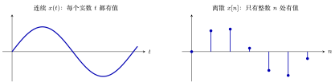{ .notes-fig loading=lazy }

<strong>图 1</strong> 连续与离散。左：一条连续的曲线，横轴上每一点都有值；右：只在整数 $n$ 处有值的序列（图中取的是左边那条曲线在 $t=0,1,\dots,6$ 处的值），点与点之间<strong>没有定义</strong>，不是等于 $0$。
{: .fig-caption }

### 2.3 周期信号与非周期信号

<strong>连续</strong>：

$$
x(t)=x(t+mT),\quad m\in\mathbb{Z}
$$

$T$ 取<strong>最小正周期</strong>。若 $T$ 是周期，则 $2T,3T,\dots$ 也都是周期，其中最小的正的那个叫基本周期。

<strong>离散</strong>：

$$
x[n]=x[n+mN],\quad m\in\mathbb{Z},\ N\ \text{为正整数}
$$

$N$ 必须是正整数（$N=0$ 时「重复」没有意义）。连续与离散的定义常只给一个，另一个要自己补出来。

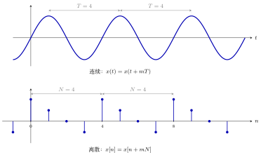{ .notes-fig loading=lazy }

<strong>图 2</strong> 周期信号。上：连续波形每隔 $T$ 重复一遍（图中 $T=4$，量相邻两个峰的距离）；下：离散序列每隔 $N$ 个点重复一遍（图中一个周期内的四个值是 $1,\tfrac12,0,-\tfrac12$，$N=4$）。
{: .fig-caption }

### 2.4 奇信号与偶信号

$$
\begin{align*}
\text{偶信号}\ (\text{even}):&\quad x(t)=x(-t)\quad \text{关于纵轴对称}\\
\text{奇信号}\ (\text{odd}):&\quad x(t)=-x(-t)\quad \text{关于原点旋转 }180^\circ\text{ 对称}
\end{align*}
$$

即高中已学过的奇函数、偶函数。

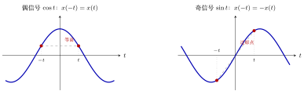{ .notes-fig loading=lazy }

<strong>图 3</strong> 偶、奇信号。左：偶信号关于纵轴对称，$t$ 与 $-t$ 两点等高（红点，取 $t=1.2$，值都是 $\cos1.2\approx0.36$）；右：奇信号关于原点对称，两点高度相反（$\sin(\pm1.2)=\pm0.93$），两点的连线穿过原点。
{: .fig-caption }

### 2.5 偶奇分解：任何信号都能唯一分解成「偶 $+$ 奇」

#### 概念：定理

重点

<strong>定理。</strong>对任意信号 $x(t)$（定义域关于原点对称，如 $t\in\mathbb{R}$），存在<strong>唯一</strong>的一对信号 $x_e(t)$、$x_o(t)$，其中 $x_e$ 是偶信号、$x_o$ 是奇信号，使得

$$
x(t)=x_e(t)+x_o(t),\qquad\text{并且}\quad
x_e(t)=\frac{x(t)+x(-t)}{2},\quad x_o(t)=\frac{x(t)-x(-t)}{2}.
$$

下标 $e$ 取自 even，$o$ 取自 odd。<strong>离散版本</strong>把 $(t)$ 换成 $[n]$ 即可： $x_e[n]=\dfrac{x[n]+x[-n]}{2}$，$x_o[n]=\dfrac{x[n]-x[-n]}{2}$。

#### 证明

要证两件事：<strong>存在</strong>（至少有一种拆法）与<strong>唯一</strong>（至多有一种拆法）。

▸ <strong>存在性。</strong> 把定理给出的 $x_e,x_o$ 定义出来，验三条：

1.  <strong>$x_e$ 是偶的</strong>： $x_e(-t)=\dfrac{x(-t)+x\bigl(-(-t)\bigr)}{2}=\dfrac{x(-t)+x(t)}{2}=x_e(t)$。

2.  <strong>$x_o$ 是奇的</strong>： $x_o(-t)=\dfrac{x(-t)-x(t)}{2}=-\dfrac{x(t)-x(-t)}{2}=-x_o(t)$。

3.  <strong>加起来是 $x(t)$</strong>： $x_e(t)+x_o(t)=\dfrac{x(t)+x(-t)+x(t)-x(-t)}{2}=x(t)$。

三条都成立，所以至少有一种拆法。

▸ <strong>引理（唯一性要用到）：既是偶又是奇的信号只能是零信号。</strong>

重点

<strong>引理。</strong>若 $f(t)$ 既是偶信号又是奇信号，则 $f$ 是<strong>零信号</strong>（整条函数处处为 $0$，记作 $f\equiv0$；注意与「某点取值为 $0$」区分）。

<strong>证明。</strong>$f$ 同时满足

$$
\text{偶：}\ f(-t)=f(t),\qquad \text{奇：}\ f(-t)=-f(t).
$$

两式左边相同，故右边相等：

$$
f(t)=-f(t)\ \Longrightarrow\ 2f(t)=0\ \Longrightarrow\ f(t)=0 .
$$

这对<strong>每一个</strong> $t$ 都成立，所以 $f\equiv0$。$\blacksquare$

反之零信号确实既偶又奇（$0=0=-0$）；离散版本把 $f(t)$ 换成 $f[n]$，证明逐字相同。

▸ <strong>唯一性（方法 A：两种拆法相减）。</strong> 假设有两种拆法

$$
x(t)=e_1(t)+o_1(t)=e_2(t)+o_2(t),
$$

其中 $e_1,e_2$ 偶，$o_1,o_2$ 奇。移项并令 $f(t)$ 等于共同的值：

$$
f(t)=e_1(t)-e_2(t)=o_2(t)-o_1(t).
$$

-   作为 $e_1-e_2$，它是偶的：$f(-t)=e_1(-t)-e_2(-t)=e_1(t)-e_2(t)=f(t)$；

-   作为 $o_2-o_1$，它是奇的：$f(-t)=o_2(-t)-o_1(-t)=-o_2(t)+o_1(t)=-f(t)$。

所以 $f$ 既偶又奇，由引理 $f\equiv0$，即 $e_1=e_2$、$o_1=o_2$：两种拆法其实是同一种。

▸ <strong>唯一性（方法 B：拆法被逼出来）。</strong> 也说明定理中公式的来源。设 $x(t)=e(t)+o(t)$，$e$ 偶、$o$ 奇；把 $t$ 换成 $-t$ 得 $x(-t)=e(t)-o(t)$，于是

$$
\begin{cases}x(t)=e(t)+o(t)\\x(-t)=e(t)-o(t)\end{cases}
\ \Longrightarrow\
e(t)=\frac{x(t)+x(-t)}{2},\quad o(t)=\frac{x(t)-x(-t)}{2}
$$

（两式相加得 $e$，相减得 $o$）。<strong>只要拆法存在，$e,o$ 就只能是这两个式子</strong>，唯一性得证。

存在性 $+$ 唯一性，定理得证。$\blacksquare$

例 1 <strong>$e^{t}$ 的偶奇分解</strong> 偶部 cosh、奇部 sinh
{: .ex-head }

$x(t)=e^{t}$：$x(-t)=e^{-t}$，所以

$$
x_e(t)=\frac{e^{t}+e^{-t}}{2}=\cosh t,\qquad x_o(t)=\frac{e^{t}-e^{-t}}{2}=\sinh t,
$$

即 $e^t=\cosh t+\sinh t$，偶部是双曲余弦，奇部是双曲正弦。

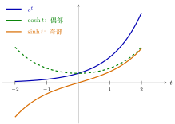{ .notes-fig loading=lazy }

<strong>图 4</strong> $e^{t}=\cosh t+\sinh t$：偶部 $\cosh t$（绿虚线，关于纵轴对称）与奇部 $\sinh t$（橙，关于原点对称）逐点相加得到蓝色的 $e^t$。验算：$t=1$ 时 $\cosh1\approx1.543$，$\sinh1\approx1.175$，和 $\approx2.718=e$。
{: .fig-caption }

### 2.6 能量信号与功率信号

<strong>离散</strong>：能量是所有取值的模的平方求和，功率是在有限区间上把能量取平均；<strong>连续</strong>把求和换成积分：

$$
E=\lim_{t_0\to-\infty,\ t_1\to+\infty}\int_{t_0}^{t_1}|x(t)|^2\d t,\qquad
P=\lim_{t_0\to-\infty,\ t_1\to+\infty}\frac{1}{t_1-t_0}\int_{t_0}^{t_1}|x(t)|^2\d t
$$

-   $E$ 有限 $\Rightarrow$ <strong>能量信号</strong>；

-   $P$ 有限 $\Rightarrow$ <strong>功率信号</strong>。

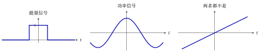{ .notes-fig loading=lazy }

<strong>图 5</strong> 三种典型情形（区间取对称的 $[-T,T]$，$T\to\infty$ 看极限）。左：宽 $2$、高 $1$ 的矩形脉冲，$E=2$ 有限，是能量信号（此时 $P=0$）。中：$\cos t$ 永远振荡下去，$E=\infty$，但平均功率 $P=\tfrac12$ 有限，是功率信号。右：$x(t)=t$ 越走越大，$E=\infty$，$P=\infty$，两者都不是。
{: .fig-caption }

## 3 基本的连续时间信号

### 3.1 单位阶跃信号 $u(t)$（教材第 10 页）

$$
u(t)=\begin{cases}1,&t\gt{}0\\0,&t\lt{}0\end{cases}
$$

物理含义：电路在 $t=0$ 接入电源，之后电压为 1，之前为 0。

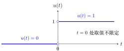{ .notes-fig loading=lazy }

<strong>图 6</strong> 单位阶跃信号 $u(t)$：$t\lt{}0$ 为 $0$，$t\gt{}0$ 为 $1$，在 $t=0$ 处跳变。两个空心圆表示该点的值不作规定（见下面的 $u(0)$）。
{: .fig-caption }

<strong>$u(0)$ 可以任取</strong>：$0$、$1$、$\tfrac12$ 乃至 $-1$ 都行。单个点上的取值不影响积分，因而也不影响后续对 $u(t)$ 的使用（严格理由见附录 A.6）。

### 3.2 冲激信号 $\delta(t)$（教材第 12 页）

#### 概念：定义与强度

$$
\delta(t)=\begin{cases}+\infty,&t=0\\0,&t\neq 0\end{cases}
\qquad\text{且人为规定}\qquad
\int_{-\infty}^{+\infty}\delta(t)\d t=1
$$

$\delta(t)$ 是<strong>奇异信号</strong>（singular signal）：不是普通函数，严格定义见附录 A.3。它描述时间极短、物理量取值极大的现象：雷电、冲击力、电容经小电阻充电。

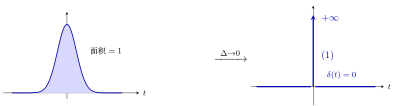{ .notes-fig loading=lazy }

<strong>图 7</strong> $\delta(t)$ 的定义与直观来源。左：宽 $\Delta$、高 $\sim1/\Delta$ 的窄脉冲，面积恒为 $1$；令 $\Delta\to0$，高度趋于 $+\infty$、宽度趋于 $0$，得到右图的 $\delta(t)$：$t\neq0$ 处为 $0$（加粗横轴），$t=0$ 处用带箭头的竖线表示；旁边 $(1)$ 是人为规定的强度 $\int_{-\infty}^{+\infty}\delta(t)\d t=1$，不是高度。
{: .fig-caption }

▸ <strong>幅度与强度</strong> $\delta(t)$ 画成一根带箭头的竖线，旁边标的 <strong>1</strong> <strong>不是高度</strong>（$t=0$ 处高度无穷大，没有有限数值），而是<strong>强度</strong>（strength，也叫权值），即 $\int_{-\infty}^{+\infty}\delta(t)\d t$，也就是脉冲的「面积」。

重点

-   $\delta(t)$：强度 $=1$（称为<strong>单位冲激</strong>）。

-   $A\,\delta(t)$：强度 $=A$，即 $\int_{-\infty}^{+\infty}A\delta(t)\d t=A$，$A$ 可以是任何实数（$5$、$-3$ 都行）。

-   图上画 $A\delta(t)$ 时，箭头旁边标的是 $A$，不是高度。

<strong>把 $\delta(t)$ 看作窄脉冲的极限。</strong>取宽度 $\Delta$、高度 $h$ 的矩形脉冲，面积 $=\Delta\cdot h$；强度 1 是人为约定的基准，与单位阶跃 $u(t)$（从 $0$ 跳到 <strong>1</strong>）同理：先规定单位版本，其余大小乘系数。

-   要面积为 $1$（单位冲激的近似）：$h=\dfrac{1}{\Delta}$；$\Delta=0.1$ 时高 $10$，$\Delta=0.01$ 时高 $100$，$\Delta\to0$ 时高 $\to\infty$，<strong>但面积始终是 1</strong>。

-   要面积为 $5$：$h=\dfrac{5}{\Delta}$，极限就是 $5\delta(t)$。

「幅度趋于无穷、面积固定」就是 $\delta(t)$ 的含义。矩形只是为了好算；三角形、高斯曲线等窄脉冲，只要面积是 1、宽度趋于 0，也得到同一个 $\delta(t)$。力学类比：冲量 $=$ 力 $\times$ 作用时间，力趋于无穷大、时间趋于零，冲量（面积）仍是有限值。

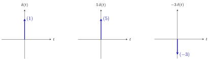{ .notes-fig loading=lazy }

<strong>图 8</strong> $\delta(t)$ 的画法：一根带箭头的竖线，旁边括号里的数是<strong>强度</strong>（面积），不是高度。三张图的箭头一样长，只示意「这里有一个冲激」；强度为负时习惯把箭头朝下画。
{: .fig-caption }

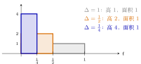{ .notes-fig loading=lazy }

<strong>图 9</strong> 宽 $\Delta$、高 $\frac1\Delta$ 的矩形脉冲：$\Delta$ 越小，脉冲越窄越高，但面积（宽 $\times$ 高）始终是 $1$。$\Delta\to0$ 时高度趋于无穷，面积仍是 $1$，这就是 $\delta(t)$。
{: .fig-caption }

#### $\delta(t)=\dfrac{\d u(t)}{\d t}$：与 $u(t)$ 的关系

$$
u(t)=\int_{-\infty}^{t}\delta(\tau)\d\tau,\qquad \delta(t)=\frac{\d u(t)}{\d t}
$$

-   <strong>积分式</strong>：$t\lt{}0$ 时，积分区间 $(-\infty,t)$ 碰不到冲激，结果 $0$；$t\gt{}0$ 时，积分区间把整个冲激包了进去，结果是它的强度 $1$。正好就是 $u(t)$。

-   <strong>求导式</strong>：$u(t)$ 在 $t\neq0$ 处是常数，导数为 $0$；在 $t=0$ 处<strong>不连续</strong>，<strong>普通导数不存在</strong>。因此 $\delta(t)=\frac{\d u(t)}{\d t}$ <strong>不能作为定义式</strong>，只是 $\delta(t)$ 与 $u(t)$ 之间的<strong>关系</strong>。

-   这个式子应按<strong>广义导数</strong>（分布意义下的导数）理解：信号在某点有大小为 $A$ 的向上跳变，其导数就在该点带出强度为 $A$ 的冲激（见下面两道例题）。

-   直观理由：把阶跃的跳变拉成一小段斜坡，斜坡的斜率是（跳变量）$/\Delta$，也就是窄脉冲的高度，面积正是跳变量。

严格证明（广义函数意义）见附录 A.5。

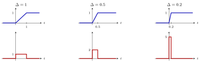{ .notes-fig loading=lazy }

<strong>图 10</strong> 把阶跃的跳变拉成宽 $\Delta$ 的斜坡。上排（蓝）：斜坡，在 $[0,\Delta]$ 上从 $0$ 升到 $1$；下排（红）：它的导数，在 $[0,\Delta]$ 上等于斜率 $\frac1\Delta$，其余处为 $0$。$\Delta$ 越小，导数越窄越高，面积（跳变量 $1$）不变，极限就是 $\delta(t)$。
{: .fig-caption }

例 1 <strong>跳变量为 5 的阶跃</strong> 导数是强度 5 的冲激
{: .ex-head }

$$
x(t)=\begin{cases}0,&t\lt{}0\\5,&t\gt{}0\end{cases}\ \Longrightarrow\ \frac{\d x(t)}{\d t}=5\,\delta(t).
$$

例 2 <strong>$u(t-2)$ 的导数</strong> 平移后的单位冲激
{: .ex-head }

$$
u(t-2)\ \Longrightarrow\ \frac{\d u(t-2)}{\d t}=\delta(t-2).
$$

▸ <strong>两个常见误解</strong>

-   $\delta(t)$ 不是普通函数，「连续、间断」这类逐点说法用不上它；它由「对别的函数做积分的结果」定义（筛选性质见附录 A.3）。

-   广义函数体系下间断点也能求导（得到 $\delta$），$\delta$ 本身还能继续求导，$\delta'(t)$ 称为<strong>冲激偶</strong>。

### 3.3 抽样函数 $\Sa(t)$（教材第 14 页，式 1.2.3）

#### 概念：定义与形状

$$
\Sa(t)=\frac{\sin t}{t}\ (t\neq0),\qquad \Sa(0)=1
$$

-   $t=0$ 处不能直接代入（$0/0$），严格定义里 $\Sa(0)=1$，因为 $\lim_{t\to0}\frac{\sin t}{t}=1$。

-   <strong>偶函数</strong>：$\sin t$ 是奇的，$t$ 是奇的，奇除奇得偶。

-   零点：$t=\pm\pi,\pm2\pi,\pm3\pi,\dots$。

-   形状：中间一个主峰（高度 1），两边是振荡衰减的波，因为 $\sin t$ 来回振荡，而分母 $|t|$ 越来越大，把幅度压下去。

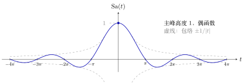{ .notes-fig loading=lazy }

<strong>图 11</strong> $\mathrm{Sa}(t)=\dfrac{\sin t}{t}$：中间主峰高 $1$，零点在 $\pm\pi,\pm2\pi,\dots$，两边振荡衰减（对应教材图 1-31）。
{: .fig-caption }

-   $\dfrac{\sin\omega t}{t}$（$\omega\gt{}0$）的形状与 $\Sa(t)$ 一样，但

    -   主峰高度：$\displaystyle\lim_{t\to0}\frac{\sin\omega t}{t}=\omega$（洛必达法则）；

    -   第一个零点：$\omega t=\pi\Rightarrow t=\frac{\pi}{\omega}$，其余零点 $\pm\frac{k\pi}{\omega}$。

    所以「高度乘 $\omega$，横向往里压缩 $\omega$ 倍」：高度 $\times\omega$、宽度 $\div\omega$，二者相乘，面积（积分恒为 $\pi$）不变。

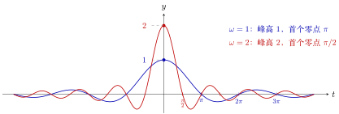{ .notes-fig loading=lazy }

<strong>图 12</strong> $\dfrac{\sin\omega t}{t}$（$\omega\gt{}0$）：$\omega$ 变大，峰高按 $\omega$ 倍升高，零点按 $1/\omega$ 向里压缩。
{: .fig-caption }

#### 概念：图解 $\Sa(t)$ 的几个关键性质

下面给前面列出的性质逐条配图。

▸ <strong>性质 1：$\Sa(0)=1$（为什么在 $0$ 处要「补一个值」）。</strong> $t=0$ 时 $\frac{\sin t}{t}=\frac00$，没有意义。办法是看 $t\to0$ 时它趋于什么。左图画出 $\sin t$（蓝）和直线 $y=t$（灰虚线）：在 $0$ 附近两条线几乎重合（$y=t$ 就是 $\sin t$ 在 $0$ 处的切线），所以两者之比 $\frac{\sin t}{t}\to1$。右图画 $\Sa(t)$：曲线逼近 $(0,1)$，在这一点补上 $\Sa(0)=1$（实心点），曲线就连成一条连续的线。

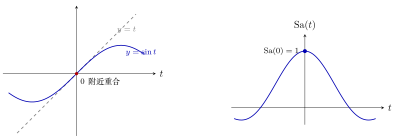{ .notes-fig loading=lazy }

<strong>图 13</strong> 性质 1：左，$\sin t$ 与它在 $0$ 处的切线 $y=t$ 几乎重合；右，因此 $\sin t/t\to1$，补上 $\Sa(0)=1$。
{: .fig-caption }

数值也印证这一点（$t$ 越小，比值越接近 $1$）：

| $t$                 |   $1$    |  $0.5$   |   $0.1$   |   $0.01$   |
|:--------------------|:--------:|:--------:|:---------:|:----------:|
| $\dfrac{\sin t}{t}$ | $0.8415$ | $0.9589$ | $0.99833$ | $0.999983$ |

▸ <strong>性质 2：偶函数（奇除以奇得偶）。</strong> $\Sa(t)=\frac{\sin t}{t}$ 是偶函数：$\sin t$ 与 $t$ 都是奇函数，奇除以奇得偶。下面三张图在 $t=a$ 与 $t=-a$ 处各标一个点。

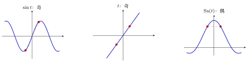{ .notes-fig loading=lazy }

<strong>图 14</strong> 性质 2：红点是 $t=\pm1.2$ 处的值。奇函数两点的函数值<strong>相反</strong>（虚线穿过原点），偶函数两点的函数值<strong>相等</strong>（虚线水平）。$\sin t$ 与 $t$ 都是奇的，相除后两个负号抵消，得到偶函数。
{: .fig-caption }

用式子写：$\Sa(-t)=\dfrac{\sin(-t)}{-t}=\dfrac{-\sin t}{-t}=\Sa(t)$。

▸ <strong>性质 3：主瓣宽、旁瓣窄，且旁瓣一个比一个小。</strong> $\Sa(t)$ 的波瓣分两类：

-   <strong>主瓣</strong>：在 $[-\pi,\pi]$，宽度 $2\pi$，峰高 $1$；

-   <strong>旁瓣</strong>：主瓣两边的波瓣，每个宽度 $\pi$，正负交替，峰高依次约为（数值）$-0.217$、$+0.128$、$-0.091$、$+0.071$……越来越小。

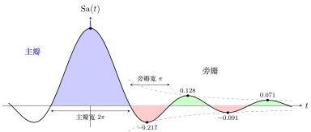{ .notes-fig loading=lazy }

<strong>图 15</strong> 性质 3：蓝色是主瓣（宽 $2\pi$、峰高 $1$），其余是旁瓣（宽 $\pi$、正负交替），黑点标出各旁瓣的峰值，灰色虚线是包络 $\pm1/|t|$。
{: .fig-caption }

-   <strong>第一个旁瓣峰高 $-0.217$</strong>，约是主瓣的 $\frac15$，即 $20\log_{10}0.217\approx-13.3\ \mathrm{dB}$。

-   <strong>旁瓣峰值恰好落在 $t=\tfrac{3\pi}{2},\tfrac{5\pi}{2},\dots$ 的附近，但不精确等于它们</strong>：真正的位置是方程 $\tan t=t$ 的解（$4.493,\ 7.725,\ 10.904,\dots$），比 $\frac{3\pi}2=4.712$ 等略小一些，原因是 $\sin t$ 的峰要被分母 $t$ 一压，峰就往左偏。

-   峰值被 $\pm\frac1{|t|}$ 夹住（虚线），所以越往外越小，衰减得很慢（反比于 $|t|$），不是指数衰减。

#### 结论：三个积分公式（重点）

重点

$$
\int_{-\infty}^{+\infty}\frac{\sin t}{t}\d t=\pi,\qquad
\int_{0}^{+\infty}\frac{\sin t}{t}\d t=\int_{-\infty}^{0}\frac{\sin t}{t}\d t=\frac{\pi}{2},\qquad
\int_{-\infty}^{+\infty}\frac{\sin\omega t}{t}\d t=\pi\ (\omega\gt{}0)
$$

这三个公式在第三章推导傅里叶变换时会反复用到。

▸ <strong>图解三个公式</strong> <strong>公式 1：整条线上的面积是 $\pi$。</strong>积分的几何意义是「曲线和横轴之间的面积」，横轴上方的部分算正，下方的部分算负。$\Sa(t)$ 的波瓣一正一负交替出现，所以总面积是「正面积减去负面积」。

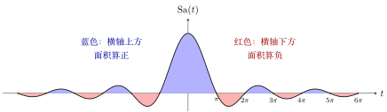{ .notes-fig loading=lazy }

<strong>图 16</strong> 公式 1：$\displaystyle\int_{-\infty}^{+\infty}\frac{\sin t}{t}\d t=\pi$。蓝色面积减去红色面积，净面积 $=\pi\approx3.14$。
{: .fig-caption }

$\Sa(t)$ 的波瓣越往外越小，但并不是「小到可以忽略」。看波瓣的累积面积（数值计算，把 $[-X,X]$ 上的面积算出来）：

| 积分范围 | 只含主瓣 | 再加第 2 对（负） | 再加第 3 对（正） | $[-40\pi,40\pi]$ |
|:---------|:--------:|:-----------------:|:-----------------:|:----------------:|
| 累积面积 |  $3.70$  |      $2.84$       |      $3.35$       |      $3.13$      |

累积面积在 $\pi\approx3.1416$ 上下来回摆动，摆幅越来越小，最后收敛到 $\pi$。这就是后面「收敛性与严格性」里说的「条件收敛」的几何样子：主瓣单独就有 $3.70$，比 $\pi$ 大，后面的负波瓣把它拉回来，正波瓣再拉上去，如此反复，才逼近 $\pi$。<em>（上表由数值积分得到，主瓣面积 $2\,\mathrm{Si}(\pi)\approx3.704$。）</em>

<strong>把累积面积画成曲线。</strong>上表只有四个点，下面把整个过程画出来：横轴是积分范围 $[-X,X]$ 的 $X$，纵轴是这个范围内的净面积 $A(X)$。

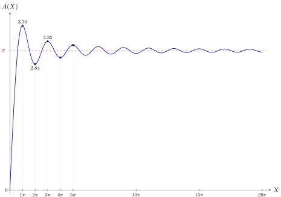{ .notes-fig loading=lazy }

<strong>图 17</strong> 累积面积 $A(X)=\displaystyle\int_{-X}^{X}\frac{\sin t}{t}\d t=2\int_0^X\frac{\sin t}{t}\d t$ 随 $X$ 的变化。曲线在 $\pi$ 上下来回摆动，极值出现在 $X=k\pi$（即 $\Sa(t)$ 的零点，此处面积刚好「转向」），摆幅越来越小，最终收敛到 $\pi$。
{: .fig-caption }

读图的要点：

-   $A(X)$ 在 $X=k\pi$ 处取极值：$k$ 为奇数时是局部最大（刚好把一个正波瓣加进来），$k$ 为偶数时是局部最小（刚好把一个负波瓣加进来）。数值是 $3.70,\ 2.84,\ 3.35,\ 2.98,\ 3.27,\dots$，围绕 $\pi$ 上下摆动。

-   每多加一个波瓣，面积改变的量就变小一点，所以摆幅越来越小。收敛的原因是「摆幅趋于 $0$」，而不是「每个波瓣面积趋于 $0$ 后就可以丢掉」，这正是条件收敛的图像。

-   第一个峰值 $3.70$ 比 $\pi$ 高出约 $18\%$（$3.70/3.14\approx1.18$）。这个超出量叫做<strong>过冲</strong>（overshoot）。<em>（同一个数 $\mathrm{Si}(\pi)\approx1.852$ 也会出现在傅里叶级数的吉布斯现象中。）</em>

<em>（曲线由 $2\int_0^X\frac{\sin t}{t}\d t$ 在 $X\in[0,20\pi]$ 上每隔 $0.1$ 采样连成。）</em>

<strong>公式 2：半条线上的面积是 $\pi/2$。</strong>$\Sa(t)$ 是偶函数，图像关于纵轴镜像对称，所以左右两半的面积完全一样，各占总面积的一半。

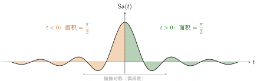{ .notes-fig loading=lazy }

<strong>图 18</strong> 公式 2：$\displaystyle\int_0^{+\infty}\frac{\sin t}{t}\d t=\int_{-\infty}^{0}\frac{\sin t}{t}\d t=\frac{\pi}{2}$。左右两半镜像对称，各占一半。
{: .fig-caption }

<strong>公式 3：$\displaystyle\int_{-\infty}^{+\infty}\frac{\sin\omega t}{t}\d t=\pi$（$\omega\gt{}0$）。</strong>$\omega$ 变大，曲线变得又高又窄（峰高 $\omega$，宽度 $\propto1/\omega$），两个效果一乘，<strong>面积保持不变</strong>，还是 $\pi$。下图左右两张，$\omega=1$ 和 $\omega=3$，横纵比例相同，可以直接比较。

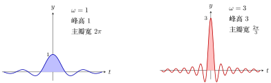{ .notes-fig loading=lazy }

<strong>图 19</strong> 公式 3：$\omega$ 从 $1$ 变成 $3$，峰高变成 $3$ 倍，主瓣宽度变成 $1/3$，面积不变。阴影是主瓣；整条曲线下的净面积都是 $\pi$。
{: .fig-caption }

这也是下面「三个公式之间的关系」里用变量代换证明的几何版本：横轴压缩 $\omega$ 倍，纵轴拉高 $\omega$ 倍，面积不变。

#### 证明：三个公式之间的关系

1.  <strong>整条线 $\leftrightarrow$ 半条线</strong>：$\frac{\sin t}{t}$ 是偶函数，图像关于纵轴对称，所以 $0$ 右边和 $0$ 左边的积分相等，各占一半：$\pi/2$。

2.  <strong>$\omega$ 的版本</strong>：令 $s=\omega t$（$\omega\gt{}0$ 保证积分上下限不变号），则 $t=s/\omega$，$\d t=\d s/\omega$：

    $$
    \int_{-\infty}^{+\infty}\frac{\sin\omega t}{t}\d t
    =\int_{-\infty}^{+\infty}\frac{\sin s}{s/\omega}\cdot\frac{\d s}{\omega}
    =\int_{-\infty}^{+\infty}\frac{\sin s}{s}\d s=\pi
    $$

    $\omega$ 约掉了。

#### 证明 $\displaystyle\int_0^{+\infty}\frac{\sin t}{t}\d t=\frac{\pi}{2}$（参数求导法）

说明

教材上的证明要用复变函数；下面给出一个不用复变函数的初等证明。

<strong>思路</strong>：直接积 $\frac{\sin t}{t}$ 积不出来（原函数不是初等函数）。于是在积分里人为添一个衰减因子 $e^{-at}$，把问题变成「含参数 $a$ 的积分」，对 $a$ 求导，导数是好积的，最后让 $a\to0$ 把因子去掉。

<strong>第 1 步：设</strong>

$$
I(a)=\int_0^{+\infty}\frac{\sin t}{t}\,e^{-at}\d t\qquad(a\ge 0)
$$

想要的是 $I(0)$。

这个新加的因子 $e^{-at}$ 是整个证明的「杠杆」，先看清它长什么样（$t\ge0$）：

-   $a=0$ 时 $e^{-0\cdot t}=1$：不衰减，$I(0)$ 就是原来要求的积分；

-   $a\gt{}0$ 时 $e^{-at}$ 随 $t$ 增大而衰减，<strong>$a$ 越大，衰减越快</strong>；

-   $a\to+\infty$ 时，除了 $t=0$ 附近，整条曲线都被压成 $0$。第 5 步就是用这一点定出常数 $C$。

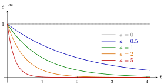{ .notes-fig loading=lazy }

<strong>图 20</strong> 衰减因子 $e^{-at}$（$t\ge0$）：$a=0$ 时恒为 $1$；$a$ 越大衰减越快，$a\to+\infty$ 时整条曲线被压向 $0$。
{: .fig-caption }

$a\gt{}0$ 时，这个因子还保证被积函数 $\frac{\sin t}{t}e^{-at}$ 在 $t\to+\infty$ 处快速衰减，积分一定收敛。

<strong>第 2 步：对 $a$ 求导</strong>（把求导放进积分号，$\frac{\partial}{\partial a}e^{-at}=-t\,e^{-at}$，正好把分母的 $t$ 消掉）：

$$
\frac{\d I}{\d a}=-\int_0^{+\infty}\sin t\;e^{-at}\d t
$$

<strong>第 3 步：用欧拉公式</strong>(Euler’s formula) $\sin t=\dfrac{e^{jt}-e^{-jt}}{2j}$：

$$
\begin{align*}
\frac{\d I}{\d a}
&=-\frac{1}{2j}\int_0^{+\infty}\bigl(e^{jt}-e^{-jt}\bigr)e^{-at}\d t\\
&=-\frac{1}{2j}\Bigl[\int_0^{+\infty}e^{-(a-j)t}\d t-\int_0^{+\infty}e^{-(a+j)t}\d t\Bigr]\\
&=-\frac{1}{2j}\Bigl[\frac{1}{a-j}-\frac{1}{a+j}\Bigr]
=-\frac{1}{2j}\cdot\frac{2j}{a^2+1}
=-\frac{1}{a^2+1}
\end{align*}
$$

（这里 $a\gt{}0$ 保证 $e^{-(a\mp j)t}\to0$，积分才收敛。也可把负号并进括号里，写成 $\frac{1}{2j}\bigl[\frac{1}{a+j}-\frac{1}{a-j}\bigr]$，通分后分母 $a^2-j^2=a^2+1$、分子 $-2j$，结果一样。）

<strong>第 4 步：积分求 $I(a)$</strong>：

$$
I(a)=-\arctan a+C
$$

<strong>第 5 步：用 $a\to+\infty$ 定常数 $C$</strong>。$a$ 很大时 $e^{-at}$ 把整个被积函数压成 $0$，所以 $I(+\infty)=0$：

$$
0=I(+\infty)=-\arctan(+\infty)+C=-\frac{\pi}{2}+C\ \Longrightarrow\ C=\frac{\pi}{2}
$$

<strong>第 6 步：令 $a\to 0$</strong>：

$$
I(0)=\int_0^{+\infty}\frac{\sin t}{t}\d t=-\arctan 0+\frac{\pi}{2}=\frac{\pi}{2}\qquad\blacksquare
$$

再由偶函数得 $\int_{-\infty}^{+\infty}\frac{\sin t}{t}\d t=2\cdot\frac\pi2=\pi$。

<em>（第 2 步「求导进积分号」与第 6 步 $a\to0^{+}$ 时的极限需要论证收敛性，见下面「收敛性与严格性」。）</em>

#### 收敛性与严格性

说明

下面逐项检查上面证明中每一步的合法性，用的是微积分里的标准做法。

证明里用到五件事，逐个检查。记 $F(t)=\displaystyle\int_t^{+\infty}\frac{\sin s}{s}\d s$（尾巴）。

▸ <strong>（1）$\displaystyle\int_0^{+\infty}\frac{\sin t}{t}\d t$ 本身是收敛的。</strong> $t=0$ 附近没有问题：$\bigl|\frac{\sin t}{t}\bigr|\le1$。问题在 $t\to+\infty$。对 $R\gt{}1$ 做分部积分：

$$
\int_1^R\frac{\sin t}{t}\d t=\Bigl[-\frac{\cos t}{t}\Bigr]_1^R-\int_1^R\frac{\cos t}{t^2}\d t
=\cos1-\frac{\cos R}{R}-\int_1^R\frac{\cos t}{t^2}\d t .
$$

$R\to\infty$ 时，$\frac{\cos R}{R}\to0$；$\bigl|\frac{\cos t}{t^2}\bigr|\le\frac{1}{t^2}$，而 $\int_1^\infty\frac{1}{t^2}\d t$ 有限，所以最后一项也有极限。因此极限存在，积分收敛。

<strong>但它只是「条件收敛」，不是「绝对收敛」</strong>：在每个区间 $[k\pi,(k+1)\pi]$ 上，$\int\frac{|\sin t|}{t}\d t\ge\frac{1}{(k+1)\pi}\int|\sin t|\d t=\frac{2}{(k+1)\pi}$，把这些加起来像调和级数 $\sum\frac1k$ 一样发散，所以 $\int_0^\infty\frac{|\sin t|}{t}\d t=+\infty$。意思是：它收敛，靠的是正负波瓣相互抵消，而不是靠波瓣越来越小直至可以忽略。这个区别是下面第（5）条为什么要多费一点力气的原因。

▸ <strong>（2）对 $a\gt{}0$，$I(a)$ 有意义。</strong> $\bigl|\frac{\sin t}{t}e^{-at}\bigr|\le e^{-at}$，而 $\int_0^\infty e^{-at}\d t=\frac1a$ 有限，所以绝对收敛。

▸ <strong>（3）第 2 步「求导放进积分号」对 $a\gt{}0$ 成立。</strong> 取任意 $a_0\gt{}0$。对所有 $a\ge a_0$：

$$
\Bigl|\frac{\partial}{\partial a}\Bigl(\frac{\sin t}{t}e^{-at}\Bigr)\Bigr|=|\sin t|\,e^{-at}\le e^{-a_0t},
$$

右边与 $a$ 无关，并且 $\int_0^\infty e^{-a_0t}\d t=\frac1{a_0}$ 有限。有这样一个「共同的、可积的上界」，微积分里「积分号下求导」的定理就成立。所以 $I'(a)=-\frac1{a^2+1}$ 对每个 $a\gt{}0$ 成立，再积分得 $I(a)=-\arctan a+C$（$a\gt{}0$，$C$ 是常数）。

▸ <strong>（4）第 5 步 $I(+\infty)=0$ 的严格理由。</strong> $|I(a)|\le\int_0^\infty e^{-at}\d t=\frac1a\to0$（$a\to+\infty$），所以 $\lim_{a\to+\infty}I(a)=0$。代入 $I(a)=-\arctan a+C$，得 $0=-\frac\pi2+C$，$C=\frac\pi2$，即对所有 $a\gt{}0$：$I(a)=\frac\pi2-\arctan a$。

▸ <strong>（5）第 6 步 $a\to0^{+}$ 时 $I(a)\to I(0)$：最需要小心的一步。</strong> 我们已经知道 $I(a)=\frac\pi2-\arctan a$（$a\gt{}0$），所以 $\lim_{a\to0^+}I(a)=\frac\pi2$。要得到的是 $I(0)=\int_0^\infty\frac{\sin t}{t}\d t=\frac\pi2$，需要证明 $\lim_{a\to0^+}I(a)=I(0)$。

因为（1）说过 $\int\frac{\sin t}{t}\d t$ 只是条件收敛，不能用「被积函数有可积的上界，极限可以放进积分号」这类绝对收敛下的办法（这里找不到那个上界）。换一种办法：用尾巴 $F(t)$。

$F$ 连续，$F(0)=I(0)$，$F(t)\to0$（$t\to\infty$，因为是收敛积分的尾巴），$F'(t)=-\frac{\sin t}{t}$，并且 $F$ 有界，设 $|F|\le M$。于是对 $a\gt{}0$ 做分部积分：

$$
I(a)=\int_0^\infty\bigl(-F'(t)\bigr)e^{-at}\d t=F(0)-a\int_0^\infty F(t)\,e^{-at}\d t .
$$

（边界项：$t\to\infty$ 时 $F(t)e^{-at}\to0$。）接下来证明最后一项 $\to0$。任给 $\varepsilon\gt{}0$，选 $T$ 使得 $t\gt{}T$ 时 $|F(t)|\lt{}\varepsilon$，则

$$
\Bigl|a\int_0^\infty F(t)e^{-at}\d t\Bigr|
\le a\int_0^T M\d t+\varepsilon\cdot a\int_T^\infty e^{-at}\d t
\le aTM+\varepsilon .
$$

令 $a\to0^+$，右边 $\to\varepsilon$。$\varepsilon$ 是任意的，所以这一项趋于 $0$，于是 $I(a)\to F(0)=I(0)$。

▸ <strong>合起来。</strong> $I(0)=\lim_{a\to0^+}I(a)=\lim_{a\to0^+}\bigl(\frac\pi2-\arctan a\bigr)=\frac\pi2$。证明因此是严格的。五个检查点里，（1）（5）是真正需要费力的，因为这个积分只是条件收敛；（2）（3）（4）都靠 $e^{-at}$ 的衰减，这也是「人为加入衰减因子」这一做法有效的原因：它让积分在 $a\gt{}0$ 时变成绝对收敛，把棘手的部分推到了最后一步 $a\to0^+$。

### 3.4 $\Sa(t)$ 的傅里叶变换

说明

傅里叶变换属于第三章的内容，这里先给出 $\Sa(t)$ 的频谱，说明前面三个积分公式的用途。符号约定（不同教材 $2\pi$ 的位置可能不同）：

$$
X(\omega)=\int_{-\infty}^{+\infty}x(t)\,e^{-j\omega t}\d t,\qquad
x(t)=\frac{1}{2\pi}\int_{-\infty}^{+\infty}X(\omega)\,e^{j\omega t}\d\omega .
$$

▸ <strong>直观含义。</strong> 傅里叶变换把一个信号拆成「各个频率的成分各有多少」。$\Sa(t)$ 的拆法特别规整：<strong>频率低于 $1$ 的成分一样多（高度 $\pi$），频率高于 $1$ 的成分一点也没有</strong>。画出来是一个方方正正的矩形。

▸ <strong>结论。</strong>

$$
\Sa(t)=\frac{\sin t}{t}\ \xrightarrow{\ \text{傅里叶变换}\ }\ 
X(\omega)=\begin{cases}\pi,&|\omega|\lt{}1\\[2pt]0,&|\omega|\gt{}1\end{cases}
$$

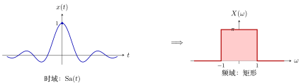{ .notes-fig loading=lazy }

<strong>图 21</strong> $\Sa(t)$ 与它的傅里叶变换。左边是一串振荡衰减的波，右边是方方正正的矩形（高 $\pi$、宽 $2$）。矩形的两条边 $\omega=\pm1$ 处的值取多少不影响结果（通常取中点 $\pi/2$），原因和 $u(0)$ 可以任取一样。
{: .fig-caption }

▸ <strong>验算：用逆变换（不必计算傅里叶积分）。</strong> 反过来做：已知频谱是上面的矩形，用逆变换把它变回时域，看是不是 $\Sa(t)$。

$$
\frac{1}{2\pi}\int_{-1}^{1}\pi\,e^{j\omega t}\d\omega
=\frac12\cdot\frac{e^{jt}-e^{-jt}}{jt}
=\frac12\cdot\frac{2j\sin t}{jt}
=\frac{\sin t}{t}.
$$

用到了欧拉公式 $e^{jt}-e^{-jt}=2j\sin t$。得到 $\Sa(t)$，说明这个矩形就是它的频谱。

▸ <strong>与三个积分公式的关系。</strong> 傅里叶变换在 $\omega=0$ 处的值，就是把整个信号加起来：$X(0)=\int_{-\infty}^{+\infty}x(t)\d t$。所以

-   <strong>公式 1</strong> $\displaystyle\int_{-\infty}^{+\infty}\frac{\sin t}{t}\d t=\pi$，意思是<strong>矩形频谱的高度是 $\pi$</strong>；

-   <strong>公式 3</strong> $\displaystyle\int_{-\infty}^{+\infty}\frac{\sin\omega_0t}{t}\d t=\pi$（$\omega_0\gt{}0$），意思是：时域那个 $\frac{\sin\omega_0t}{t}$ 的频谱是高 $\pi$、宽 $2\omega_0$ 的矩形（边在 $\pm\omega_0$），<strong>不管 $\omega_0$ 多大，高度都是 $\pi$</strong>，变的只是宽度；

-   <strong>公式 2</strong>（半条线 $\pi/2$）只是公式 1 的一半（偶函数使左右对称），在频谱上没有单独的几何对应。

这就是三个公式在第三章反复出现的原因：它们给出 $\Sa$ 的频谱形状。

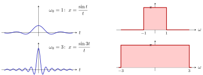{ .notes-fig loading=lazy }

<strong>图 22</strong> 公式 3 的图解：左列是时域，右列是频谱。$\omega_0$ 从 $1$ 增大到 $3$，时域曲线变得<strong>又高又窄</strong>（峰高 $\omega_0$），频谱的矩形变得<strong>更宽</strong>（宽 $2\omega_0$），<strong>高度始终是 $\pi$</strong>。
{: .fig-caption }

▸ <strong>规律：时域窄，频域宽。</strong> 上图说明，一个信号在时间上挤得越窄、越尖，它占据的频率范围就越宽，反之亦然。这条规律（时间和频率不能同时都窄）在整门课里反复出现。

▸ <strong>为什么 $\Sa(t)$ 重要。</strong> 一个理想低通滤波器，把低于截止频率的成分原样放过、高于截止频率的全部去掉，它的频率响应就是上面那个矩形，它对应的时域响应就是 $\Sa$ 形状的曲线。后面讲采样和信号重建时，$\Sa(t)$ 会一再出现。

▸ <strong>局限与注意事项。</strong>

-   $\Sa(t)$ 从 $-\infty$ 延伸到 $+\infty$，实际中做不出来（不可实现）。

-   前面证明过它<strong>不是绝对可积</strong>（条件收敛），所以它的傅里叶变换积分也只在条件收敛的意义下成立，这是矩形频谱边缘处值不确定的原因之一。

-   记号约定不同的书，$2\pi$ 出现的位置不同，但「时域 $\Sa$ $\leftrightarrow$ 频域矩形」这个结论不变。

## 4 基本的离散时间信号（教材第 15 页起）

### 4.1 单位脉冲序列 $\delta[n]$

$$
\delta[n]=\begin{cases}1,&n=0\\0,&n\neq0\end{cases}
$$

称为<strong>单位脉冲序列</strong>(unit impulse sequence)：横轴是 $n$，$n=0$ 处为 $1$，其余整数处为 $0$。

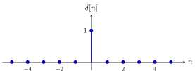{ .notes-fig loading=lazy }

<strong>图 23</strong> 单位脉冲序列 $\delta[n]$：只在 $n=0$ 处等于 $1$，其余整数处全为 $0$。与连续的 $\delta(t)$ 不同，这里每个点都有确定的有限值，没有「无穷大」。
{: .fig-caption }

### 4.2 单位阶跃序列 $u[n]$

$$
u[n]=\begin{cases}1,&n\ge0\\0,&n\lt{}0\end{cases}
$$

$n=0,1,2,\dots$ 处都是 $1$，一直向右延伸；$n\lt{}0$ 处全是 $0$。

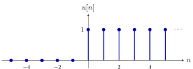{ .notes-fig loading=lazy }

<strong>图 24</strong> 单位阶跃序列 $u[n]$：$n\ge0$ 时全为 $1$，$n\lt{}0$ 时全为 $0$。与连续的 $u(t)$ 不同，离散的 $u[0]$ 有明确的值 $1$，不需要「任取」。
{: .fig-caption }

### 4.3 连续与离散的四个信号对照

|      |           连续（圆括号）            |          离散（方括号）           |
|:-----|:-----------------------------------:|:---------------------------------:|
| 冲激 |  $\delta(t)$：奇异，$t=0$ 处无穷大  | $\delta[n]$：普通，$n=0$ 处等于 1 |
| 阶跃 | $u(t)$：$t\gt{}0$ 为 1，$u(0)$ 任意 |       $u[n]$：$n\ge0$ 为 1        |

<strong>$\delta(t)$ 和 $\delta[n]$ 不是一回事</strong>，不要混淆：$\delta[n]$ 是普通信号（$n=0$ 处为 1，其余为 0）；$\delta(t)$ 是奇异信号，第二章才严格定义。区分办法见前面「圆括号连续、方括号离散」的规则。

## A 附录：广义函数（generalized function）的说明

说明

本附录用分布论（distribution theory）的标准结论，解释正文里「$\delta(t)$ 不是普通函数」「$u(t)$ 在 $0$ 处不可导却有导数」「$u(0)$ 可以任取」这几句话；课程内的严格定义见第二章。

### A.1 第一步：为什么普通函数这套说法不够用

普通函数的想法是：给我一个 $t$，我告诉你函数值。$\delta(t)$ 想描述的是「一个极短、极强的冲击」，在 $t=0$ 处它的值是「无穷大」，而无穷大不是一个数，所以按「每点一个值」的办法，根本没法把 $\delta(t)$ 写成一个函数。

但这个冲击有一件事是<strong>确定而有限</strong>的：它对别的东西产生的<em>总效果</em>。比如一个力的冲量（作用的总量），或者它去「抽取」另一个信号在某一点的值。数学家的办法是：<strong>不去问它每点的值，只问它的总效果</strong>。

### A.2 第二步：测试函数（test function）——用来「试探」的工具

先准备一类很乖的函数，叫<strong>测试函数</strong> $\varphi(t)$：

-   无穷次可导（非常光滑，没有尖角、没有跳变）；

-   在某个有限区间之外恒等于 $0$（像一个光滑的小山丘，两头平坦落地）。

它的作用像一把「探针」：用它去碰一碰广义函数，看反应。

### A.3 第三步：广义函数 $=$ 一台「输入探针、输出一个数」的机器

<strong>广义函数</strong>就是一台机器：你把一个测试函数 $\varphi$ 放进去，它吐出一个数，记作 $\langle T,\varphi\rangle$。（严格定义还要求这台机器是线性的，并且「探针变化很小则输出变化也很小」（连续性）。）

重点

-   $\delta$ 这台机器的规则：<strong>输入 $\varphi$，输出 $\varphi$ 在 $0$ 点的值</strong>：$\langle\delta,\varphi\rangle=\varphi(0)$。

-   这就是<strong>筛选性质</strong>：$\delta$ 像一个筛子，把 $\varphi$ 在 $0$ 处的值「筛」出来。

-   普通函数 $f(t)$ 也能当一台机器：规则是 $\varphi\mapsto\int_{-\infty}^{+\infty}f(t)\varphi(t)\d t$。所以<strong>普通函数是广义函数的特例</strong>，广义函数是普通函数的推广。

$\delta$ 之所以叫<strong>奇异</strong>的（singular），就是因为<em>没有</em>任何普通函数能产生「$\varphi\mapsto\varphi(0)$」这台机器。

### A.4 第四步：为什么说 $\delta$ 是窄脉冲的「极限」

正文里用宽 $\Delta$、高 $1/\Delta$ 的矩形脉冲 $\delta_\Delta(t)$ 来想象 $\delta(t)$。现在可以说清楚这个极限是什么意思了：

$$
\langle\delta_\Delta,\varphi\rangle=\frac{1}{\Delta}\int_0^{\Delta}\varphi(t)\d t
\ \xrightarrow{\ \Delta\to0\ }\ \varphi(0)=\langle\delta,\varphi\rangle .
$$

（$\Delta$ 很小时，$\varphi$ 在 $(0,\Delta)$ 上几乎就是常数 $\varphi(0)$，取平均就得到 $\varphi(0)$。）

这叫<strong>弱收敛</strong>：不是「每一点的函数值收敛」，而是「放进每一个探针，输出都收敛」。逐点看，$\delta_\Delta(0)$ 是 $1/\Delta\to\infty$ 的，根本不收敛；但用探针一试，它收敛得很好。这也解释了为什么<strong>换成三角形、高斯曲线等别的窄脉冲，只要面积是 $1$、宽度趋于 $0$，结果都一样</strong>：探针看到的只是「面积 $1$、集中在 $0$」这件事。

### A.5 第五步：广义导数——解释 $\delta(t)=\dfrac{\d u(t)}{\d t}$

先看普通函数。对光滑的 $f$，用分部积分（探针在两头为 $0$，边界项消失）：

$$
\int f'(t)\varphi(t)\d t=-\int f(t)\varphi'(t)\d t .
$$

也就是说：<strong>把导数从 $f$ 身上「转移」到探针 $\varphi$ 身上，只多一个负号</strong>。右边的写法即使 $f$ 本身不可导也有意义（只要 $f$ 能积分）。于是数学家<strong>规定</strong>：

$$
\langle T',\varphi\rangle:=-\langle T,\varphi'\rangle
$$

这就是<strong>广义导数</strong>的定义。好处是：<strong>任何广义函数都能求导，而且可以求无限次</strong>。

现在算 $u(t)$ 的广义导数（即「不能作为定义式」背后的严格版本）：

$$
\begin{align*}
\langle u',\varphi\rangle
&=-\langle u,\varphi'\rangle=-\int_{-\infty}^{+\infty}u(t)\varphi'(t)\d t
=-\int_{0}^{+\infty}\varphi'(t)\d t\\
&=-\bigl[\varphi(+\infty)-\varphi(0)\bigr]=\varphi(0)=\langle\delta,\varphi\rangle .
\end{align*}
$$

（用到了 $u(t)$ 只在 $t\gt{}0$ 取 $1$，以及 $\varphi$ 在远处为 $0$。）所以 $u'=\delta$ <strong>在广义函数的意义下严格成立</strong>，不是工程上的近似。「不能作为定义式」是因为：这个等式要先有「广义导数」这套规则才有意义，而 $\delta$ 的定义本身（A.3 的筛选规则）不依赖它。

用同样的办法：

-   <strong>冲激偶</strong>（doublet）$\delta'(t)$：$\langle\delta',\varphi\rangle=-\langle\delta,\varphi'\rangle=-\varphi'(0)$，它「筛出」的是探针在 $0$ 处的<strong>导数</strong>（带负号）。

-   一个信号在 $t_0$ 处有向上跳变 $A$，它的广义导数 $=$ 普通导数（$t\neq t_0$ 处的斜率）$+\ A\,\delta(t-t_0)$。正文里的 $5\delta(t)$、$\delta(t-2)$ 都是它的特例。

### A.6 第六步：为什么 $u(0)$ 可以取任意值

广义函数是靠「积分的结果」来识别的。如果两个普通函数只在<strong>一个点（或有限个点）</strong>上不同，那么对任何探针 $\varphi$，$\int f\varphi\d t$ 的结果完全一样，因为一个点的「宽度」是零，对积分没有贡献。所以这两个函数产生的是<strong>同一台机器</strong>，也就是同一个广义函数。

$u(0)$ 取 $0$、$\tfrac12$、$1$ 甚至 $-1$，只改变了 $t=0$ 这一个点的值，机器完全不变，所以信号与系统里它是「可以任取」的。

反过来，这也说明了一个重要的限制：<strong>广义函数没有「某一点的值」这回事</strong>。问「$\delta(0)$ 等于几」本身就是没意义的问题，正文里写的「$t=0$ 处为 $+\infty$」只是帮助想象的说法。

### A.7 使用上的限制

-   <strong>没有点值</strong>：见上，不能问 $\delta(t_0)$ 是多少。

-   <strong>不能随便相乘</strong>：$\delta(t)\cdot\delta(t)$ 没有意义（两个广义函数一般不能相乘）。但「广义函数 $\times$ 光滑函数」是可以的，比如 $f(t)\delta(t)=f(0)\delta(t)$（$f$ 光滑），这是筛选性质的另一种写法。

-   <strong>「连续、间断」这类说法用不上</strong>：这是逐点的概念，而广义函数不逐点定义。

### A.8 普通函数与广义函数对照

|  | 普通函数 | 广义函数 |
|:---|:---|:---|
| 怎么定义 | 每个点给一个值 | 作用在探针 $\varphi$ 上给一个数 |
| $\delta$ 怎么描述 | 无法描述（$+\infty$ 不是数） | $\varphi\mapsto\varphi(0)$ |
| 导数 | 要求连续、可导 | 转移到探针上，总是存在，可无限次求导 |
| 单点的值 | 有，且影响函数本身 | 没有，改一个点不影响 |

所以：<strong>$\delta(t)=\frac{\d u}{\d t}$ 是严格成立的，只不过是在广义函数的意义下；$\delta$ 的「无穷大」是想象的拐杖，真正的定义是筛选性质。</strong>
