# 信号的自变量变换

浙江大学 2022《信号与系统》（胡浩基）§1.4.2 听课笔记

[:material-file-pdf-box: 下载 PDF 版](pdf/01-信号的自变量变换.pdf){ .md-button }

<!-- 本页由 tools/signal_notes/sync.py 从 LaTeX 笔记自动生成，请勿手改；改动请改源 .tex 后重新同步。 -->

## 1 自变量变换

<strong>自变量变换</strong>(transformation of the independent variable)：把信号 $x(t)$ 的「$t$」换成「$at+b$」，得到新信号 $x(at+b)$。从图像上看，就是把波形沿横轴<strong>平移</strong>、<strong>翻转</strong>、<strong>压缩或拉伸</strong>，纵轴的值不变。

做这类题的核心是<strong>四句口诀</strong>（§2），它对应翻转、压缩或拉伸、平移三种基本变换。

## 2 连续信号的自变量变换

### 2.1 概念：四句口诀

重点

做这类题目的口诀：

1.  <strong>化成标准形式</strong>。

2.  <strong>前有负号翻转</strong>。

3.  <strong>系数大于 $1$ 压缩，系数小于 $1$ 拉伸</strong>（指系数的<strong>绝对值</strong>）。

4.  <strong>加号左移，减号右移</strong>。

口诀的第一句管起步（化成标准形式），第二、三、四句各管一种基本变换：翻转、压缩或拉伸、平移。下面先把这三种变换逐个看清。

### 2.2 概念：翻转变换 $x(-t)$（口诀第二句）

只把 $t$ 换成 $-t$ 的变换叫<strong>翻转</strong>（time reversal）：$x(t)\to x(-t)$。口诀第二句「前有负号翻转」说的就是它。要点只有两条：

-   <strong>以纵轴（$t=0$）为对称轴做镜像</strong>：原来在 $t=p$ 处的点，变到 $t=-p$ 处，纵轴的值不变；

-   <strong>$t=0$ 处的点不动</strong>（$x(-0)=x(0)$）。

翻转两次回到原来的信号：$x(-(-t))=x(t)$。

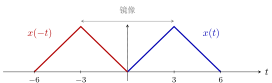{ .notes-fig loading=lazy }

<strong>图 1</strong> 翻转：蓝色 $x(t)$ 的三个关键点 $0,3,6$ 变成红色 $x(-t)$ 的 $0,-3,-6$，纵轴值不变，整体以纵轴为对称轴镜像。
{: .fig-caption }

▸ <strong>翻转和「偶、奇信号」是同一回事。</strong> 第一份笔记里「偶信号 $x(t)=x(-t)$」「奇信号 $x(t)=-x(-t)$」，用现在的话说就是：<strong>翻转之后和原信号相同的是偶信号，翻转之后和原信号相差一个负号的是奇信号。</strong>任何信号的偶部和奇部也都是靠翻转造出来的：

$$
x_e(t)=\frac{x(t)+x(-t)}{2},\qquad x_o(t)=\frac{x(t)-x(-t)}{2}.
$$

下图用上面的三角波 $x(t)$ 演示：$x(t)$ 本身不是偶的也不是奇的，它的偶部是「$x(t)$ 与翻转后的 $x(-t)$ 取平均」，两个半高度的三角形左右对称；奇部是「相减再除 $2$」，右边是正的、左边是负的，关于原点反对称。

{ .notes-fig loading=lazy }

<strong>图 2</strong> 用翻转造出偶部与奇部：$x(t)=x_e(t)+x_o(t)$。偶部和奇部的峰高都是 $\tfrac12$。（验算：$t=3$ 时 $x_e=\tfrac{1+0}{2}=\tfrac12$，$x_o=\tfrac{1-0}{2}=\tfrac12$，加起来是 $1$；$t=-3$ 时 $x_e=\tfrac12$，$x_o=-\tfrac12$，加起来是 $0$，与 $x(-3)=0$ 一致。）
{: .fig-caption }

▸ <strong>和日常经验的对应。</strong> 把 $x(t)$ 想成一段声音，$x(-t)$ 就是<strong>倒放</strong>（录音从后往前播）。时间上的翻转是一个数学操作；真实世界里的信号不能真的「倒着发生」，但处理已经录好的数据时可以做。

### 2.3 概念：时间尺度变换 $x(at)$（口诀第三句）

只做「压缩或拉伸」而不翻转、不平移的变换，叫<strong>时间尺度变换</strong>（time scaling）：$x(t)\to x(at)$，$a\gt{}0$。口诀第三句说的就是它：

-   $a\gt{}1$：<strong>压缩</strong>，波形沿横轴向<strong>纵轴</strong>（$t=0$）靠拢，变窄；

-   $0\lt{}a\lt{}1$：<strong>拉伸</strong>，波形离纵轴越来越远，变宽。

关键点的位置规则：<strong>原来在 $t=p$ 处的点，变到 $t=p/a$ 处，纵轴的值不变</strong>。因为新信号在 $t$ 处的值是原信号在 $at$ 处的值，要看到原来 $p$ 处的特征，需要 $at=p$。

|               |   $x(t)$    | $x(2t)$：压缩 | $x(t/2)$：拉伸 |
|:--------------|:-----------:|:-------------:|:--------------:|
| 关键点 $t$ 值 | $0,\ 3,\ 6$ | $0,\ 1.5,\ 3$ |  $0,\ 6,\ 12$  |
| 峰高          |     $1$     |      $1$      |      $1$       |
| 底边宽度      |     $6$     |      $3$      |      $12$      |

（用的是一个三角波 $x(t)$：$t=0$ 为 $0$，$t=3$ 为峰，$t=6$ 为 $0$。§2.7 的例 1 用的也是它。）

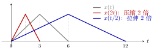{ .notes-fig loading=lazy }

<strong>图 3</strong> 时间尺度变换。灰：$x(t)$；红：$x(2t)$，所有关键点除以 $2$，向纵轴靠拢；蓝：$x(t/2)$，所有关键点乘以 $2$，远离纵轴。三条曲线的峰高都是 $1$，三角形的左端都固定在 $t=0$。
{: .fig-caption }

▸ <strong>关键：尺度变换是以纵轴为中心的。</strong> 上面的三角形左端恰好在 $t=0$，所以看起来像「只是变窄」。如果波形不在原点，压缩的同时<strong>位置也会变</strong>：关键点 $p\to p/a$，不只是宽度变。下图用一个落在 $[4,8]$ 上的三角形来演示：

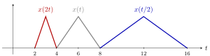{ .notes-fig loading=lazy }

<strong>图 4</strong> 原来的三角形在 $[4,8]$（峰在 $6$）。$x(2t)$ 的三角形在 $[2,4]$（峰在 $3$），向原点靠拢；$x(t/2)$ 的三角形在 $[8,16]$（峰在 $12$），远离原点。每个点的位置都乘了 $1/a$。
{: .fig-caption }

所以要先做「压缩或拉伸」再做「平移」，这是同一个道理：压缩是围绕原点进行的。

▸ <strong>压缩和拉伸改变了什么，没改变什么。</strong>

-   <strong>没变</strong>：峰高（纵轴的值）。

-   <strong>变了</strong>：宽度变成原来的 $1/a$ 倍；<strong>面积</strong>也变成原来的 $1/a$ 倍。三角形的底边 $6\to3\to12$，面积 $3\to1.5\to6$。一般公式 $\int_{-\infty}^{+\infty}x(at)\d t=\dfrac{1}{a}\int_{-\infty}^{+\infty}x(t)\d t$（$a\gt{}0$，把 $s=at$ 代入即可）。

这里能解释前面一份笔记里的一个现象：$\Sa(\omega t)$ 的面积是 $\dfrac{\pi}{\omega}$，会随 $\omega$ 变小；而 $\dfrac{\sin\omega t}{t}=\omega\cdot\Sa(\omega t)$ 乘了一个 $\omega$，面积刚好回到 $\pi$。所以「$\sin\omega t/t$ 的积分始终是 $\pi$」的几何原因是：宽度压成 $1/\omega$，高度又乘 $\omega$，两者抵消。

▸ <strong>和日常经验的对应。</strong> 把 $x(t)$ 想成一段声音，$x(2t)$ 就是用 $2$ 倍速播放：时长缩短为一半，同时音调升高（采样点被更快地播放）。$x(t/2)$ 是半速播放：时长翻倍，音调降低。注意这里说的是「简单地加速或减速播放」；很多播放器的「变速不变调」用的是别的算法，不属于单纯的 $x(at)$。

▸ <strong>$a\lt{}0$ 怎么办。</strong> $x(at)$（$a\lt{}0$）就是先翻转再压缩或拉伸：$x(-2t)=x(2(-t))$，先画 $x(-t)$，再按绝对值 $2$ 压缩。口诀的第二句和第三句分别处理这两件事。

▸ <strong>图解：不同的 $a$ 一排看。</strong> 把同一个三角波 $x(t)$ 用 $a=3,\,2,\,1,\,\tfrac12,\,\tfrac13$ 各做一次，五行对齐，一眼看出「$a$ 越大越窄、越靠近纵轴，$a$ 越小越宽、越远离纵轴」：

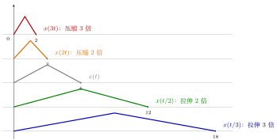{ .notes-fig loading=lazy }

<strong>图 5</strong> 同一个三角波（原来的底边在 $[0,6]$）经 $x(at)$ 之后，底边的右端点变成 $6/a$：$a=3,2,1,\tfrac12,\tfrac13$ 对应 $2,3,6,12,18$。峰高始终是 $1$，左端固定在 $t=0$。
{: .fig-caption }

▸ <strong>再强调三点。</strong>

1.  <strong>压缩的是时间轴，不是纵轴</strong>：峰高不变，宽度变成 $1/a$。

2.  <strong>$a\gt{}1$ 压缩，$0\lt{}a\lt{}1$ 拉伸</strong>：这就是口诀第三句，看的是系数的<strong>绝对值</strong>。

3.  <strong>离散情形要小心</strong>：$x[2n]$ 会丢掉点，$x[n/2]$ 在奇数处没有定义（§3 离散一节会讲），所以离散里基本只用 $\pm1$。

### 2.4 概念：平移变换 $x(t-t_0)$（口诀第四句）

只做平移的变换：$x(t)\to x(t-t_0)$。口诀第四句「加号左移，减号右移」说的就是它：

-   $x(t-t_0)$（$t_0\gt{}0$）：<strong>右移 $t_0$</strong>，也叫<strong>延迟</strong>（delay）；

-   $x(t+t_0)$（$t_0\gt{}0$）：<strong>左移 $t_0$</strong>，也叫<strong>超前</strong>（advance）。

关键点规则：<strong>原来在 $t=p$ 处的点，变到 $t=p+t_0$ 处（对 $x(t-t_0)$），形状和纵轴的值都不变。</strong>理由：新信号在 $t$ 处的值是原信号在 $t-t_0$ 处的值，要看到原来 $p$ 处的特征，需要 $t-t_0=p$，即 $t=p+t_0$。「减号」对应「往大的方向（右）走」，所以减号右移。

|               | $x(t+2)$：左移 $2$ |   $x(t)$    | $x(t-2)$：右移 $2$ |
|:--------------|:------------------:|:-----------:|:------------------:|
| 关键点 $t$ 值 |    $-2,\ 1,\ 4$    | $0,\ 3,\ 6$ |    $2,\ 5,\ 8$     |
| 峰高          |        $1$         |     $1$     |        $1$         |
| 底边宽度      |        $6$         |     $6$     |        $6$         |

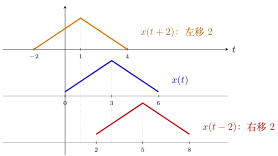{ .notes-fig loading=lazy }

<strong>图 6</strong> 平移：三条同样形状的三角形，只是位置不同。竖直点线对齐三个峰（$t=1,3,5$），相邻两个峰之间相差 $2$。形状、峰高、底边都不变。
{: .fig-caption }

▸ <strong>平移改变了什么，没改变什么。</strong>

-   <strong>没变</strong>：形状、峰高、面积（$\int x(t-t_0)\d t=\int x(t)\d t$）、能量。

-   <strong>变了</strong>：每个点的位置整体移动 $t_0$。

对比前面：<strong>压缩/拉伸</strong>会改变宽度和面积，<strong>翻转</strong>改变方向，只有<strong>平移</strong>什么形状上的东西都不改。

### 2.5 概念：合在一起 $x(at+b)$

前面把口诀的二、三、四句分别拆开看过了。现在把它们放到一起：一般的自变量变换是 $x(at+b)$，其中 $a$ 可正可负，$b$ 是常数。

重点

<strong>一步到位的验算公式</strong>：原来在 $t=p$ 处的点，在 $x(at+b)$ 里变到

$$
t=\frac{p-b}{a}
$$

处，纵轴值不变。（令 $at+b=p$ 解出 $t$。）画图时可以先用这个公式把三个关键点的新位置算出来，再用口诀检查。

<strong>做法顺序</strong>：先化成标准形式 $x\bigl(a(t+\tfrac ba)\bigr)$，再按「翻转 $\to$ 压缩或拉伸 $\to$ 平移」做，平移量是 $b/a$（不是 $b$）。

### 2.6 证明：为什么口诀成立

这里把口诀成立的道理写出来，记住这三条就不容易错。

1.  <strong>为什么要化成 $x(a(t+b/a))$（提出系数）</strong>：因为「平移」平移的是 $t$ 本身。$x(3t+6)$ 里的 $6$ 是对 $3t$ 加的，不是对 $t$ 加的，所以真正平移的距离是 $6/3=2$，不是 $6$。化成标准形式 $x(3(t+2))$ 之后，括号里的 $2$ 才是直接作用在 $t$ 上的平移量。

2.  <strong>为什么加号左移</strong>：新信号在 $t$ 处的值，是原信号在 $t+2$ 处的值。原信号在 $p$ 处的特征（比如峰），在新信号里要到 $t+2=p$，即 $t=p-2$ 处才看得到，比原来位置<strong>小</strong>，就是向左。减号反之。

3.  <strong>为什么系数大于 $1$ 压缩</strong>：$x(3t)$ 在 $t$ 处的值是原信号在 $3t$ 处的值，原信号走完 $3$ 个单位，新信号只用 $1$ 个单位，所以「变快」了，波形被挤窄。系数小于 $1$ 则相反，被拉宽。

下图把第二条（为什么加号左移）画出来：下排是 $x(t+2)$，上排是 $x(t)$，虚线连接「新信号的点」和「它在原信号里读取的位置」（读取位置是 $t+2$）。

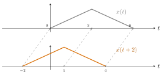{ .notes-fig loading=lazy }

<strong>图 7</strong> 下排 $x(t+2)$ 在 $t=-2,1,4$ 处的值，是上排 $x(t)$ 在 $\tau=t+2=0,3,6$ 处的值。每个特征（比如峰）在新信号里出现的位置，比原来小 $2$，所以是左移。
{: .fig-caption }

▸ <strong>图解：为什么是「压缩」——从输出倒推到输入。</strong> $x(2t)$ 在 $t$ 处的值，是原信号在 $2t$ 处的值。用具体数字走一遍（三角波：$0\le\tau\le3$ 时 $x(\tau)=\tau/3$，$3\le\tau\le6$ 时 $x(\tau)=(6-\tau)/3$）：

|                              |     |            |            |       |            |     |
|:-----------------------------|:---:|:----------:|:----------:|:-----:|:----------:|:---:|
| 新信号的 $t$                 | $0$ |   $0.5$    |    $1$     | $1.5$ |    $2$     | $3$ |
| 要去原信号读的位置 $\tau=2t$ | $0$ |    $1$     |    $2$     |  $3$  |    $4$     | $6$ |
| 读到的值 $x(\tau)=x(2t)$     | $0$ | $\tfrac13$ | $\tfrac23$ |  $1$  | $\tfrac23$ | $0$ |

新信号只走了 $t=0\to3$，已经把原信号从 $\tau=0$ 读到了 $\tau=6$ 的全部内容，所以波形被「压」进了原来一半的时间里。下图把对应关系画出来：下排是 $x(2t)$，上排是 $x(t)$，每条虚线连接「新信号的点」和「它在原信号里读取的位置」。把这些虚线向下延长，它们会交于纵轴上的同一点（图中的「放射中心」），这就是「以纵轴为中心的压缩」。

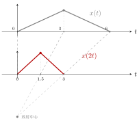{ .notes-fig loading=lazy }

<strong>图 8</strong> 压缩 $2$ 倍：下排 $x(2t)$ 上的点 $t=0,1.5,3$，对应它在上排 $x(t)$ 里读取的位置 $\tau=0,3,6$（每个读取位置是 $t$ 的 $2$ 倍）。虚线是对应关系。
{: .fig-caption }

说明

一个容易踩的坑：先化成标准形式，再按「翻转 $\to$ 压缩或拉伸 $\to$ 平移」的顺序做，平移量是 $b/a$，不是 $b$。如果坚持先平移再压缩，平移量就是 $b$（即 $x(t+6)$，再压缩 $3$ 倍），结果相同，但很容易搞错，所以「先化成标准形式」放在口诀第一条。

### 2.7 例题

例 1 <strong>三角波的 $x(3t+6)$ 与 $x(-3t+6)$</strong> 翻转·压缩·平移
{: .ex-head }

题目：已知 $x(t)$ 是下面的三角波：$t\in[0,3]$ 上升、$t\in[3,6]$ 下降，最高点高度为 $1$。画出 $x(3t+6)$ 和 $x(-3t+6)$。

{ .notes-fig loading=lazy }

<strong>图 9</strong> 已知的三角波 $x(t)$：在 $t=0$ 处为 $0$，$t=3$ 处升到 $1$，$t=6$ 处回到 $0$。
{: .fig-caption }

▸ <strong>方法一：固定关键点。</strong> 把波形上的三个关键点（$t=0,3,6$）固定下来，问：在新信号里，这三个点分别跑到了哪里？思路是：新信号 $x(3t+6)$ 在 $t$ 处的值，等于 $x$ 在「括号里那个数」处的值。所以让括号里的数等于原来的关键点：

| 原来的关键点 | $x(\cdot)$ 的值 | 令 $3t+6$ 等于它 | 新信号里对应的 $t$ |
|:------------:|:---------------:|:----------------:|:------------------:|
|     $0$      |       $0$       |     $3t+6=0$     |       $t=-2$       |
|     $3$      |    $1$（峰）    |     $3t+6=3$     |       $t=-1$       |
|     $6$      |       $0$       |     $3t+6=6$     |       $t=0$        |

所以 $x(3t+6)$ 是一个三角波：在 $t=-2$ 处为 $0$，$t=-1$ 处是峰（高 $1$），$t=0$ 处回到 $0$。

同样 $x(-3t+6)$：$-3t+6=0\Rightarrow t=2$；$=3\Rightarrow t=1$；$=6\Rightarrow t=0$。它是 $t=0$ 处为 $0$、$t=1$ 处是峰、$t=2$ 处回到 $0$ 的三角波。

下面的口诀更常用：先建立「信号移来移去、翻转过来翻转过去、拉伸缩短」的图像感。

▸ <strong>方法二：四步口诀。</strong> <strong>$x(3t+6)$</strong>：

1.  <strong>化成标准形式</strong>：把 $t$ 前面的系数提出来，$x(3t+6)=x\bigl(3(t+2)\bigr)$；

2.  <strong>前有负号翻转</strong>：$3$ 前面没有负号，这步可以不做；

3.  <strong>系数大于 $1$ 压缩</strong>：系数是 $3\gt{}1$，横向压缩 $3$ 倍。$x(t)$ 的关键点 $0,3,6$ 除以 $3$，变成 $0,1,2$；

4.  <strong>加号左移</strong>：括号里是 $t+2$，是加号，左移 $2$ 个单位：$0,1,2$ 变成 $-2,-1,0$。

<strong>$x(-3t+6)$</strong>：

1.  <strong>化成标准形式</strong>：$x(-3t+6)=x\bigl(-3(t-2)\bigr)$。（验算：$-3\times(-2)=6$。）

2.  <strong>前有负号翻转</strong>：先画 $x(-t)$，以纵轴为对称轴翻过去：关键点 $0,3,6$ 变成 $0,-3,-6$；

3.  <strong>系数绝对值 $3\gt{}1$ 压缩</strong>：针对翻转后的图压缩 $3$ 倍：$-6,-3,0$ 变成 $-2,-1,0$，得到 $x(-3t)$；

4.  <strong>减号右移</strong>：括号里是 $t-2$，是减号，右移 $2$ 个单位：$-2,-1,0$ 变成 $0,1,2$。

最后得到的答案和方法一的结果一致（峰在 $t=1$，两端在 $t=0$ 和 $t=2$）。

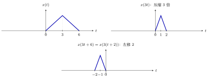{ .notes-fig loading=lazy }

<strong>图 10</strong> $x(3t+6)$ 的做法：先压缩（$x(3t)$），再左移 $2$。
{: .fig-caption }

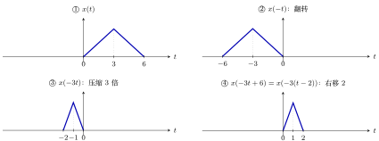{ .notes-fig loading=lazy }

<strong>图 11</strong> $x(-3t+6)$ 的四步：①$\to$② 翻转，②$\to$③ 压缩，③$\to$④ 右移。
{: .fig-caption }

<strong>这四步要熟练掌握。</strong>

例 2 <strong>$x\bigl(-\tfrac12t+1\bigr)$</strong> 翻转·拉伸·平移
{: .ex-head }

第二道题。注意式子是 $x\bigl(-\tfrac12t+1\bigr)$，不是 $x(-2t+1)$。

已知 $x(t)$ 是一个直角三角形：在 $t=-1$ 处有一条竖直边（高 $2$），斜边向右下落到 $t=0$ 处的 $0$。按四步口诀计算：

1.  标准形式：$x\bigl(-\tfrac12t+1\bigr)=x\bigl(-\tfrac12(t-2)\bigr)$；

2.  前有负号翻转：竖直边从 $t=-1$ 翻到 $t=1$，斜边落点仍在 $0$；

3.  系数绝对值 $\tfrac12\lt{}1$ 拉伸：横向拉伸 $2$ 倍，竖直边到 $t=2$，落点仍是 $0$；

4.  减号右移 $2$：竖直边到 $t=4$，落点到 $t=2$。

<em>（验算两点：$t=4$ 时 $x(-\tfrac12\cdot4+1)=x(-1)=2$；$t=2$ 时 $x(0)=0$。）</em>

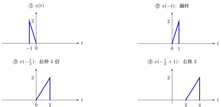{ .notes-fig loading=lazy }

<strong>图 12</strong> $x(-\frac12t+1)$ 的四步。
{: .fig-caption }

例 3 <strong>反过来做：已知 $x(3-2t)$，求 $x(t)$</strong> 变量代换
{: .ex-head }

这道题「反过来了」：给的是变换<em>之后</em>的波形，要画<em>原来</em>的 $x(t)$。

题目给的 $x(3-2t)$ 的波形：$t\in[2,3]$ 上高度 $1$，$t\in[3,4]$ 上高度 $2$，其余为 $0$。

<strong>思路：变量代换。</strong>设 $u=3-2t$，则 $t=\dfrac{3-u}{2}$。已知的是「关于 $t$ 的函数 $x(3-2t)$」，把它的图像当成一个已知函数 $g$，则要求的 $x(t)=g\bigl(\tfrac{3-t}{2}\bigr)$，也就是 $g$ 做了自变量变换。把它化成标准形式：

$$
g\Bigl(\frac{3-t}{2}\Bigr)=g\Bigl(-\frac12\,(t-3)\Bigr),
$$

然后照口诀：

1.  标准形式：$-\tfrac12(t-3)$；

2.  前有负号翻转：$g$ 的图（在 $[2,4]$）翻成 $[-4,-2]$；

3.  系数绝对值 $\tfrac12\lt{}1$ 拉伸 $2$ 倍：$[-8,-4]$；

4.  减号右移 $3$：$[-5,-1]$。

答案：$x(t)$ 在 $[-5,-3]$ 上高度 $2$，在 $[-3,-1]$ 上高度 $1$。

下面每一步单独画一张，并标上刻度（这里的 $g$ 就是已知的 $x(3-2t)$）：

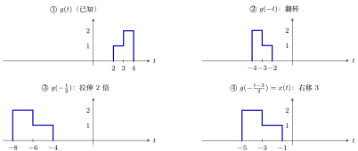{ .notes-fig loading=lazy }

<strong>图 13</strong> 例 3 的四步：①$\to$② 翻转，区间 $[2,4]\to[-4,-2]$，高度 $1,2$ 的两段左右互换；②$\to$③ 拉伸 $2$ 倍，$[-8,-4]$；③$\to$④ 右移 $3$，$[-5,-1]$。
{: .fig-caption }

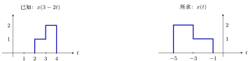{ .notes-fig loading=lazy }

<strong>图 14</strong> 左：已知的 $x(3-2t)$；右：所求的 $x(t)$。
{: .fig-caption }

▸ <strong>易错点。</strong> 按口诀走一遍：翻转后区间变成 $[-4,-2]$，拉伸 $2$ 倍后坐标都乘 $2$，变成 $[-8,-4]$，最后「减号要右移」。作图时不要把几个图画在同一根坐标轴上，并标注 $t$ 和关键点的数值。

<em>（用上面的变换验算：$x(t)=g\bigl(\tfrac{3-t}{2}\bigr)$。取 $t=-4$：$\tfrac{3-(-4)}{2}=3.5\in[3,4]$，$g=2$；取 $t=-2$：$\tfrac{3-(-2)}{2}=2.5\in[2,3]$，$g=1$。与答案一致。）</em>

▸ <strong>练习。</strong> 教材第 31 页习题 1-7、1-8 都是这类题。

### 2.8 例题：回头看熟悉的信号

下面用几个熟悉的信号作例子：前两个是尺度变换，阶跃、窗和脉冲的和放在 §4–§6。

例 4 <strong>$\Sa(\omega t)$ 与 $\frac{\sin\omega t}{t}$</strong> 压缩
{: .ex-head }

已知 $\Sa(t)=\dfrac{\sin t}{t}$，画 $\Sa(\omega t)=\dfrac{\sin\omega t}{\omega t}$（$\omega\gt{}0$）。只用第三条口诀：系数是 $\omega$，$\omega\gt{}1$ 就压缩 $\omega$ 倍。原来的零点 $\pm\pi,\pm2\pi,\dots$ 变成 $\pm\dfrac{\pi}{\omega},\pm\dfrac{2\pi}{\omega},\dots$，峰高仍是 $1$。

前一节的 $\dfrac{\sin\omega t}{t}=\omega\cdot\Sa(\omega t)$：把 $\Sa(\omega t)$ <strong>乘一个 $\omega$</strong>，峰高就是 $\omega$，零点 $\pm k\pi/\omega$。

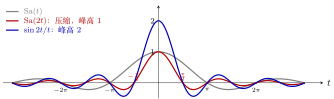{ .notes-fig loading=lazy }

<strong>图 15</strong> 取 $\omega=2$。灰：$\Sa(t)$，零点在 $\pm\pi,\pm2\pi,\dots$；红：$\Sa(2t)$，零点向纵轴靠拢到 $\pm\frac\pi2,\pm\pi,\dots$，峰高仍是 $1$；蓝：$\dfrac{\sin2t}{t}=2\Sa(2t)$，零点和红线相同，峰高变成 $2$。
{: .fig-caption }

例 5 <strong>第五章的例子：$X(\omega/T)$</strong> 拉伸
{: .ex-head }

第五章会碰到一个标准的例子：$X(\omega)$ 是一个带限信号（band-limited signal，只在 $[-\omega_0,\omega_0]$ 上有值，其他地方为 $0$），峰值（$\omega=0$ 处）为 $E$。问：$X\bigl(\tfrac{\omega}{T}\bigr)$ 是什么形状？答案：<strong>峰值仍是 $E$</strong>，两个端点从 $\pm\omega_0$ 变成 $\pm T\omega_0$。这就是第三条口诀：系数 $\tfrac1T$，$T\gt{}1$ 时系数小于 $1$，是拉伸。

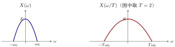{ .notes-fig loading=lazy }

<strong>图 16</strong> $X(\omega/T)$ 是 $X(\omega)$ 沿 $\omega$ 轴拉伸 $T$ 倍：峰值不变，宽度变成 $T$ 倍。左边的钟形只是示意。
{: .fig-caption }

### 2.9 例题：把几种变换组合起来

<strong>用不同的变换组合把前面的口诀和公式各练一遍。</strong>

例 6 <strong>翻转加平移：$x(-t+3)$</strong> 翻转·平移
{: .ex-head }

$x(-t+b)$ 的标准形式是 $x(-(t-b))$，括号里是<strong>减号</strong>，所以是翻转之后<strong>右移 $b$</strong>，不是左移，哪怕 $b$ 前面看起来是「加号」。下面用直角三角形演示 $x(-t+3)$：

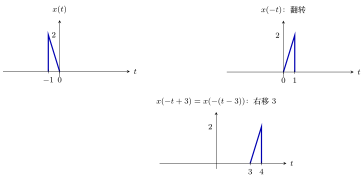{ .notes-fig loading=lazy }

<strong>图 17</strong> 翻转再平移。竖直边（高 $2$）从 $t=-1$ 翻到 $t=1$，再右移 $3$ 到 $t=4$，斜边落点从 $0$ 经 $0$ 到 $3$。验算：$t=4$ 时 $x(-4+3)=x(-1)=2$；$t=3$ 时 $x(0)=0$。
{: .fig-caption }

例 7 <strong>平移和压缩一起出现：$x(2t-4)$</strong> 压缩·平移
{: .ex-head }

$x(2t-4)$ 的标准形式是 $x(2(t-2))$，所以<strong>先压缩 $2$ 倍，再右移 $2$</strong>，平移量是 $2$ 而不是 $4$。这是前面口诀第一句「化成标准形式」要防的坑。

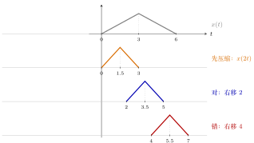{ .notes-fig loading=lazy }

<strong>图 18</strong> $x(2t-4)=x(2(t-2))$：先压缩得到 $x(2t)$（关键点 $0,3,6\to0,1.5,3$），再右移 $2$ 得到 $2,3.5,5$（蓝）。把 $b=4$ 直接当平移量会得到 $4,5.5,7$（红），整体偏右。验算：$t=3.5$ 时 $x(2\times3.5-4)=x(3)=1$，正是峰。
{: .fig-caption }

例 8 <strong>不对称三角波的 $x(-2t+4)$</strong> 翻转·压缩·平移
{: .ex-head }

选一个不对称的三角波，避免翻转之后恰好和原图重合：$x(t)$ 在 $t=0$ 为 $0$，$t=2$ 为峰（高 $1$），$t=6$ 回到 $0$。

<strong>一步到位验算</strong>：$a=-2$，$b=4$，$t=\dfrac{p-4}{-2}$：

|                           |     |     |      |
|:--------------------------|:---:|:---:|:----:|
| 原来的点 $p$              | $0$ | $2$ | $6$  |
| 新位置 $t=\frac{p-4}{-2}$ | $2$ | $1$ | $-1$ |

所以 $x(-2t+4)$ 是一个三角波：左端在 $t=-1$，峰在 $t=1$，右端在 $t=2$。注意左右互换了（原来的 $p=0$ 现在在右端）。

<strong>口诀做法（先化成标准形式 $x(-2(t-2))$）</strong>：

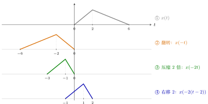{ .notes-fig loading=lazy }

<strong>图 19</strong> 口诀顺序：①$\to$② 前有负号翻转，②$\to$③ 系数绝对值 $2\gt{}1$ 压缩，③$\to$④ 减号右移 $2$。每步的三个关键点：$(0,2,6)\to(-6,-2,0)\to(-3,-1,0)\to(-1,1,2)$，与一步到位算出的结果一致。
{: .fig-caption }

▸ <strong>换一种顺序也行，但平移量不同。</strong> 也可以先平移、再做翻转和压缩：$x(-2t+4)$ 是把 $x(\cdot+4)$（先左移 $4$）里的 $t$ 换成 $-2t$。

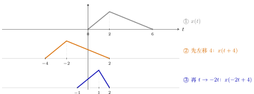{ .notes-fig loading=lazy }

<strong>图 20</strong> 另一种顺序：先把 $x(t)$ 左移 $4$ 得到 $x(t+4)$，再把自变量换成 $-2t$（翻转并压缩 $2$ 倍），每个点 $p\to-p/2$：$(-4,-2,2)\to(2,1,-1)$，即左端 $-1$、峰 $1$、右端 $2$，得到和上一种顺序相同的结果。
{: .fig-caption }

两种顺序结果相同，区别只在平移量：<strong>先缩放再平移，要先提出系数，括号里是 $t-2$，平移 $2$ 个单位（$=|b/a|=4/2$）；先平移再缩放，平移的是 $x(\cdot+4)$，平移 $4$ 个单位（就是 $b$）。</strong>所以「化成标准形式」放在口诀第一句：提出系数之后，平移量一目了然，不用在心里换算。

▸ <strong>最常见的几个错误（对照图）。</strong> 同样画 $x(-2t+4)$，下图把正确答案和其中两种错误画在一起：

{ .notes-fig loading=lazy }

<strong>图 21</strong> 蓝：正确答案（左端 $-1$、峰 $1$、右端 $2$）。红虚线：把平移量误写成 $b=4$（翻转压缩之后又右移 $4$），整体偏右。橙虚线：把「减号右移」记反，左移 $2$，偏到左边。
{: .fig-caption }

1.  <strong>忘了提出系数</strong>：$-2t+4$ 里的 $4$ 对应的平移量是 $4/2=2$（不是 $4$）；

2.  <strong>方向记反</strong>：标准形式是 $x(-2(t-2))$，括号里是<strong>减号</strong>，所以右移；

3.  <strong>左右搞反</strong>：有负号就要翻转，翻转之后左端和右端互换（本例中原来的 $p=0$ 变到右端）。

遇到拿不准的时候，用上面「一步到位」公式把三个关键点算一遍，对照就知道哪里错了。

例 9 <strong>回声：原声加上延迟、变小的一份</strong> 平移的应用
{: .ex-head }

声音的回声就是「原声加上延迟之后、变小的一份」。设 $x(t)$ 是一个声音片段，则

$$
y(t)=x(t)+\tfrac12\,x(t-8)
$$

是原声加上延迟 $8$、音量减半的回声。用上面的三角波示意：

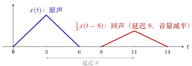{ .notes-fig loading=lazy }

<strong>图 22</strong> $y(t)=x(t)+\tfrac12x(t-8)$：原声（蓝）与延迟、减半的回声（红）。两个三角形没有重叠，所以相加后就是各自原样。
{: .fig-caption }

如果延迟小于信号宽度，两份会重叠，相加就要把重叠部分逐点加起来。下面把延迟改成 $4$（小于底边 $6$）：$y(t)=x(t)+\tfrac12x(t-4)$。

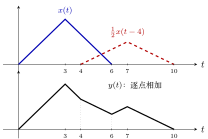{ .notes-fig loading=lazy }

<strong>图 23</strong> 延迟 $4$ 时两份重叠在 $[4,6]$ 上。上：蓝 $x(t)$ 与红虚线 $\tfrac12x(t-4)$；下：相加后的 $y(t)$，关键点 $(0,0),(3,1),(4,\tfrac23),(6,\tfrac13),(7,\tfrac12),(10,0)$。验算：$t=4$ 时 $x(4)=\tfrac23$，回声刚开始为 $0$，和为 $\tfrac23$；$t=6$ 时 $x(6)=0$，回声 $\tfrac12x(2)=\tfrac13$。
{: .fig-caption }

例 10 <strong>周期信号与「余弦就是左移的正弦」</strong> 平移与周期
{: .ex-head }

第一份笔记里周期信号的定义 $x(t)=x(t+mT)$，用现在的话说就是：<strong>平移任意整数个周期，信号不变</strong>。再举一个熟悉的例子：$\cos t=\sin\bigl(t+\tfrac\pi2\bigr)$，即<strong>把正弦左移 $\tfrac\pi2$ 就是余弦</strong>。

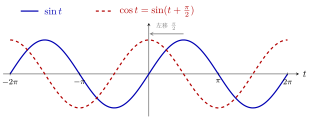{ .notes-fig loading=lazy }

<strong>图 24</strong> $\cos t=\sin(t+\tfrac\pi2)$：正弦（蓝）左移 $\tfrac\pi2$ 就得到余弦（红虚线）。再左移 $2\pi$（一个周期）则回到原来的曲线。
{: .fig-caption }

## 3 离散信号的自变量变换

### 3.1 概念

口诀仍然是这四句，但离散的情况 <strong>$n$ 前面的系数基本只有 $+1$ 或 $-1$</strong>，所以第三句（压缩、拉伸）一般用不上：$x[2n]$ 会把奇数位置的点丢掉，$x[n/2]$ 在 $n$ 为奇数时没有定义，都需要额外约定。

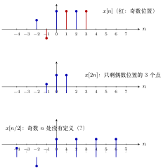{ .notes-fig loading=lazy }

<strong>图 25</strong> 离散情形不能随便缩放。上：$x[n]$（$x[-2]=\tfrac12$，$x[-1]=-\tfrac12$，$x[0..3]=1$）。中：$x[2n]$ 取 $x[-2],x[0],x[2]$，放在 $n=-1,0,1$，奇数位置的 $x[-1],x[1],x[3]$ 被丢掉了。下：$x[n/2]$ 把 $x[k]$ 放到 $n=2k$ 处，奇数 $n$ 要读 $x$ 在半整数处的值，没有定义。
{: .fig-caption }

▸ <strong>离散的翻转。</strong> $x[n]\to x[-n]$，同样以 $n=0$ 为对称轴：$n=p$ 处的值变到 $n=-p$ 处。用一个小序列 $x[n]$（$x[-2]=\tfrac12$，$x[-1]=-\tfrac12$，$x[0..3]=1$，后面的例题用的也是它）：翻转后 $x[-n]$ 在 $n=2$ 处是 $\tfrac12$，$n=1$ 处是 $-\tfrac12$，$n=0,-1,-2,-3$ 处是 $1$。

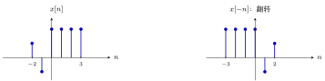{ .notes-fig loading=lazy }

<strong>图 26</strong> 离散翻转：每根竖线以 $n=0$ 为轴镜像，高度不变。
{: .fig-caption }

▸ <strong>离散的平移。</strong> $x[n-k]$（$k$ 为整数）右移 $k$，$x[n+k]$ 左移 $k$，形状不变，后面例题里的 $x[n-3]$ 就是这种。离散的平移量只能是整数（相邻采样点之间没有点可放）。

### 3.2 例题

例 1 <strong>$x[n-3]$ 与 $x[4-n]$</strong> 右移·翻转
{: .ex-head }

已知 $x[n]$：$x[-2]=\tfrac12$，$x[-1]=-\tfrac12$，$x[0]=x[1]=x[2]=x[3]=1$，其余为 $0$。

<strong>$x[n-3]$</strong>：已经是标准形式；$n$ 前面没有负号，系数是 $1$，不用翻转也不用压缩；减号右移 $3$。形状不变，把坐标改一改：原来 $-2,-1$ 的点移到 $1,2$，原来 $0,1,2,3$ 的点移到 $3,4,5,6$，即右移三个单位。

<strong>$x[4-n]$</strong>：标准形式是 $x[-(n-4)]$，先翻转，再右移 $4$。逐步追踪每个点：

| 原来的 $n$ | 翻转后 | 右移 $4$ 后 | 在新信号里的位置 |     值      |
|:----------:|:------:|:-----------:|:----------------:|:-----------:|
|    $3$     |  $-3$  |     $1$     |      $n=1$       |     $1$     |
|    $2$     |  $-2$  |     $2$     |      $n=2$       |     $1$     |
|    $1$     |  $-1$  |     $3$     |      $n=3$       |     $1$     |
|    $0$     |  $0$   |     $4$     |      $n=4$       |     $1$     |
|    $-1$    |  $1$   |     $5$     |      $n=5$       | $-\tfrac12$ |
|    $-2$    |  $2$   |     $6$     |      $n=6$       | $\tfrac12$  |

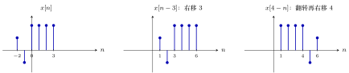{ .notes-fig loading=lazy }

<strong>图 27</strong> 离散信号的自变量变换。$x[n]$ 在 $n=-2,-1$ 处是 $\tfrac12,-\tfrac12$，在 $n=0,1,2,3$ 处是 $1$。
{: .fig-caption }

## 4 阶跃信号 $u(t)$、$u[n]$ 的自变量变换

### 4.1 概念：令括号里的式子等于 $0$

<strong>把口诀用到最简单的信号上：阶跃。</strong>

$u(t)$ 只有一个「跳变」：括号里的数大于 $0$ 时为 $1$，小于 $0$ 时为 $0$。所以对 $u(at+b)$ 有一个最省事的办法，不用画中间步骤：

重点

<strong>令括号里的式子 $at+b$ 等于 $0$，解出的 $t$ 就是跳变位置；再看括号里 $\gt{}0$ 的那一侧，那一侧取 $1$。</strong>

▸ <strong>离散：$u[n]$。</strong> $u[n]$ 的定义是 $n\ge0$ 时为 $1$，$n\lt{}0$ 时为 $0$。所以对 $u[n+b]$ 或 $u[-n+b]$ 也可以用同一个最省事的办法：

重点

<strong>令括号里的式子 $\ge0$，解出的 $n$ 的范围就是取 $1$ 的那一段；其余是 $0$。</strong>（注意是「$\ge0$」，因为 $u[0]=1$，连续的 $u(t)$ 在边界上不规定值，这里的边界点是<strong>包含</strong>的。）

▸ <strong>离散情形的一个区别。</strong> $u[n]$ 在 $n=0$ 处<strong>有确定的值 $1$</strong>，所以 $u[-n]$ 在 $n\le0$ 上是 $1$（包含 $n=0$），$u[n-3]$ 在 $n\ge3$ 上是 $1$（包含 $n=3$）。连续的 $u(t)$ 跳变点处的值不规定，离散的没有这个问题（§5 里 $u[n+2]-u[n-3]$ 一题，边界点的处理就是靠这一点）。

▸ <strong>连续 $u(t)$ 与离散 $u[n]$ 的对比。</strong>

|  | 连续 $u(t)$ | 离散 $u[n]$ |
|:---|:--:|:--:|
| 跳变（边界）点的值 | 不规定 | 确定为 $1$ |
| 取 $1$ 的条件 | 括号里 $\gt{}0$ | 括号里 $\ge0$ |
| $u(at)$ 与 $u[an]$（$a\gt{}0$） | 都等于原来的阶跃 | $u[2n]=u[n]$，但一般要小心 |

### 4.2 证明：为什么 $u(2t)=u(t)$

▸ <strong>连续：压缩对阶跃没有效果。</strong> $2t\gt{}0$ 和 $t\gt{}0$ 是同一个条件，跳变位置都在 $t=0$（而 $0$ 压缩任意倍还是 $0$）。更一般地，对任意 $a\gt{}0$，$u(at)=u(t)$。这是阶跃信号很特殊的地方：<strong>拉伸压缩都不改变它的图像</strong>，只有平移和翻转才会改变。<em>（这一点对「冲激信号」不成立：$\delta(at)$ 与 $\delta(t)$ 差一个系数，第二章再讲。）</em>

▸ <strong>离散：$u[2n]$ 怎么看。</strong> $u[2n]$ 是把 $u[n]$ 每隔一个取一个点（$n=\dots,-2,-1,0,1,2,\dots$ 对应 $u$ 的 $\dots,-4,-2,0,2,4,\dots$ 这些位置），取出来的值是：负的 $n$ 全是 $0$，$n\ge0$ 全是 $1$，所以结果仍是 $u[n]$。这与连续的 $u(2t)=u(t)$ 一致。一般离散信号在 $n$ 前面带 $2$ 会丢掉点，不能简单说成「压缩」；$u[n/2]$ 在 $n$ 为奇数时没有定义，需要额外约定。

### 4.3 例题

例 1 <strong>阶跃函数 $u(t)$ 的五个变换</strong> 跳变位置
{: .ex-head }

按上面的办法算五个，再用口诀对照检查：

| 信号 | 跳变位置 | 取 $1$ 的一侧 | 对应的口诀 |
|:---|:---|:---|:---|
| $u(t-2)$ | $t=2$ | 右侧 | 减号右移 $2$ |
| $u(t+2)$ | $t=-2$ | 右侧 | 加号左移 $2$ |
| $u(-t)$ | $t=0$ | <strong>左侧</strong>（$-t\gt{}0\iff t\lt{}0$） | 前有负号翻转 |
| $u(2t)$ | $t=0$ | 右侧 | 压缩 $2$ 倍，但<strong>图没有变</strong> |
| $u(-2t+4)$ | $t=2$ | <strong>左侧</strong>（$-2t+4\gt{}0\iff t\lt{}2$） | 标准形式 $u(-2(t-2))$：翻转、压缩（无影响）、右移 $2$ |

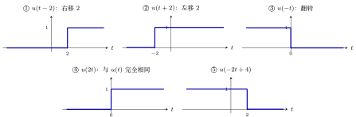{ .notes-fig loading=lazy }

<strong>图 28</strong> $u(t)$ 的自变量变换。蓝色粗线是新信号，横轴上方一条线表示取值 $1$，下方（贴着横轴）表示取值 $0$。跳变点处的值不规定（和 $u(0)$ 任取一样）。
{: .fig-caption }

例 2 <strong>阶跃序列 $u[n]$ 的五个变换</strong> 取 1 的范围
{: .ex-head }

| 序列 | 括号里 $\ge0$ | 取 $1$ 的范围 | 对应的口诀 |
|:---|:---|:---|:---|
| $u[n-3]$ | $n-3\ge0$ | $n\ge3$ | 减号右移 $3$ |
| $u[n+2]$ | $n+2\ge0$ | $n\ge-2$ | 加号左移 $2$ |
| $u[-n]$ | $-n\ge0$ | $n\le0$ | 前有负号翻转 |
| $u[-n+4]$ | $-n+4\ge0$ | $n\le4$ | 标准形式 $u[-(n-4)]$：翻转，减号右移 $4$ |
| $u[2n]$ | $2n\ge0$ | $n\ge0$ | 与 $u[n]$ 的图相同（见 §4.2） |

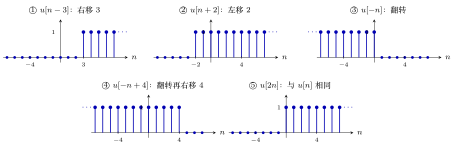{ .notes-fig loading=lazy }

<strong>图 29</strong> $u[n]$ 的自变量变换。每根竖线高 $1$，横轴上的小圆点表示取值 $0$；边界点 $n_0$ 处的值是确定的 $1$，所以 $u[n-3]$ 的第一根线在 $n=3$，$u[-n]$ 的最后一根线在 $n=0$。
{: .fig-caption }

## 5 用阶跃信号表示「窗」

### 5.1 概念：两个阶跃相减

1.  $u(t-t_0)$：阶跃函数 $u(t)$ 的自变量减 $t_0$，<strong>减号右移 $t_0$</strong>：从 $t=t_0$ 开始等于 $1$。

2.  方波 $g(t)$：在 $0\lt{}t\lt{}t_0$ 上为 $1$，其他地方为 $0$：

    $$
    g(t)=u(t)-u(t-t_0).
    $$

    理由：$u(t)$ 从 $0$ 开始是 $1$，$u(t-t_0)$ 从 $t_0$ 开始是 $1$，两个相减：$t\lt{}0$ 时都是 $0$，$t\gt{}t_0$ 时是 $1-1=0$，只在 $0\lt{}t\lt{}t_0$ 一段 $1-0=1$。

{ .notes-fig loading=lazy }

<strong>图 30</strong> 用两个阶跃相减得到方波：$g(t)=u(t)-u(t-t_0)$。
{: .fig-caption }

▸ <strong>离散的版本。</strong> $g_N[n]$：在 $n=0,1,\dots,N-1$ 上为 $1$，其余为 $0$。写法：$g_N[n]=u[n]-u[n-N]$。理由：$u[n]$ 从 $0$ 开始是 $1$，$u[n-N]$ 从 $N$ 开始是 $1$，相减后只在 $0\le n\le N-1$ 上是 $1$。

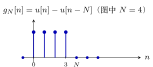{ .notes-fig loading=lazy }

<strong>图 31</strong> 离散的「窗」$g_N[n]=u[n]-u[n-N]$（图中 $N=4$）：在 $n=0,1,\dots,N-1$ 上为 $1$。
{: .fig-caption }

### 5.2 例题

例 1 <strong>$u(t+3)-u(t-3)$</strong> 方波
{: .ex-head }

画 $u(t+3)-u(t-3)$：加号左移 $3$，从 $t=-3$ 开始是 $1$；减号右移 $3$，从 $t=3$ 开始是 $1$；相减后 <strong>在 $-3\lt{}t\lt{}3$ 上等于 $1$</strong>，其他为 $0$。

{ .notes-fig loading=lazy }

<strong>图 32</strong> $u(t+3)-u(t-3)$ 在 $-3\lt{}t\lt{}3$ 上等于 $1$。
{: .fig-caption }

例 2 <strong>$u[n+2]-u[n-3]$</strong> 5 个点
{: .ex-head }

画 $u[n+2]-u[n-3]$：$u[n+2]$ 从 $n=-2$ 开始是 $1$，$u[n-3]$ 从 $n=3$ 开始是 $1$，相减后<strong>在 $n=-2,-1,0,1,2$（共 5 个点）上是 $1$，其余为 $0$</strong>。 离散的这类题比连续的<strong>稍微烧脑</strong>，难点是「<strong>在边界处哪里开始等于零</strong>」要算清楚：右边在 $n=3$ 处，两个阶跃都是 $1$，相减等于 $0$，所以右端点是 $n=2$ 而不是 $n=3$。

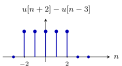{ .notes-fig loading=lazy }

<strong>图 33</strong> $u[n+2]-u[n-3]$ 在 $n=-2,\dots,2$ 上为 $1$。
{: .fig-caption }

## 6 把序列写成冲激的和

### 6.1 概念

▸ <strong>一个著名的公式（书第 45 页，式 2-28）：序列等于平移并加权的单位脉冲之和。</strong>

重点

$$
x[n]=\sum_{k=-\infty}^{+\infty}x[k]\,\delta[n-k]
$$

### 6.2 证明：为什么成立

-   $x[k]$ 是 $x[n]$ 在 $n=k$ 处的值（一个数）；

-   $\delta[n-k]$ 是在 $n=k$ 处为 $1$、其他处为 $0$ 的信号；

-   两者相乘，得到「只在 $n=k$ 处等于 $x[k]$，其余处为 $0$」的信号；

-   对每一个不同的 $k$ 都这样做，再全部加起来，每个位置 $n$ 上都取到了正确的值。

这个公式第二章还会再讲；有了「移来移去」的概念就容易理解。下面例题里的五项相加，就是它的一个具体实例（只有 $k=-2,\dots,2$ 这五项非零）。

### 6.3 例题

例 1 <strong>把 $x[-2..2]=1,2,1,-1,-2$ 写成脉冲的和</strong> 五项之和
{: .ex-head }

例：$x[n]$ 在 $n=-2,-1,0,1,2$ 处分别是 $1,2,1,-1,-2$，其余为 $0$。问：能看出它等于下面这个式子吗？

$$
x[n]=\delta[n+2]+2\,\delta[n+1]+\delta[n]-\delta[n-1]-2\,\delta[n-2].
$$

<strong>解释（用的还是那两句口诀）：</strong>

-   $\delta[n]$ 只在 $n=0$ 处是 $1$；

-   $\delta[n+2]$：加号左移 $2$，在 $n=-2$ 处是 $1$，所以第一项刚好对应 $x[-2]=1$；

-   $\delta[n+1]$ 在 $n=-1$ 处是 $1$，但 $x[-1]=2$，所以要乘 $2$：$2\delta[n+1]$；

-   $\delta[n-1]$：减号右移 $1$，在 $n=1$ 处是 $1$，而 $x[1]=-1$，所以乘 $-1$；

-   同理 $-2\,\delta[n-2]$ 对应 $x[2]=-2$。

看到这样的序列，应马上反应到：它就是若干个平移过的单位脉冲，每一个按对应的值加权，再加起来。

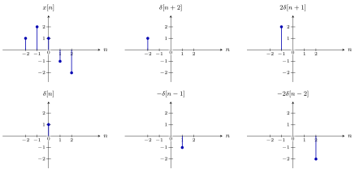{ .notes-fig loading=lazy }

<strong>图 34</strong> 把 $x[n]$ 拆成五个平移并加权的单位脉冲：五个分量相加就是左上角的 $x[n]$（$x[-2..2]=1,2,1,-1,-2$）。
{: .fig-caption }
