# 典型的系统：线性、时不变、因果、无记忆、可逆、稳定

浙江大学 2022《信号与系统》（胡浩基）教材第 28 页「系统的基本性质」听课笔记

[:material-file-pdf-box: 下载 PDF 版](pdf/02-典型的系统.pdf){ .md-button }

<!-- 本页由 tools/signal_notes/sync.py 从 LaTeX 笔记自动生成，请勿手改；改动请改源 .tex 后重新同步。 -->

## 1 概览：6 对性质

一个<strong>系统</strong>(system)是一台机器：信号 $x(t)$ 进去，信号 $y(t)$ 出来。后面所有性质，都是在问「这台机器有什么脾气」。6 对性质每一对都<strong>非此即彼</strong>（不是线性就是非线性，以此类推），所以只要把正面的定义写严格就够了。

| 性质                              | 反面                          |
|:----------------------------------|:------------------------------|
| 线性系统(linear system)           | 非线性系统(nonlinear system)  |
| 时不变系统(time-invariant system) | 时变系统(time-varying system) |
| 因果系统(causal system)           | 非因果系统(non-causal system) |
| 无记忆系统(memoryless system)     | 记忆系统(system with memory)  |
| 可逆系统(invertible system)       | 不可逆系统                    |
| 稳定系统(stable system)           | 不稳定系统                    |

## 2 线性系统

### 2.1 概念

重点

一个系统，如果<strong>同时</strong>满足下面两条，它就是线性系统；否则（只满足一条，或两条都不满足）就是非线性系统。

假设对<strong>任意</strong>输入 $x(t)$，系统给出输出 $y(t)$（记作 $x(t)\to y(t)$），那么：

1.  <strong>齐次性</strong>(homogeneity)：$a\,x(t)\to a\,y(t)$，其中 $a$ 是任意实数。  
    <em>输入放大 $a$ 倍，输出也恰好放大 $a$ 倍。</em>

2.  <strong>叠加性</strong>(superposition，也叫可加性)：若 $x_1(t)\to y_1(t)$、$x_2(t)\to y_2(t)$，则 $x_1(t)+x_2(t)\to y_1(t)+y_2(t)$。  
    <em>两个输入加在一起送进去，输出就是它们各自输出的和。</em>

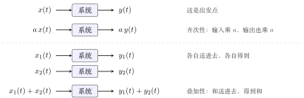{ .notes-fig loading=lazy }

<strong>图 1</strong> 线性系统的两条规矩。注意每一行里的「系统」都是<strong>同一台</strong>机器。
{: .fig-caption }

两点要记住：

-   <strong>缺一不可</strong>：只有齐次性和叠加性同时满足才是线性（见本节末的思考题）。

-   <strong>「任意」是定义的灵魂</strong>：$x(t)$、$x_1(t)$、$x_2(t)$、$a$ 都是任意的（记作 $\forall$）。后面所有难点，都出在没有真正理解这个「任意」。例如 $y(t)=3x(t)$ 的意思是：这台机器对<strong>任意</strong>输入都乘 3。

离散线性系统的定义只需把圆括号 $(t)$ 换成方括号 $[n]$：$x[n]\to y[n]$，$a\,x[n]\to a\,y[n]$，$x_1[n]+x_2[n]\to y_1[n]+y_2[n]$。

### 2.2 证明

重点

<strong>证</strong>一个系统是线性的：对<strong>所有</strong>输入、<strong>所有</strong> $a$ 都验证两条规矩，一条也不能漏。

<strong>证</strong>一个系统不是线性的：只要找到<strong>一个</strong>反例，让它不满足齐次性或叠加性之一，就够了。

原因就是定义里的「任意」：说「对任意都成立」要全部验完；说「不是对任意都成立」，有一个例外就够。

▸ <strong>证线性：设中间变量，打成「一包」。</strong> 先看清这台机器的规矩：「送进去信号 $f$，出来 $F[f]$」（例如放大器：送进去 $f$，出来 $3f$）。因为 $x(t)$ 是任意信号，所以 $a\,x(t)$ 也<strong>只是又一个信号</strong>；设中间变量 $f(t)=a\,x(t)$，把它当成一包整体送进去，再做代换。步骤：

1.  齐次性：令 $f=a\,x(t)$，算出 $F[f]$，化成 $a\,y(t)$；

2.  叠加性：令 $f=x_1(t)+x_2(t)$，算出 $F[f]$，化成 $y_1(t)+y_2(t)$。

▸ <strong>证非线性：对照「实际」和「希望」。</strong> 取最简单的输入（如 $x\equiv0$ 或 $x\equiv1$，$\equiv$ 表示恒等于）和 $a=2$：<strong>实际</strong>是把 $a\,x$ 送进系统得到的输出；<strong>希望</strong>是「若齐次性成立，应得 $a\,y$」。两者不等，就矛盾，说明系统不是线性的。

### 2.3 例题：证明是线性

下面每题都按定义分<strong>齐次性</strong>、<strong>叠加性</strong>两步，写成证明。

例 1 <strong>放大器 $y(t)=3x(t)$</strong> 线性
{: .ex-head }

<strong>系统</strong>：$x(t)\to y(t)=3x(t)$，即输入乘 $3$。

<strong>证明</strong>。

$$
\begin{align*}
\text{齐次性：}\quad & a\,x(t)\ \to\ 3\cdot a\,x(t)=a\cdot 3x(t)=a\,y(t),\\
\text{叠加性：}\quad & x_1(t)+x_2(t)\ \to\ 3\bigl(x_1(t)+x_2(t)\bigr)=3x_1(t)+3x_2(t)=y_1(t)+y_2(t).
\end{align*}
$$

两式对任意输入、任意实数 $a$ 均成立，故 $y(t)=3x(t)$ 为线性系统。$\blacksquare$

例 2 <strong>$y(t)=t\,x(t)$</strong> 线性
{: .ex-head }

<strong>系统</strong>：$x(t)\to y(t)=t\,x(t)$。$t$ 是每个时刻的乘数，不随输入改变。

<strong>证明</strong>。

$$
\begin{align*}
\text{齐次性：}\quad & a\,x(t)\ \to\ t\cdot a\,x(t)=a\bigl(t\,x(t)\bigr)=a\,y(t),\\
\text{叠加性：}\quad & x_1(t)+x_2(t)\ \to\ t\bigl(x_1(t)+x_2(t)\bigr)=t\,x_1(t)+t\,x_2(t)=y_1(t)+y_2(t).
\end{align*}
$$

两式对任意输入、任意实数 $a$ 均成立，故 $y(t)=t\,x(t)$ 为线性系统。$\blacksquare$

<strong>注</strong>：$t$ 随时间变化不影响线性——线性只问「放大或相加时，输出是否跟着放大或相加」，$t$ 只是逐点的系数；它的影响体现在时不变性上（见下一节的 $y(t)=t\,x(t)$）。

例 3 <strong>微分器 $y(t)=\dfrac{\mathrm{d}x(t)}{\mathrm{d}t}$</strong> 线性
{: .ex-head }

<strong>系统</strong>：$x(t)\to y(t)=\dfrac{\mathrm{d}x(t)}{\mathrm{d}t}$。

<strong>证明</strong>。用微分的线性：

$$
\begin{align*}
\text{齐次性：}\quad & \frac{\mathrm{d}}{\mathrm{d}t}\bigl[a\,x(t)\bigr]=a\frac{\mathrm{d}x(t)}{\mathrm{d}t}=a\,y(t),\\
\text{叠加性：}\quad & \frac{\mathrm{d}}{\mathrm{d}t}\bigl[x_1(t)+x_2(t)\bigr]=\frac{\mathrm{d}x_1(t)}{\mathrm{d}t}+\frac{\mathrm{d}x_2(t)}{\mathrm{d}t}=y_1(t)+y_2(t).
\end{align*}
$$

故微分器为线性系统。$\blacksquare$

例 4 <strong>积分器 $y(t)=\displaystyle\int_{-\infty}^{t}x(\tau)\,\mathrm{d}\tau$</strong> 线性
{: .ex-head }

<strong>系统</strong>：$x(t)\to y(t)=\displaystyle\int_{-\infty}^{t}x(\tau)\,\mathrm{d}\tau$。

<strong>证明</strong>。用积分的线性（常数可提出，和的积分等于积分的和）：

$$
\begin{align*}
\text{齐次性：}\quad & \int_{-\infty}^{t}a\,x(\tau)\,\mathrm{d}\tau=a\int_{-\infty}^{t}x(\tau)\,\mathrm{d}\tau=a\,y(t),\\
\text{叠加性：}\quad & \int_{-\infty}^{t}\bigl[x_1(\tau)+x_2(\tau)\bigr]\mathrm{d}\tau=\int_{-\infty}^{t}x_1(\tau)\,\mathrm{d}\tau+\int_{-\infty}^{t}x_2(\tau)\,\mathrm{d}\tau=y_1(t)+y_2(t).
\end{align*}
$$

故积分器为线性系统。$\blacksquare$

例 5 <strong>离散的四个系统</strong> 线性
{: .ex-head }

把前面几个系统改写成离散形式：

| 系统 | 在做什么 | 结论 |
|:---|:---|:---|
| $y[n]=2x[n]$ | 每个数乘 2 | 线性，证法同 $3x(t)$ |
| $y[n]=n\,x[n]$ | 第 $n$ 个数乘 $n$ | 线性，证法同 $t\,x(t)$ |
| $y[n]=x[n]-x[n-1]$ | 当前值减前一个值（<strong>差分</strong>） | 线性，下面完整证 |
| $y[n]=\displaystyle\sum_{k=-\infty}^{n}x[k]$ | 从最早加到现在（<strong>累加</strong>） | 线性，留作练习 |

差分(difference)就是离散的微分器（离散信号没法求导，「后一个减前一个」就是近似的求导）；累加(accumulator)就是离散的积分器。

▸ <strong>差分 $y[n]=x[n]-x[n-1]$ 的证明。</strong>

-   齐次性：输入 $a\,x[n]$，输出 $a\,x[n]-a\,x[n-1]=a\bigl(x[n]-x[n-1]\bigr)=a\,y[n]$；

-   叠加性：输入 $x_1[n]+x_2[n]$，输出 $\bigl(x_1[n]-x_1[n-1]\bigr)+\bigl(x_2[n]-x_2[n-1]\bigr)=y_1[n]+y_2[n]$。

故差分为线性系统。$\blacksquare$

### 2.4 例题：证明不是线性

例 6 <strong>$y(t)=x(t)+1$</strong> 非线性
{: .ex-head }

<strong>系统</strong>：$x(t)\to y(t)=x(t)+1$。

<strong>证明</strong>（举反例）。取 $x(t)\equiv0$、$a=2$：

-   输入 $x(t)\equiv0$，输出 $y(t)=0+1=1$；

-   输入 $2x(t)\equiv0$，与原输入是<strong>同一个信号</strong>，实际输出仍为 $1$；

-   若齐次性成立，应有 $a\,y(t)=2\times1=2$。

实际输出 $1\neq$ 期望值 $2$，故齐次性不成立，$y(t)=x(t)+1$ 为非线性系统。$\blacksquare$

{ .notes-fig loading=lazy }

<strong>图 2</strong> 反例 $y(t)=x(t)+1$：输入是同一个全零信号，输出却被要求同时等于 $1$ 和 $2$。
{: .fig-caption }

例 7 <strong>$y(t)=x(t)^2$</strong> 非线性
{: .ex-head }

<strong>系统</strong>：$x(t)\to y(t)=x(t)^2$。

<strong>证明</strong>（举反例）。取 $x(t)\equiv1$、$a=2$：

$$
\begin{align*}
\text{实际：}\quad & x(t)\equiv1\ \to\ y(t)=1^2=1,\qquad 2x(t)\equiv2\ \to\ 2^2=4;\\
\text{期望：}\quad & a\,y(t)=2\times1=2.
\end{align*}
$$

实际输出 $4\neq$ 期望值 $2$，故齐次性不成立，$y(t)=x(t)^2$ 为非线性系统。$\blacksquare$

{ .notes-fig loading=lazy }

<strong>图 3</strong> 反例 $y(t)=x(t)^2$：输入翻一倍，输出翻了<strong>四</strong>倍。
{: .fig-caption }

可跳过

<strong>快速检查：全零输入必须得到全零输出</strong>。齐次性里 $a$ 可取 $0$，所以线性系统对零输入一定给零输出；$y(t)=x(t)+1$ 就栽在这里。反过来<strong>不成立</strong>：$y(t)=x(t)^2$ 对零输入给零，却不是线性的。所以这个检查只能「判死刑」，不能「判线性」。

### 2.5 线性的快速判据：两句话

这个办法不能覆盖所有系统，但能覆盖 70%–80% 以上。

重点

线性系统的判据：

1.  <strong>每一项都有 $x$</strong>；

2.  <strong>每一项的 $x$ 都是一次</strong>。

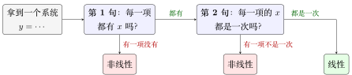{ .notes-fig loading=lazy }

<strong>图 4</strong> 线性系统的两句话判断法。
{: .fig-caption }

| 系统 | 两句话检查 | 结论 |
|:---|:---|:---|
| $y(t)=3x(t)+2x(t-2)$ | 两项都有 $x$，都是一次 | 线性 |
| $y[n]=n\,x[n-2]+3x[n+1]$ | 两项都有 $x$，都是一次（$n$ 是系数，不是 $x$） | 线性 |
| $y(t)=3x(t)+2$ | 第二项「$2$」<strong>没有 $x$</strong> | 非线性 |
| $y[n]=e^{x[n]}$ | 看起来「有 $x$，也只出现一次」，<strong>但要展开看</strong> | 非线性 |

▸ <strong>为什么 $e^{x[n]}$ 看起来像线性却不是。</strong> $e^{x}=1+x+\dfrac{x^2}{2!}+\cdots$（泰勒展开，Taylor expansion），里面有常数项 $1$（没有 $x$）、有 $x^2$（不是一次），两句话都不满足，所以非线性。两句话要看<strong>展开以后</strong>每一项的样子，不是看表面写法。

可跳过

<strong>两句话的边界</strong>：$x$ 被套在函数里，如 $|x(t)|$、$\sin x(t)$，和 $e^{x}$ 是同一类陷阱；两个 $x$ 相乘，如 $x(t)\,x(t-1)$，「一次」就不满足；真要严格证明，还是回到齐次 + 叠加。

### 2.6 与教材定义的等价

教材把两条合成一条（教材第 28 页，式 1-89、1-90）。两种定义<strong>完全等价</strong>，关键在「任意」。

|  | 内容 |
|:---|:---|
| 分开写 | 两条分开写：齐次性 $x(t)\to y(t)\Rightarrow a\,x(t)\to a\,y(t)$；叠加性 $x_1\to y_1,\ x_2\to y_2\Rightarrow x_1+x_2\to y_1+y_2$。 |
| 合并写 | 一条合起来写：对任意 $x_1\to y_1$、$x_2\to y_2$ 和任意实数 $a,b$，都有 $a\,x_1(t)+b\,x_2(t)\to a\,y_1(t)+b\,y_2(t)$。 |

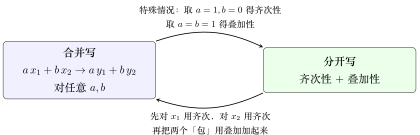{ .notes-fig loading=lazy }

<strong>图 5</strong> 两个定义互相推得出对方，所以说它们等价。
{: .fig-caption }

▸ <strong>合并写 $\Rightarrow$ 分开写（简单）。</strong> 取 $b=0$（$a$ 任意），$x_1=x$：$a\,x+0\to a\,y+0$，即齐次性 $a\,x\to a\,y$。取 $a=b=1$：直接得到叠加性。

▸ <strong>分开写 $\Rightarrow$ 合并写（稍难）。</strong> <strong>已知</strong>（分开写的定义，对<strong>任意</strong>输入都成立）。为避免和后面的 $a,b$ 混淆，齐次性里的倍数换用字母 $c$：

-   齐次性：若 $x\to y$，则对任意实数 $c$，有 $c\,x\to c\,y$；

-   叠加性：若 $x_A\to y_A$、$x_B\to y_B$，则 $x_A+x_B\to y_A+y_B$。

<strong>要证</strong>（合并写的定义）：任取 $x_1\to y_1$、$x_2\to y_2$，任取实数 $a,b$，都有

$$
a\,x_1(t)+b\,x_2(t)\ \to\ a\,y_1(t)+b\,y_2(t).
$$

<strong>证明</strong>。分三步，只用 (H) 和 (S)，完全不去管系统「里面」具体是什么运算：

1.  <strong>对 $x_1$ 用 (H)，取 $c=a$。</strong>$x_1$ 是任意输入，已知 $x_1\to y_1$，所以 (H) 对它成立：

    $$
    a\,x_1(t)\ \to\ a\,y_1(t).
    $$

2.  <strong>对 $x_2$ 用 (H)，取 $c=b$。</strong>$x_2$ 也是任意输入，已知 $x_2\to y_2$，$b$ 是任意实数，所以

    $$
    b\,x_2(t)\ \to\ b\,y_2(t).
    $$

3.  <strong>把前两步的结果当作两个输入，用 (S)。</strong>令 $u(t)=a\,x_1(t)$，$v(t)=b\,x_2(t)$。它们各自只是一个信号（「一包」）；由第 1、2 步，$u\to a\,y_1$，$v\to b\,y_2$。(S) 对<strong>任意</strong>两个输入都成立，取 $x_A=u$、$x_B=v$，$y_A=a\,y_1$、$y_B=b\,y_2$，得

    $$
    u+v\ \to\ a\,y_1+b\,y_2,\qquad\text{即}\qquad a\,x_1(t)+b\,x_2(t)\ \to\ a\,y_1(t)+b\,y_2(t).
    $$

$x_1,x_2,a,b$ 都是任取的，所以合并写的定义对<strong>任意</strong>输入、任意 $a,b$ 成立。证毕。

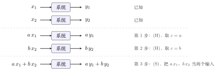{ .notes-fig loading=lazy }

<strong>图 6</strong> 分开写 $\Rightarrow$ 合并写：先用齐次性分别把 $x_1$、$x_2$ 放大成 $a\,x_1$、$b\,x_2$，再用叠加性把两个放大后的信号加起来。每一行的「系统」仍是<strong>同一台</strong>机器。
{: .fig-caption }

▸ <strong>几个容易卡住的地方</strong>

-   <strong>为什么能对 $x_1$ 用 (H)</strong>：(H) 里的 $x$ 是<strong>任意</strong>输入，$x_1$ 就是其中一个；(H) 里的 $c$ 是任意实数，取成 $a$ 当然允许（$a=0$ 或负数也行）。这就是「任意」的用法：把定义里的字母换成手头的具体信号和数。

-   <strong>第 1 步的输出 $a\,y_1$ 是 (H) 保证的</strong>，不是我们自己去算 $a\,x_1$ 经过系统得到的；我们根本不知道系统内部怎么算，只知道 (H)。

-   <strong>第 3 步为什么不是「直接相加」</strong>：$a\,x_1$ 和 $b\,x_2$ 的输出 $a\,y_1$、$b\,y_2$ 是第 1、2 步得到的结论；要把「两个输入的和」对应到「两个输出的和」，靠的是 (S)，不能省。(S) 只管「两个输入相加」，所以要先用 (H) 把 $a,b$ 吸收进信号里，凑成 (S) 的形状。

若觉得绕、烧脑，核心是没有理解「任意」。日常用哪个都行：分开写更适合入门证明，合并写更适合推别的结论。

### 2.7 思考题：缺一不可

重点

1.  请举一个系统，<strong>满足齐次性，不满足叠加性</strong>；

2.  请再举一个系统，<strong>满足叠加性，不满足齐次性</strong>。

两道里<strong>有一道特别难</strong>（提示：$a$ 可取负数）。

可跳过

<strong>第 1 道</strong>：$y(t)=\dfrac{x(t)^2}{x(t-1)}$（分母为 $0$ 时约定输出 $0$）满足齐次性：$\dfrac{a^2x(t)^2}{a\,x(t-1)}=a\cdot\dfrac{x(t)^2}{x(t-1)}$；但取某一时刻 $(x_1(t),x_1(t-1))=(1,1)$、$(x_2(t),x_2(t-1))=(1,2)$，则 $y_1=1$、$y_2=\tfrac12$，而和的输出是 $\tfrac{2^2}{3}=\tfrac43\neq\tfrac32$，叠加性不成立。第 2 道很难：$a$ 取任意实数时，叠加性已能推出整数、分数的齐次性，反例只能靠「病态」函数（柯西函数方程的非线性解，需借助选择公理）。

## 3 时不变系统

### 3.1 概念

重点

假设对<strong>任意</strong>输入 $x(t)$，系统给出输出 $y(t)$。如果对<strong>任意实数</strong> $t_0$，都有

$$
x(t-t_0)\ \to\ y(t-t_0),
$$

那么它是<strong>时不变系统</strong>(time-invariant system)；否则是<strong>时变系统</strong>(time-varying system)。

<em>直观理解：输入晚到 $t_0$ 秒，输出也恰好晚 $t_0$ 秒，形状一点不变。</em>

$x(t-t_0)$ 就是把 $x$ <strong>右移 $t_0$ 个单位</strong>（$t_0$ 为负则左移）。

时不变：同样的输入无论何时送入，输出都一样；若输出随送入时刻改变，就是时变。系统的输出不随输入送入的时刻而改变。

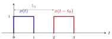{ .notes-fig loading=lazy }

<strong>图 7</strong> 时不变：输入整体右移 $t_0$，输出也只是同样右移 $t_0$，形状不变，即 $x(t-t_0)\to y(t-t_0)$。
{: .fig-caption }

### 3.2 证明

重点

<strong>证</strong>时不变：必须严格按定义证。设中间变量 $f(t)=x(t-t_0)$，代进系统的规矩，得到「实际」输出；再把 $y(t)$ 里所有的 $t$ 换成 $t-t_0$，得到「希望」输出。两边相等就是时不变。

<strong>证</strong>时变：举一个反例，列出「实际」和「希望」，二者不等即可。

### 3.3 做题步骤：固定写两行

<strong>固定写两行，按部就班不容易代错。</strong>

1.  <strong>先用口诀预判</strong>：$x$ 括号外有没有随 $t$ 变的项？括号里是不是只有 $t$ 加减常数？两条都过，多半时不变；有一条不过，多半时变。带积分或求和的系统口诀不灵，直接走下面几步（积分要换元，例子见例 5）。

2.  <strong>写出系统规矩</strong>：用中间变量 $f$ 表示「送进来的任意信号」，把系统写成 $f(t)\to\cdots$。例：$x(2t)$ 写成 $f(t)\to f(2t)$；$t\,x(t)$ 写成 $f(t)\to t\,f(t)$。

3.  <strong>第一行，写「实际」</strong>（先移输入，再过系统）：令 $f(t)=x(t-t_0)$，先写出它的入口规则 $f(\square)=x(\square-t_0)$，再把系统规矩里要的东西填进 $\square$。系统自带的东西（$2t$ 里的 $2$、$\cos t$、单独的 $t$）<strong>原样保留，不跟着 $t_0$ 动</strong>。

4.  <strong>第二行，写「期望」</strong>（先过系统，再移输出）：先写出 $y(\square)$ 的规则，再把 $\square$ 换成 $t-t_0$：$y(t)$ 里<strong>所有</strong>的 $t$ 一起换。

5.  <strong>比较两行</strong>。对任意 $t_0$ 都相等，是时不变，$\blacksquare$；不等，是时变。证时变时再取一个具体的 $x$（矩形脉冲、阶跃、单位脉冲）和一个具体的 $t_0$（如 $1$），算出两个不同的结果，$\blacksquare$。

<strong>时变的两种来源</strong>（看到哪一种，就知道「实际」和「期望」会在哪里分家）：

| 类型 | 例子 | 为什么「实际」$\neq$「期望」 |
|:---|:---|:---|
| 对 $t$ 缩放或反转 | $x(2t)$、$x(-t)$、$x[3-n]$ | 「实际」里输入的平移被系统打折（$x(2t)$：$t_0$ 变成 $t_0/2$）或反向；「期望」是原样平移 |
| 括号外挂着随 $t$ 变的项（乘或加都算） | $t\,x(t)$、$x(t)\cos t$、$x(t)+\cos t$ | 这一项是系统自带的，钉在时间轴上：输入挪了它不动；而「期望」是整个输出一起平移，它跟着挪 |

<strong>三个最容易犯的错</strong>：

1.  把 $y(t-t_0)$ 当成「延时输入之后的输出」。它是先过系统再延时，是「期望」；

2.  算「实际」时把系统里的 $2$ 也乘到 $t_0$ 上，写成 $x\bigl(2(t-t_0)\bigr)$；

3.  以为 $\cos t$、$t$ 这类系统自带的项会跟着输入一起延时。

### 3.4 例题：证明时不变

例 1 <strong>$y(t)=x(t-1)$</strong> 时不变
{: .ex-head }

<strong>系统</strong>：$x(t)\to y(t)=x(t-1)$，即输入右移 $1$ 个单位。

<strong>证明</strong>。任取 $t_0$。

-   实际：输入 $f(t)=x(t-t_0)$，输出 $f(t-1)=x\bigl((t-1)-t_0\bigr)=x(t-1-t_0)$；

-   期望：$y(t-t_0)=x\bigl((t-t_0)-1\bigr)=x(t-1-t_0)$。

实际 $=$ 期望，对任意 $t_0$ 成立，故 $y(t)=x(t-1)$ 为时不变系统。$\blacksquare$

例 2 <strong>$y(t)=e^{x(t+1)}$</strong> 时不变
{: .ex-head }

<strong>系统</strong>：$f(t)\to e^{f(t+1)}$。

<strong>证明</strong>。任取 $t_0$。

-   实际：输入 $f(t)=x(t-t_0)$，输出 $e^{f(t+1)}=e^{x(t+1-t_0)}$；

-   期望：$y(t-t_0)=e^{x((t-t_0)+1)}=e^{x(t+1-t_0)}$。

实际 $=$ 期望，对任意 $t_0$ 成立，故 $y(t)=e^{x(t+1)}$ 为时不变系统。$\blacksquare$

例 3 <strong>微分器 $y(t)=\dfrac{\mathrm{d}x(t)}{\mathrm{d}t}$</strong> 时不变
{: .ex-head }

<strong>系统</strong>：$f(t)\to\dfrac{\mathrm{d}f(t)}{\mathrm{d}t}$。$x'$ 表示 $x$ 的导函数。

<strong>证明</strong>。任取 $t_0$。

-   实际：输入 $f(t)=x(t-t_0)$，输出 $\dfrac{\mathrm{d}}{\mathrm{d}t}\,x(t-t_0)=x'(t-t_0)$（括号里的 $t-t_0$ 对 $t$ 的导数是 $1$，不会多出系数）；

-   期望：$y(t)=x'(t)$，故 $y(t-t_0)=x'(t-t_0)$。

实际 $=$ 期望，对任意 $t_0$ 成立，故微分器为时不变系统。$\blacksquare$

数字看一眼：取 $x(t)=t^2$，$t_0=1$。输入 $(t-1)^2$ 的导数是 $2(t-1)$，$y(t-1)=2(t-1)$，两边一样。直觉：曲线整体右移，每一点附近的变化率也跟着右移，形状不变。

例 4 <strong>差分 $y[n]=x[n]-x[n-1]$</strong> 时不变
{: .ex-head }

<strong>系统</strong>：$f[n]\to f[n]-f[n-1]$（当前值减前一个值）。离散信号的时不变，是对任意<strong>整数</strong> $n_0$：输入 $x[n-n_0]$ 时，输出 $y[n-n_0]$。

<strong>证明</strong>。任取整数 $n_0$。

-   实际：输入 $f[n]=x[n-n_0]$，则 $f[n-1]=x\bigl[(n-1)-n_0\bigr]$，输出 $f[n]-f[n-1]=x[n-n_0]-x[n-1-n_0]$；

-   期望：$y[n]=x[n]-x[n-1]$，故 $y[n-n_0]=x[n-n_0]-x\bigl[(n-n_0)-1\bigr]=x[n-n_0]-x[n-1-n_0]$。

实际 $=$ 期望，对任意整数 $n_0$ 成立，故差分为时不变系统。$\blacksquare$

数字看一眼：输入单位脉冲 $\delta[n]$，输出 $\delta[n]-\delta[n-1]$（$n=0$ 处为 $1$，$n=1$ 处为 $-1$）。输入右移 $2$ 变成 $\delta[n-2]$，输出 $\delta[n-2]-\delta[n-3]$（$n=2$ 处为 $1$，$n=3$ 处为 $-1$），正好是原输出右移 $2$。口诀也直接过：$n$ 只在括号里，只是 $n$ 和 $n-1$。

例 5 <strong>积分器 $y(t)=\displaystyle\int_{-\infty}^{t}x(\tau)\,\mathrm{d}\tau$</strong> 时不变
{: .ex-head }

<strong>系统</strong>：$f(t)\to\displaystyle\int_{-\infty}^{t}f(\tau)\,\mathrm{d}\tau$。$t$ 在积分上限，口诀按字面会判成时变，所以必须回到定义。

<strong>证明</strong>。任取 $t_0$。

-   实际：输入 $f(\tau)=x(\tau-t_0)$，输出 $\displaystyle\int_{-\infty}^{t}x(\tau-t_0)\,\mathrm{d}\tau$。令 $s=\tau-t_0$（理由见下文），则 $\mathrm{d}\tau=\mathrm{d}s$；$\tau=-\infty$ 时 $s=-\infty$，$\tau=t$ 时 $s=t-t_0$。于是输出 $=\displaystyle\int_{-\infty}^{t-t_0}x(s)\,\mathrm{d}s$；

-   期望：$y(t)=\displaystyle\int_{-\infty}^{t}x(\tau)\,\mathrm{d}\tau$，把所有 $t$ 换成 $t-t_0$，$y(t-t_0)=\displaystyle\int_{-\infty}^{t-t_0}x(\tau)\,\mathrm{d}\tau$。积分变量只是计数的名字（哑变量，dummy variable），写成 $\tau$ 还是 $s$ 结果一样，故 $=\displaystyle\int_{-\infty}^{t-t_0}x(s)\,\mathrm{d}s$。

实际 $=$ 期望，对任意 $t_0$ 成立，故积分器为时不变系统。$\blacksquare$

数字看一眼：取 $x$ 为 $[0,1]$ 上等于 $1$ 的矩形，$t_0=1$。原输出：$t\lt{}0$ 为 $0$，$0\le t\le1$ 为 $t$（斜坡），$t\gt{}1$ 停在 $1$。输入右移 $1$ 变成 $[1,2]$ 上的矩形，实际输出：$t\lt{}1$ 为 $0$，$1\le t\le2$ 为 $t-1$，$t\gt{}2$ 停在 $1$，正好是原输出右移 $1$。

可跳过

<strong>为什么要令 $s=\tau-t_0$</strong>。

1.  <strong>目的</strong>：「实际」那行里被积的是<strong>挪过的</strong> $x(\tau-t_0)$，而 $y$ 的定义只会算「$x$ 本人」的积分，两边长得不一样，没法比。把 $\tau-t_0$ 整个起个新名字 $s$，被积函数还原成 $x(s)$，才能和「期望」对上。

2.  <strong>代价</strong>：积分范围也要用新名字重算：上限 $t$ 变成 $t-t_0$，下限 $-\infty$ 不变；$\mathrm{d}\tau$ 变成 $\mathrm{d}s$（$t_0$ 是常数）。

3.  <strong>效果</strong>：平移从被积函数里「搬」到了积分上限里。直觉：曲线右移 $t_0$ 再累计到 $t$，等于曲线不动，只累计到 $t-t_0$。

例 6 <strong>累加器 $y[n]=\displaystyle\sum_{k=-\infty}^{n}x[k]$</strong> 时不变
{: .ex-head }

<strong>系统</strong>：$f[n]\to\displaystyle\sum_{k=-\infty}^{n}f[k]$。它是离散的积分器，$n$ 同样在求和上限，口诀不适用。证法和积分器一样，只是把积分换成求和、$\tau$ 换成 $k$。

<strong>证明</strong>。任取整数 $n_0$。

-   实际：输入 $f[k]=x[k-n_0]$，输出 $\displaystyle\sum_{k=-\infty}^{n}x[k-n_0]$。令 $m=k-n_0$：$k=-\infty$ 时 $m=-\infty$，$k=n$ 时 $m=n-n_0$。于是输出 $=\displaystyle\sum_{m=-\infty}^{n-n_0}x[m]$；

-   期望：$y[n-n_0]=\displaystyle\sum_{k=-\infty}^{n-n_0}x[k]=\sum_{m=-\infty}^{n-n_0}x[m]$（求和下标 $k$、$m$ 只是计数的名字，叫什么都一样）。

实际 $=$ 期望，对任意整数 $n_0$ 成立，故累加器为时不变系统。$\blacksquare$

数字看一眼：输入 $\delta[n]$，输出从 $n=0$ 起全为 $1$（$n\lt{}0$ 为 $0$）。输入右移 $2$ 变成 $\delta[n-2]$，输出从 $n=2$ 起全为 $1$，正好是原输出右移 $2$。

微分器、积分器、差分、累加器这四个都是时不变。它们的规则只看「相对位置」（和前一刻比，或从最早累积到现在），不看「几点钟」；输入整体挪了，「现在」跟着挪，输出也就只是整体跟着挪。

### 3.5 例题：证明时变（反例）

例 7 <strong>$y(t)=x(2t)$</strong> 时变
{: .ex-head }

<strong>系统</strong>：$x(t)\to y(t)=x(2t)$，即波形沿时间轴压缩 $2$ 倍。

<strong>证明</strong>（举反例）。取 $x(t)=1$（$0\le t\le1$），其余为 $0$；取 $t_0=1$。

-   实际：输入 $x(t-1)$ 在 $1\le t\le2$ 上为 $1$，经系统压缩后在 $0.5\le t\le1$ 上为 $1$；

-   期望：若时不变，输出应为 $y(t-1)$，即 $y(t)$ 右移 $1$，在 $1\le t\le1.5$ 上为 $1$。

实际 $\neq$ 期望，故 $y(t)=x(2t)$ 为时变系统。$\blacksquare$

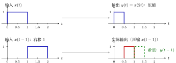{ .notes-fig loading=lazy }

<strong>图 8</strong> $y(t)=x(2t)$ 的反例：第二行红色（实际）和绿色虚线（希望）不在同一位置，所以是时变系统。
{: .fig-caption }

可跳过

<strong>为什么「实际」是 $x(2t-t_0)$，而不是 $x\bigl(2(t-t_0)\bigr)$</strong>。这是最容易绕晕的一步，关键是看清<strong>入口 $\square$ 里填的是什么</strong>。把函数当成一台机器，括号里的 $\square$ 是入口：

-   $y$ 这台机器（$y(t)=x(2t)$）：<strong>进去一个数，先乘 $2$，再交给 $x$</strong>，即 $y(\square)=x(2\square)$；

-   $f$ 这台机器（$f(t)=x(t-t_0)$）：<strong>进去一个数，先减 $t_0$，再交给 $x$</strong>，即 $f(\square)=x(\square-t_0)$。

| 路线 | 把什么填进哪台机器 | 结果 |
|:---|:---|:---|
| 实际：先移输入，再过系统 | 系统规矩 $f(t)\to f(2t)$：把 $2t$ 填进 $f$（先减 $t_0$） | $x(2t-t_0)$ |
| 期望：先过系统，再移输出 | 把 $t-t_0$ 填进 $y$（先乘 $2$） | $x\bigl(2(t-t_0)\bigr)=x(2t-2t_0)$ |

两条路里「乘 $2$」和「减 $t_0$」的先后次序相反，所以结果不同。注意：$y(t-t_0)$ 是「先过系统，再延时输出」，那是<strong>期望</strong>，不是延时输入之后的输出。

<strong>代数字看</strong>：取 $t_0=1$、看 $t=3$ 这一刻，实际取 $x(2\cdot3-1)=x(5)$，期望取 $x(2\cdot3-2)=x(4)$，两边读的是 $x$ 在不同位置的值。用上面的矩形（$0\le t\le1$ 为 $1$）：实际 $x(2t-1)$ 在 $0.5\le t\le1$ 为 $1$，期望 $x(2t-2)$ 在 $1\le t\le1.5$ 为 $1$，正是图里的红色和绿色虚线。

<strong>换个写法</strong>：$x(2t-t_0)=x\bigl(2(t-\tfrac{t_0}{2})\bigr)$。输入右移了 $t_0$，输出却只右移 $\tfrac{t_0}{2}$（延迟被压缩打了对折）；时不变要求输出也右移 $t_0$，对不上。推广：$x(at)$ 的输入右移 $t_0$，输出只右移 $t_0/a$，只要 $a\neq1$ 就是时变。

例 8 <strong>$y(t)=t\,x(t)$</strong> 时变
{: .ex-head }

<strong>系统</strong>：$x(t)\to y(t)=t\,x(t)$。

<strong>证明</strong>（举反例）。取 $x(t)=u(t)$（单位阶跃：$t\gt{}0$ 为 $1$，$t\lt{}0$ 为 $0$），$t_0=1$。

-   实际：输入 $u(t-1)$，输出 $t\,u(t-1)$：$t\lt{}1$ 时为 $0$，$t\ge1$ 时等于 $t$；

-   期望：$y(t-1)=(t-1)\,u(t-1)$：$t\lt{}1$ 时为 $0$，$t\ge1$ 时等于 $t-1$。

$t\ge1$ 时两者相差 $1$（如 $t=1$：实际为 $1$，期望为 $0$），故 $y(t)=t\,x(t)$ 为时变系统。$\blacksquare$

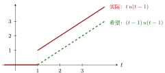{ .notes-fig loading=lazy }

<strong>图 9</strong> $y(t)=t\,x(t)$ 的反例，输入 $u(t-1)$：实际输出（红）在 $t=1$ 处直接跳到 $1$，而希望的输出（绿虚线）是从 $0$ 开始爬。两条线上下错开了整整 $1$。
{: .fig-caption }

例 9 <strong>$y[n]=x[3-n]$</strong> 时变
{: .ex-head }

<strong>系统</strong>：$x[n]\to y[n]=x[3-n]$。$n$ 前的负号把平移变成了反向平移。

<strong>证明</strong>（举反例）。取 $x[n]=\delta[n]$（单位脉冲：只在 $n=0$ 处为 $1$）。

-   输入 $\delta[n]$，输出 $y[n]=\delta[3-n]$，脉冲在 $n=3$；

-   输入 $\delta[n-1]$（右移 $1$），实际输出 $y[n]=\delta[(3-n)-1]=\delta[2-n]$，脉冲在 $n=2$；

-   期望：若时不变，输出应是第 1 步结果的右移 $1$，脉冲在 $n=4$。

实际（$n=2$）$\neq$ 期望（$n=4$），故 $y[n]=x[3-n]$ 为时变系统。$\blacksquare$

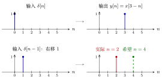{ .notes-fig loading=lazy }

<strong>图 10</strong> $y[n]=x[3-n]$ 的反例：输入右移 1，实际输出的脉冲不是右移到 $4$，而是左移到 $2$。
{: .fig-caption }

例 10 <strong>$y(t)=x(t)+\cos t$</strong> 时变
{: .ex-head }

<strong>系统</strong>：$f(t)\to f(t)+\cos t$。式子里的 $\cos t$ 是<strong>系统自带</strong>的，不是输入的一部分：输入右移，它不动；把整个输出右移，它才跟着一起动。

<strong>证明</strong>。任取 $t_0$。

-   实际：输入 $f(t)=x(t-t_0)$，输出 $f(t)+\cos t=x(t-t_0)+\cos t$；

-   期望：$y(t-t_0)=x(t-t_0)+\cos(t-t_0)$。

两者相差 $\cos t-\cos(t-t_0)$。取 $x(t)\equiv0$、$t_0=\dfrac{\pi}{2}$、$t=0$：实际 $=\cos0=1$，期望 $=\cos\bigl(-\dfrac{\pi}{2}\bigr)=0$，不等，故 $y(t)=x(t)+\cos t$ 为时变系统。$\blacksquare$

对照：$y(t)=x(t)+5$ 加的是常数，实际 $x(t-t_0)+5=$ 期望 $x(t-t_0)+5$，是时不变。

### 3.6 时不变的快速判据：两句话

这个办法能覆盖 80% 以上的常见系统。

重点

时不变系统的判据：

1.  <strong>$t$ 只在 $x$ 的括号里</strong>（括号外面不能再有 $t$）；

2.  <strong>$t$ 只能是 $t$</strong>，不能是 $2t$、$-2t$、$t^2$ 等其他函数。

离散的时候把 $t$ 换成 $n$。

| 系统            | 两句话检查                                        | 结论   |
|:----------------|:--------------------------------------------------|:-------|
| $y(t)=x(t-1)$   | $t$ 只在括号里，括号里就是 $t$（平移了 1）        | 时不变 |
| $y(t)=e^{x(t)}$ | $t$ 只在括号里，括号里是 $t$                      | 时不变 |
| $y(t)=x(2t)$    | 括号里是 $2t$，不只是 $t$                         | 时变   |
| $y(t)=t\,x(t)$  | 有一个 $t$ 跑到了 $x$ 的<strong>括号外面</strong> | 时变   |
| $y[n]=x[3-n]$   | 括号里是 $3-n$，$n$ 前面有<strong>负号</strong>   | 时变   |

可跳过

<strong>一处要留意</strong>：第 2 句应读成「括号里是 $t$ 加减一个<strong>常数</strong>（只平移）」；乘系数（$2t$）、取反（$-t$、$3-n$）、平方（$t^2$）才算「其他函数」。

可跳过

<strong>口诀的两处提醒</strong>。

1.  第 1 条的「括号外不能有 $t$」，<strong>乘和加都算</strong>：$t\,x(t)$、$x(t)\cos t$、$x(t)+\cos t$ 都是时变。括号外是<strong>常数</strong>不算：$3x(t)$、$x(t)+5$ 仍是时不变。

2.  口诀只是筛查，不是定义；带积分的系统要回到定义。例如积分器 $y(t)=\displaystyle\int_{-\infty}^{t}x(\tau)\,\mathrm{d}\tau$：$t$ 在积分上限，跑到了 $x$ 的括号外面，口诀按字面会判成时变，但它其实是时不变（证明见例 5），离散的累加器同理（例 6）。

### 3.7 练习：五道

先盖住结论自己判，再对答案。每题先用口诀预判，再按「做题步骤」写两行；证时变要取具体的 $x$ 和 $t_0$。

▸ <strong>练习 1$y(t)=x(t-1)+2$：时不变</strong>

-   实际：$f(t)=x(t-t_0)$，输出 $f(t-1)+2=x(t-1-t_0)+2$；

-   期望：$y(t-t_0)=x\bigl((t-t_0)-1\bigr)+2=x(t-1-t_0)+2$。

相等，时不变。$+2$ 是常数，不随 $t$ 变，不影响。

▸ <strong>练习 2$y(t)=x(2t)+3$：时变</strong>

-   实际：输出 $f(2t)+3=x(2t-t_0)+3$；

-   期望：$y(t-t_0)=x\bigl(2(t-t_0)\bigr)+3=x(2t-2t_0)+3$。

取例 7 的矩形（$0\le t\le1$ 为 $1$）和 $t_0=1$：实际在 $0.5\le t\le1$ 上比 $3$ 高 $1$，期望在 $1\le t\le1.5$ 上比 $3$ 高 $1$，位置不同。$+3$ 无害，问题出在 $2t$。

▸ <strong>练习 3$y(t)=x(t)\cos 2t$：时变</strong>

-   实际：$x(t-t_0)\cos2t$（系统自带的 $\cos2t$ 不动）；

-   期望：$x(t-t_0)\cos\bigl(2(t-t_0)\bigr)$。

取 $x(t)\equiv1$、$t_0=\dfrac{\pi}{4}$、$t=0$：实际 $=\cos0=1$，期望 $=\cos\bigl(-\dfrac{\pi}{2}\bigr)=0$，不等。<strong>$t_0$ 不能乱取</strong>：$\cos2t$ 的周期是 $\pi$，取 $t_0=\pi$ 时两行恰好相等。时不变要求对<strong>任意</strong> $t_0$ 成立，所以证时变时要挑一个不相等的 $t_0$。

▸ <strong>练习 4$y(t)=x(t+1)\,x(t-1)$：时不变（易错：非线性不等于时变）</strong>

-   实际：输出 $f(t+1)f(t-1)=x(t+1-t_0)\,x(t-1-t_0)$；

-   期望：$y(t-t_0)=x\bigl((t-t_0)+1\bigr)\,x\bigl((t-t_0)-1\bigr)=x(t+1-t_0)\,x(t-1-t_0)$。

相等，时不变。数字看一眼：取 $x$ 为 $[0,3]$ 上等于 $1$ 的矩形，$t_0=1$。原输出在 $[1,2]$ 为 $1$；输入右移 $1$ 后，实际输出在 $[2,3]$ 为 $1$，正是原输出右移 $1$。

两个 $x$ 相乘是非线性，但时不变只看「括号外有没有随 $t$ 变的项、括号里是不是只有 $t$ 加减常数」，和线性无关。两个括号里的数不一样（$t+1$、$t-1$）只说明系统有记忆，是另一对性质。

▸ <strong>练习 5$y(t)=x(t)\,x(-t)$：时变</strong>

-   实际：输出 $f(t)f(-t)=x(t-t_0)\,x(-t-t_0)$；

-   期望：$y(t-t_0)=x(t-t_0)\,x\bigl(-(t-t_0)\bigr)=x(t-t_0)\,x(t_0-t)$。

取 $x$ 为 $[-1,1]$ 上等于 $1$ 的矩形，$t_0=1$：原输出在 $[-1,1]$ 为 $1$，期望是它右移 $1$，在 $[0,2]$ 为 $1$。实际：输入右移后在 $[0,2]$，$f(-t)$ 在 $[-2,0]$，两段只在 $t=0$ 一点相遇，输出除这一点外全为 $0$。原因是 $x(-t)$ 把方向反了：输入向右挪，这一项在输出里向左挪，和例 9 的 $x[3-n]$ 同一类。

## 4 因果系统

### 4.1 概念

重点

<strong>因果系统</strong>(causal system)：任何时刻的输出，只取决于<strong>现在和过去</strong>的输入，不取决于未来的输入（教材 P29 的定义）。

形象地说，输出 $y(t)$ 在输入 $x(t)$ 之后发生：输入 $x$ <strong>从 $t_0$ 才开始有值</strong>，输出 $y$ <strong>从 $t_1$ 才开始有值</strong>，则<strong>系统是因果的，当且仅当 $t_1\ge t_0$</strong>。若 $t_1\lt{}t_0$，输入还没来，输出就「未卜先知」地出来了，是<strong>非因果系统</strong>(non-causal system)。

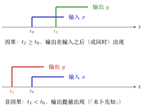{ .notes-fig loading=lazy }

<strong>图 11</strong> 因果与非因果：比较两个「起点」$t_0$（输入从这里开始）和 $t_1$（输出从这里开始）。
{: .fig-caption }

说明

-   教材定义（P29）为准：「输出在输入之后」只是形象说法。

-   现实系统不具备预知能力，所以非因果系统<strong>物理上难以实现</strong>。

### 4.2 证明：判据

重点

<strong>因果的判据</strong>：$x$ 括号里的数，<strong>恒</strong>不大于 $y$ 括号里的数。

只要有<strong>任何一个时刻</strong>，$x$ 括号里的数比 $y$ 的更大，就是非因果。

### 4.3 例题

| 系统 | $x$ 括号里 vs $y$ 括号里（$t$ 或 $n$） | 结论 |
|:---|:---|:---|
| $y(t)=x(t-1)$ | $t-1\lt{}t$，恒成立 | 因果 |
| $y(t)=x(t+1)$ | $t+1\gt{}t$，输出比输入早一个单位 | 非因果 |
| $y(t)=x(2t)$ | $t\gt{}0$ 时 $2t\gt{}t$。反例：输入从 $t=1$ 开始，压缩 2 倍后输出从 $t=\tfrac12$ 开始，<strong>提前</strong> | 非因果 |
| $y(t)=x(\tfrac12 t)$ | $t\lt{}0$ 时 $\tfrac12t\gt{}t$（如 $t=-2$，$\tfrac12t=-1\gt{}-2$）。反例：输入从 $t=-1$ 开始，拉伸 2 倍后输出从 $t=-2$ 开始，<strong>早</strong> | 非因果 |
| $y[n]=x[3-n]$ | $3-n$ 和 $n$ 没有恒定的大小关系 | 非因果 |

$x(\tfrac12t)$ 这一题要换到 $t\lt{}0$：取 $t\gt{}0$ 时 $\tfrac12t\lt{}t$，用到的是过去的输入，看不出问题；但<strong>只要有一处时刻</strong>用到未来，就是非因果。

## 5 记忆与无记忆系统

### 5.1 概念

重点

<strong>无记忆系统</strong>(memoryless system)：<strong>$y(t)$ 的值仅仅依赖于 $x(t)$ 的值</strong>（同一时刻的输入）。离散时把圆括号换成方括号。反面是<strong>记忆系统</strong>(system with memory)。

直观理解：无记忆像<strong>计算器</strong>，按下哪个数立刻出结果，只看这一次按键；记忆像<strong>银行余额</strong>，取决于过去所有的存取记录。

{ .notes-fig loading=lazy }

<strong>图 12</strong> 无记忆：$y(t)$ 只由同一时刻的 $x(t)$ 决定；有记忆：还要用到其它时刻的输入。
{: .fig-caption }

### 5.2 证明：判据

重点

<strong>无记忆的判据</strong>：$x$ 和 $y$ 括号里的数<strong>完全一样</strong>。（因果是「不大于」，无记忆是「相等」。）

### 5.3 例题

| 系统                   | 结论   | 理由                                |
|:-----------------------|:-------|:------------------------------------|
| $y(t)=x(t)^2+e^{x(t)}$ | 无记忆 | $y(t)$ 只依赖 $x(t)$                |
| $y(t)=x(t-1)$          | 记忆   | $y(t)$ 依赖 $t-1$ 时刻的值          |
| $y[n]=x[n]^3$          | 无记忆 | 只依赖同一个 $n$ 的值               |
| $y[n]=x[2n]$           | 记忆   | $n$ 点的输出依赖 $x$ 在 $2n$ 点的值 |

▸ <strong>无记忆系统一定是因果系统吗？</strong> <strong>对</strong>。因果判据是「$x$ 括号里的数恒小于或等于 $y$ 括号里的数」，无记忆两个括号里的数<strong>恰好相等</strong>，落在「等于」这一种情况里，所以一定因果；反过来不成立：$y(t)=x(t-1)$ 因果但有记忆。

## 6 可逆系统

### 6.1 概念

重点

<strong>可逆系统</strong>(invertible system)：<strong>$x(t)$ 能唯一地写成 $y(t)$ 的形式</strong>。三种等价的说法：

-   从输出可以<strong>唯一地</strong>倒推出输入；

-   $y(t)$ 和 $x(t)$ 是<strong>一一对应</strong>的映射；

-   $y=f(x)$ <strong>有反函数</strong>。

这与「什么函数有反函数」同理。

{ .notes-fig loading=lazy }

<strong>图 13</strong> 可逆：存在逆系统把输出唯一地还原成输入；两个不同输入给出同一输出时不可逆。
{: .fig-caption }

### 6.2 证明：判据

能把 $x$ 用 $y$ 写出来（写得出逆），就可逆；若有两个不同的输入给出同一个输出（或倒推时出现多个解），就不可逆。

### 6.3 例题

| 系统 | 结论 | 理由 |
|:---|:---|:---|
| $y(t)=x(t-1)$ | 可逆 | $x(t)=y(t+1)$ |
| $y(t)=x(t)^2$ | <strong>不可逆</strong> | $x(t)=\pm\sqrt{y(t)}$，一个 $y$ 对应<strong>两个</strong>不同的 $x$ |
| $y(t)=x(2t)$ | 可逆 | $x(t)=y(\tfrac12t)$ |
| 累加器 $y[n]=\displaystyle\sum_{k=-\infty}^{n}x[k]$ | 可逆 | $x[n]=y[n]-y[n-1]$（相邻两个累加一减，刚好剩下 $x[n]$） |
| 积分器 $y(t)=\displaystyle\int_{-\infty}^{t}x(\tau)\,\mathrm{d}\tau$ | 可逆 | $x(t)=\dfrac{\mathrm{d}y(t)}{\mathrm{d}t}$ |
| 微分器 $y(t)=\dfrac{\mathrm{d}x(t)}{\mathrm{d}t}$ | <strong>不可逆</strong> | $x(t)=\displaystyle\int_{-\infty}^{t}y(\tau)\,\mathrm{d}\tau+C$，常数 $C$ 可取任意值，倒推不唯一 |

累加器的逆：把 $y[n]$ 与 $y[n-1]$ 相减，只剩 $x[n]$。结论：<strong>积分器、累加器可逆，微分器不可逆</strong>。

<strong>微分器为什么不可逆</strong>：求导会把常数丢掉。$x(t)=5$ 和 $x(t)=7$ 求导后都是 $0$，倒推时说不清原来是 $5$ 还是 $7$，这就是「$+C$」的来源。积分器每一刻都在累积，信息没有丢，所以可以求导还原。

## 7 稳定系统

### 7.1 概念：有界进，有界出

设 $x(t)\to y(t)$。若 $x(t)$ <strong>有界</strong>就能推出 $y(t)$ <strong>有界</strong>，即「输入有界对应着输出有界」，就是<strong>稳定系统</strong>(stable system)；若有界的输入能对应出<strong>无界</strong>的输出，就是不稳定系统。（英文教材常称 BIBO 稳定，bounded-input bounded-output。）

重点

<strong>有界</strong>(bounded)的定义：

$$
x(t)\ \text{有界}\ \Longleftrightarrow\ \text{存在}\ M,\ \text{对任意的}\ t\ \text{有}\ |x(t)|\lt{}M.
$$

画出来：$x(t)$ 始终被「上面 $+M$、下面 $-M$」两条线夹住，不可能飞到 $\pm\infty$。

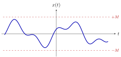{ .notes-fig loading=lazy }

<strong>图 14</strong> 有界信号：不管 $t$ 取多大多小，波形始终待在两条红色虚线之间。
{: .fig-caption }

### 7.2 证明

重点

<strong>证</strong>稳定：设 $|x(t)|\lt{}M$，推出 $|y(t)|$ 被某个固定的数夹住。这个数可以很大，只要固定就行。

<strong>证</strong>不稳定：举一个有界的输入，让输出变成无界。

### 7.3 例题：稳定

例 1 <strong>$y(t)=e^{x(t)}$</strong> 稳定
{: .ex-head }

<strong>系统</strong>：$x(t)\to y(t)=e^{x(t)}$。

<strong>证明</strong>。设输入有界：$|x(t)|\lt{}M$。则

$$
|y(t)|=\bigl|e^{x(t)}\bigr|=e^{x(t)}\ \le\ e^{|x(t)|}\ \le\ e^{M},
$$

其中第一处不等号用到 $x(t)\le|x(t)|$ 及 $e^{u}$ 单调递增。$e^{M}$ 是与 $t$ 无关的固定上界，故 $y(t)$ 有界，系统稳定。$\blacksquare$

例 2 <strong>$y(t)=x(t)^3-2x(t)^2+x(t)+1$</strong> 稳定
{: .ex-head }

<strong>系统</strong>：$x(t)\to y(t)=x(t)^3-2x(t)^2+x(t)+1$。

<strong>证明</strong>。设 $|x(t)|\lt{}M$。由三角不等式 $|a+b+c+d|\le|a|+|b|+|c|+|d|$（并注意 $|-2x^2|=2|x|^2$），

$$
\begin{align*}
|y(t)|&=\bigl|x^3-2x^2+x+1\bigr|\\
&\le |x|^3+2|x|^2+|x|+1\\
&\le M^3+2M^2+M+1.
\end{align*}
$$

$M^3+2M^2+M+1$ 是固定上界，故 $y(t)$ 有界，系统稳定。$\blacksquare$

多项式型系统都可用同一办法：把每一项的 $|x|$ 换成 $M$，得到的数只要固定，系统就稳定——与表达式看起来多「大」无关。

### 7.4 例题：不稳定

<table>
<thead>
<tr>
<th style="text-align: left;">系统</th>
<th style="text-align: left;">结论</th>
<th style="text-align: left;">反例</th>
</tr>
</thead>
<tbody>
<tr>
<td style="text-align: left;">微分器 
\(y(t)=\dfrac{\mathrm{d}x(t)}{\mathrm{d}t}\)</td>
<td style="text-align: left;">不稳定</td>
<td style="text-align: left;">取 \(x(t)=u(t)\)（阶跃，被 \(1\) 夹住）。它在 \(t=0\) 处一下子升 \(1\)，求导得冲激 \(\delta(t)\)，在 \(t=0\) 变成<strong>无穷大</strong>，夹不住</td>
</tr>
<tr>
<td style="text-align: left;">积分器 
\(y(t)=\displaystyle\int_{-\infty}^{t}x(\tau)\,\mathrm{d}\tau\)</td>
<td style="text-align: left;">不稳定</td>
<td style="text-align: left;">取 \(x(t)\equiv1\)（被 \(M=1\) 夹住）。从 \(-\infty\) 积到 \(t\)，\(y(t)=+\infty\)，夹不住</td>
</tr>
<tr>
<td style="text-align: left;">累加器 
\(y[n]=\displaystyle\sum_{k=-\infty}^{n}x[k]\)</td>
<td style="text-align: left;">不稳定</td>
<td style="text-align: left;">同样道理</td>
</tr>
</tbody>
</table>

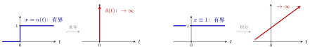{ .notes-fig loading=lazy }

<strong>图 15</strong> 左：微分器把一个有界的阶跃变成无穷大的冲激。右：积分器把一个有界的常数 $1$ 越积越大，没有上限。
{: .fig-caption }

▸ <strong>思考题。</strong> 连续的微分器不稳定，但<strong>离散的微分器</strong>（差分 $y[n]=x[n]-x[n-1]$）是<strong>稳定</strong>的，想一想为什么。

可跳过

<strong>解答</strong>：设 $|x[n]|\lt{}M$，则 $|y[n]|\le|x[n]|+|x[n-1]|\lt{}2M$，被 $2M$ 夹住，所以稳定。连续微分器不稳定，是因为连续信号可以在一瞬间跳变（跳变处导数无穷大）；离散信号每个点都是有限的数，相邻两点相减，差不会无穷大。

## 8 综合习题：教材第 33 页习题 1-16

做教材第 33 页习题 1-16，把五个性质综合起来用：

| 系统 | 线性 | 时不变 | 无记忆 | 因果 | 稳定 |
|:---|:--:|:--:|:--:|:--:|:--:|
| $y(t)=e^{x(t)}$ | $\times$ | $\checkmark$ | $\checkmark$ | $\checkmark$ | $\checkmark$ |
| $y[n]=x[n]\,x[n-1]$ | $\times$ | $\checkmark$ | $\times$ | $\checkmark$ | $\checkmark$ |
| $y(t)=\dfrac{\mathrm{d}x(t)}{\mathrm{d}t}$ | $\checkmark$ | $\checkmark$ | $\times$ | $\checkmark$ | $\times$ |

（$\checkmark$ 表示「是」，$\times$ 表示「否」。）

### 8.1 第一行 $y(t)=e^{x(t)}$

-   线性<strong>否</strong>：看上去「每项有 $x$、$x$ 一次」，但 $e^{x}=1+x+\tfrac{x^2}{2!}+\cdots$ 不是一次；

-   时不变<strong>是</strong>：$t$ 只在 $x$ 括号里，括号里只是 $t$；

-   无记忆<strong>是</strong>：$y(t)$ 只依赖 $x(t)$；

-   因果<strong>是</strong>：无记忆系统一定因果；

-   稳定<strong>是</strong>：前面例 1 证过。

### 8.2 第二行 $y[n]=x[n]\,x[n-1]$

-   线性<strong>否</strong>：两个 $x$ 相乘，$x$ 不是一次；

-   时不变<strong>是</strong>：$n$ 只在 $x$ 括号里，括号里是 $n$ 和 $n-1$（只平移）。

-   无记忆<strong>否</strong>：$y[n]$ 还跟 $x[n-1]$ 有关；

-   因果<strong>是</strong>：$x$ 括号里是 $n$ 和 $n-1$，都不大于 $y$ 括号里的 $n$；

-   稳定<strong>是</strong>：$|x[n]x[n-1]|\le M\cdot M$，被 $M^2$ 夹住。

### 8.3 第三行 微分器 $y(t)=\dfrac{\mathrm{d}x(t)}{\mathrm{d}t}$

-   线性<strong>是</strong>，时不变<strong>是</strong>：前面都证明过（时不变的证明见例 3）。

-   无记忆<strong>否</strong>：要算 $\dfrac{\mathrm{d}x}{\mathrm{d}t}$，必须知道 $t\pm\Delta t$ 那么<strong>一小点</strong>地方的值；

-   稳定<strong>否</strong>：前面讲过，微分器不稳定；

-   因果：争议最大的一格，见下。

▸ <strong>微分器是因果的吗？</strong> 这一格有争议：<strong>写因果或非因果都有依据，按导数的两种等价算法可判为因果</strong>。理由是导数是一个极限，可以有两种算法：

| 算法 | 式子 | 按因果的定义 |
|:---|:---|:---|
| 取 $t$ <strong>右边</strong>一点点 | $\displaystyle\lim_{\Delta t\to0^+}\dfrac{x(t+\Delta t)-x(t)}{\Delta t}$ | 用到了 $t+\Delta t\gt{}t$ 的值，<strong>非因果</strong> |
| 取 $t$ <strong>左边</strong>一点点 | $\displaystyle\lim_{\Delta t\to0^+}\dfrac{x(t)-x(t-\Delta t)}{\Delta t}$ | 用到的 $t-\Delta t\lt{}t$，<strong>因果</strong> |

推理：把 $y(t)$ 写成 $\dfrac{\mathrm{d}x(t)}{\mathrm{d}t}$ 本身就有一个<strong>假设</strong>：左极限和右极限<strong>相等</strong>（导数存在）。既然如此，虽然右边那个算法是非因果的，也能用底下这个因果的算法算出来，所以按这个角度它是因果的。

可跳过

<strong>直观理解</strong>：导数是「变化有多快」。要知道 $t$ 这一刻变化多快，既可以「看一眼刚才到现在涨了多少」（只用过去，因果），也可以「偷看一眼马上要涨多少」（用了未来，非因果）。导数存在时两种看法算出的数相同，因此可判为因果。

### 8.4 小测验

<strong>小测验</strong>：五分钟做五道题，逐格判断。

练习方法：盖住 $\checkmark/\times$，对每个系统逐格判断，用各节的判据：线性看「每项有 $x$、一次」；时不变看「$t$ 只在括号里、只是 $t$」；无记忆看「两个括号里的数一样」；因果看「$x$ 括号里的数恒不大于 $y$ 括号里的」；稳定看「能不能用 $M$ 夹住」。
