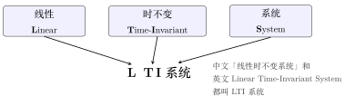
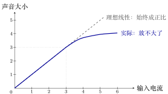
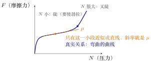

# 线性时不变（LTI）系统的定义

浙江大学 2022《信号与系统》（胡浩基）第二章开篇（教材第 35 页）听课笔记

[:material-file-pdf-box: 下载 PDF 版](pdf/03-线性时不变(LTI)系统的定义.pdf){ .md-button }

<!-- 本页由 tools/signal_notes/sync.py 从 LaTeX 笔记自动生成，请勿手改；改动请改源 .tex 后重新同步。 -->

## 1 LTI 是什么

第二章「LTI 系统的时域分析」（教材第 35 页）的研究对象是 LTI 系统，先给出它的定义。

### 1.1 名字

<strong>LTI</strong> 是 Linear Time-Invariant 的首字母：L 取自 Linear（线性），T、I 取自 Time-Invariant（时不变）。后面再加上 System（系统），就是 <strong>LTI 系统</strong>。

{ .notes-fig loading=lazy }

<strong>图 1</strong> L 取自 Linear，T、I 取自 Time-Invariant；LTI 本身只是「线性时不变」，加上「系统」才是 LTI 系统。
{: .fig-caption }

重点

<strong>如果一个系统既线性、又时不变，就叫它线性时不变系统</strong>（Linear Time-Invariant System，简称 LTI）。两个条件必须<strong>同时</strong>满足：只满足一个、或两个都不满足，都不是 LTI。

线性指齐次性 $+$ 叠加性，时不变指输入平移多少、输出也平移多少（定义见《典型的系统》）。

## 2 六个性质的英文对照

六个性质的中英文及反面：

| 性质（中文） | 英文                  | 反面（英文）                       |
|:-------------|:----------------------|:-----------------------------------|
| 线性系统     | Linear System         | non-linear                         |
| 时不变系统   | Time-Invariant System | time-variant                       |
| 因果系统     | Causal System         | non-causal（也有写作 uncausal 的） |
| 无记忆系统   | Memoryless System     | memory（有记忆）                   |
| 可逆系统     | Invertible System     | non-invertible                     |
| 稳定系统     | Stable System         | unstable                           |

三处英文要注意：

-   因果的反面：常见写法 `non-causal`，也有写作 `uncausal` 的。

-   不可逆写作 `non-invertible`；时变也写作 `time-varying`。

-   可逆的拼写是 `Invertible`（-ible 结尾），不是 `Invertable`。

## 3 为什么研究 LTI 系统

LTI 系统是本课程的重点，研究它有三个理由：① 为什么研究<strong>线性</strong>；② 为什么研究<strong>时不变</strong>；③ LTI 本身<strong>很简单</strong>。前两个说明「这两个假设为什么合理」，第三个说明「它为什么好算」。

### 3.1 理由一：线性

#### 3.1.1 世界上没有绝对线性的系统

以喇叭为例（输入电流、输出声音）。<strong>齐次性做不到</strong>：通 1、2、3 单位电流，声音可以分别大 1、2、3 倍；但通 100、10000 单位电流时，声音不可能相应放大 100、10000 倍——任何物理系统都有极限。<strong>叠加性也做不到</strong>：一个人说话喇叭能放出，两个人、三个人叠加，总有一次放不下。

{ .notes-fig loading=lazy }

<strong>图 2</strong> 喇叭的输入–输出关系（示意，相对单位）。输入不超过 $3$ 时，实际曲线与直线重合，输入翻几倍、声音就大几倍；输入再大，声音不再跟着变大（饱和），齐次性被打破。
{: .fig-caption }

重点

世界上没有绝对意义的线性系统：齐次性与叠加性在足够大的输入上都会被物理极限打破。

#### 3.1.2 线性是合理的近似

结论：<strong>线性只是对现实问题的近似</strong>。理由不是「世界上有很多线性系统」，而是：现实系统太复杂，<strong>只能用最简单的模型——线性——去近似</strong>。

重点

研究线性系统的理由：没有绝对的线性系统，但线性模型是最简单的近似，工程上常用它分析复杂问题。

例 1 <strong>摩擦力公式 $F=\mu N$</strong> 线性近似
{: .ex-head }

<strong>模型</strong>：压力 $N$ 与摩擦力 $F$ 的经验公式

$$
F=\mu N,
$$

它不是从基本规律推出的，而是经验近似。

▸ <strong>推导。</strong> 设 $F=S(N)$，在 $N=0$ 处作<strong>泰勒展开</strong>(Taylor expansion)：

$$
F=S(N)\approx S(0)+S'(0)\,N+\frac{S''(0)}{2!}N^2+\cdots
$$

假设没有压力就没有摩擦力（$S(0)=0$），且二次以上的项都近似为 $0$，则

$$
F\approx S'(0)\,N.
$$

（泰勒展开：光滑函数在一点附近可写成「直线 + 弯 + 更弯」的叠加；线性近似只留第一项。）记 $\mu=S'(0)$：<strong>$\mu$ 就是曲线在 $N=0$ 处的斜率</strong>。

▸ <strong>适用范围。</strong> $\mu$ 并非常数：静摩擦时要使劲拉，$\mu$ 较大；高速运动时 $\mu$ 又变大。<strong>只有运动在合理范围内，$\mu$ 才近似为常数</strong>。真实的 $F$–$N$ 关系是一条弯曲的曲线：小 $N$ 陡、中间平缓、大 $N$ 又陡；只在中间取一小段，才能近似成直线（见下图）。

{ .notes-fig loading=lazy }

<strong>图 3</strong> 摩擦力和压力的关系（形状示意）：从原点几乎竖直上冲，拐弯后平缓，过了右边的点又往上翘。<strong>只在中间一段，$F$ 才近似正比于 $N$。</strong>
{: .fig-caption }

这样近似并不精确，但不这样做就无法分析摩擦力与压力的关系：决定因素很多，只能取最简单的模型。

例 2 <strong>三极管</strong> 线性近似
{: .ex-head }

<strong>模型</strong>：电路课把三极管三个引线的电流写成

$$
I,\qquad \beta I,\qquad (\beta+1)I,
$$

即看成电流按固定比例 $\beta$ 联系的线性器件。

{ .notes-fig loading=lazy }

<strong>图 4</strong> 三极管的线性模型：进去 $I$，上面 $\beta I$，下面 $(\beta+1)I$。
{: .fig-caption }

按 NPN 三极管的标准符号，进线是<strong>基极</strong>(base)，上面是<strong>集电极</strong>(collector)，下面带箭头的是<strong>发射极</strong>(emitter)；$\beta$ 是<strong>电流放大系数</strong>(current gain)，$I_C=\beta I_B$ 正是一个线性关系。

<strong>实际</strong>：真实三极管并不严格满足这组线性关系，只在放大区近似如此。

不这样近似就无法分析三极管。更精确的做法是用 PSPICE、Protel 等电路软件里的<strong>非线性</strong>模型；手工分析或只需建立<strong>感性认识</strong>时，线性模型够用。

### 3.2 理由二：时不变

「时不变」的日常版：今天输入 $x(t)$ 得 $y(t)$，明天输入同样的信号 $x(t-t_0)$，得同样的输出 $y(t-t_0)$；后天、永远如此，$t_0$ 任意。

{ .notes-fig loading=lazy }

<strong>图 5</strong> 时不变的日常版：同一个信号晚 $t_0$ 送进去，输出也只是晚 $t_0$ 出来，形状不变；今天、明天、永远都如此。三行里的「系统」是<strong>同一台</strong>机器，它的脾气不随日子变。
{: .fig-caption }

<strong>绝对的时不变不存在。</strong>若有这种系统，世界就「不老」了。有些东西能在较长时间内不变，但连宇宙都可能毁灭，所以没有绝对意义的时不变系统。

<strong>那为什么还要假设？</strong>三个理由：

1.  不假设就无法研究：时变意味着输出随时间无规律，无法预测。

2.  研究时变系统也要先假定一个变化规律，否则无从下手。

3.  即使系统时变，在很短一段时间内也可近似为时不变（例如一块肉隔几天才腐烂，中间几小时可视为不变）。

重点

研究时不变系统的理由：没有绝对的时不变，但时不变是对自然的合理近似；不假设，连研究都没法开始。

### 3.3 理由三：LTI 很简单

<strong>LTI 本身很简单</strong>，核心是下面这句：

重点

知道 LTI 系统的<em>一个</em> $x(t)$ 对应的 $y(t)$，就知道<em>所有</em> $x(t)$ 对应的 $y(t)$。

第二章那么多数学、公式，核心就是这一句；后面的卷积、冲激响应都在回答「怎么从那一个推出所有」。

可跳过

那「一个」不能是任意信号：取「输入恒 $0$、输出恒 $0$」，什么也推不出来。它必须是有代表性的信号——单位冲激 $\delta(t)$，其响应叫<strong>冲激响应</strong>。任意信号可拆成冲激的叠加（线性），每个冲激只是平移（时不变），所以知道 $\delta(t)$ 的响应就能求任意输入的输出。

## 4 与《典型的系统》的关系

《典型的系统》讲「怎么判断一个系统有没有某个性质」；本笔记讲「为什么要关心这些性质」：给出 LTI 的定义、六个性质的英文、三个研究理由。判断方法见《典型的系统》，这里不重复。
