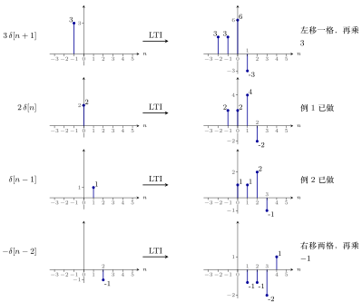
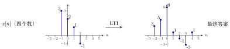
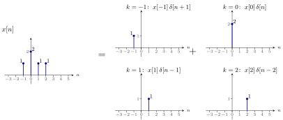
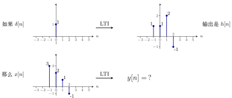
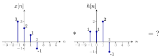
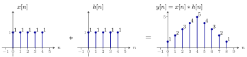
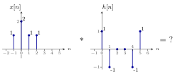
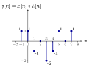

# 离散 LTI 系统的卷积公式推导

浙江大学 2022《信号与系统》（胡浩基）第二章（教材第 45 页 2.2 节）听课笔记

[:material-file-pdf-box: 下载 PDF 版](pdf/04-离散LTI系统卷积公式推导.pdf){ .md-button }

<!-- 本页由 tools/signal_notes/sync.py 从 LaTeX 笔记自动生成，请勿手改；改动请改源 .tex 后重新同步。 -->

## 1 从一道画图题出发：已知一对，推另一对

已知 $\delta[n]$ 通过 LTI 系统的输出，求别的输入的输出。难度逐步增加：乘 $2$、右移一格、两者相加、输入有四个数；每一步只用一条性质。把同样的做法推广到任意输入，就得到卷积（第 2 节）。

### 1.1 复习：线性与时不变的定义

重点

1.  <strong>线性系统</strong>（对<strong>任意</strong>输入）：

    -   <strong>齐次性</strong>(homogeneity)：$x[n]\to y[n]$，则 $a\,x[n]\to a\,y[n]$，$a$ 是实数；

    -   <strong>叠加性</strong>(superposition)：$x_1[n]\to y_1[n]$、$x_2[n]\to y_2[n]$，则 $x_1[n]+x_2[n]\to y_1[n]+y_2[n]$。

2.  <strong>时不变系统</strong>：$x[n]\to y[n]$，则 $x[n-n_0]\to y[n-n_0]$。<strong>离散的坐标必须是整数，所以 $n_0$ 要规定是整数</strong>（$n_0\in\mathbb{Z}$）。

### 1.2 画图题：每次只用一条性质

设一个 LTI 系统：$x[n]\to\boxed{\text{LTI}}\to y[n]$。已知输入单位脉冲 $x[n]=\delta[n]$（只在 $n=0$ 处为 $1$）时的输出 $y[n]$：

{ .notes-fig loading=lazy }

<strong>图 1</strong> 已知条件：输出在 $n=-1,0,1,2$ 处分别是 $1,1,2,-1$，其他位置都是 $0$。
{: .fig-caption }

这个输出后面起名叫<strong>单位脉冲响应</strong> $h[n]$（第 2 节）。

下面三道题，每题用一条性质，从已知推到未知。

例 1 <strong>输入扩大两倍</strong> 齐次性
{: .ex-head }

<strong>题目</strong>：输入 $x[n]=2\delta[n]$（在 $n=0$ 处为 $2$），送进<strong>同一个</strong> LTI，输出是什么？

{ .notes-fig loading=lazy }

<strong>解</strong>：<strong>每个值都乘 $2$</strong>，下标不变。

{ .notes-fig loading=lazy }

<strong>依据</strong>：<strong>齐次性</strong>。定义里的 $x[n]$ 是<strong>任意</strong>的，当然包含 $\delta[n]$ 这一种；现在输入乘了 $2$（即齐次性里的 $a=2$），输出也乘 $2$。

注意：不是线性系统就没有这个结论。

例 2 <strong>输入右移一格</strong> 时不变性
{: .ex-head }

<strong>题目</strong>：输入 $x[n]=\delta[n-1]$（只在 $n=1$ 处为 $1$，也就是把 $\delta[n]$ 向右挪了一格），送进同一个 LTI，输出是什么？

{ .notes-fig loading=lazy }

<strong>解</strong>：<strong>输出也整体右移一格</strong>。

{ .notes-fig loading=lazy }

<strong>依据</strong>：<strong>时不变性</strong>——输入相对原来右移一个单位，输出也右移一个单位。

例 3 <strong>两个脉冲相加的输入</strong> 叠加性
{: .ex-head }

<strong>题目</strong>：例 1 用了齐次性，例 2 用了时不变性，这道题用剩下的<strong>叠加性</strong>：<strong>把例 1 和例 2 的输入加起来</strong>，即 $x[n]=2\delta[n]+\delta[n-1]$（$n=0$ 处为 $2$，$n=1$ 处为 $1$，别处为 $0$），送进同一个 LTI，输出是什么？

{ .notes-fig loading=lazy }

<strong>解</strong>：由叠加性，输出就是前两道题输出的<strong>和</strong>。逐位相加（<strong>易错点</strong>：先按下标 $n$ 对齐再相加，否则容易加错）：

|           $n$           | $-1$ | $0$ | $1$ | $2$  | $3$  |
|:-----------------------:|:----:|:---:|:---:|:----:|:----:|
|    例 1 的输出 $2h$     | $2$  | $2$ | $4$ | $-2$ | $0$  |
| 例 2 的输出（右移一格） | $0$  | $1$ | $1$ | $2$  | $-1$ |
|          相加           | $2$  | $3$ | $5$ | $0$  | $-1$ |

答案：$n=-1,0,1,2,3$ 处依次为 $2,3,5,0,-1$（范围 $-1$ 到 $3$）。

{ .notes-fig loading=lazy }

重点

<strong>三道题用三条性质：</strong>  
<strong>例 1</strong>：输入乘 $a$，输出也乘 $a$ $\Rightarrow$ 齐次性。  
<strong>例 2</strong>：输入右移 $n_0$，输出也右移 $n_0$ $\Rightarrow$ 时不变性。  
<strong>例 3</strong>：输入相加，输出也相加 $\Rightarrow$ 叠加性。

### 1.3 加难度：输入有四个数

例 4 <strong>四点输入经过同一个 LTI</strong> 拆成脉冲再相加
{: .ex-head }

这类题不难，只是<strong>繁琐</strong>，难在<strong>又快又对</strong>；快速的做法见第 3、4 节。

<strong>题目</strong>：$x[n]$ 在 $n=-1,0,1,2$ 处分别是 $3,2,1,-1$，送进<strong>同一个</strong> LTI 系统（$\delta[n]$ 的输出是 $n=-1..2$ 处的 $1,1,2,-1$），输出 $y[n]$ 是什么？

{ .notes-fig loading=lazy }

▸ <strong>做法：把输入拆成四个脉冲。</strong> <strong>输入有四个非零的数，把它拆成四个脉冲的和</strong>：

$$
x[n]=3\,\delta[n+1]+2\,\delta[n]+1\,\delta[n-1]-1\,\delta[n-2].
$$

然后<strong>每一个脉冲单独过 LTI</strong>（用齐次性和时不变性），最后把四个输出<strong>加起来</strong>（用叠加性）：

{ .notes-fig loading=lazy }

<strong>图 2</strong> 四个脉冲各自通过同一个 LTI 的输出（各行纵向缩放不同）。
{: .fig-caption }

其中 $2\delta[n]$ 和 $\delta[n-1]$ 已有现成结果（例 1、例 2），直接引用；要新做的是另外两个。

▸ <strong>确定范围。</strong> 四个输出加起来，最左边有值的地方是四个最左边里的最小值：$-1,\,-1\,(\text{来自}2\delta),\,0,\,1$ 以及新做的 $-2$，所以最左是 $n=-2$；最右边是 $1,2,3,4$ 里最大的，所以最右是 $n=4$。因此 $y[n]$ <strong>只在 $n=-2$ 到 $4$ 有值</strong>。

▸ <strong>逐点相加。</strong>

| $n$ | $-2$ | $-1$ | $0$ | $1$ | $2$ | $3$ | $4$ |
|:--:|:--:|:--:|:--:|:--:|:--:|:--:|:--:|
| $3\delta[n+1]$ 的输出 | $3$ | $3$ | $6$ | $-3$ | $0$ | $0$ | $0$ |
| $2\delta[n]$ 的输出 | $0$ | $2$ | $2$ | $4$ | $-2$ | $0$ | $0$ |
| $\delta[n-1]$ 的输出 | $0$ | $0$ | $1$ | $1$ | $2$ | $-1$ | $0$ |
| $-\delta[n-2]$ 的输出 | $0$ | $0$ | $0$ | $-1$ | $-1$ | $-2$ | $1$ |
| <strong>相加 $y[n]$</strong> | $\mathbf{3}$ | $\mathbf{5}$ | $\mathbf{9}$ | $\mathbf{1}$ | $\mathbf{-1}$ | $\mathbf{-3}$ | $\mathbf{1}$ |

结果是 $3,5,9,1,-1,-3,1$。

{ .notes-fig loading=lazy }

<strong>图 3</strong> 这道题的输入（左）和最后的输出（右）。输入只有 4 个点，输出有 7 个点，两端各<strong>变长</strong>了。
{: .fig-caption }

说明

<strong>三个值得记下来的观察</strong>：

1.  输入有 4 个点、$h[n]$ 也有 4 个点，输出却有 $4+4-1=7$ 个点。这个规律在列表法一节总结为「最左边相加、最右边相加」（见第 3 节）。

2.  这样算肯定能做出来，只是复杂，而且<strong>很容易犯错</strong>。第 3、4 节讲不容易犯错的简单方法。

3.  <strong>做法只有三步</strong>：拆成脉冲 $\to$ 每个脉冲单独过系统 $\to$ 加起来。把这三步推广到任意输入，就是卷积（第 2 节）。

## 2 从这道题推广到卷积

例 4 的做法只有三步：<strong>拆成脉冲 $\to$ 每个脉冲单独过系统 $\to$ 加起来</strong>。下面把这三步推广到任意输入。

### 2.1 第一步：单位脉冲响应 $h[n]$

先定义两个名字：

-   $x[n]=\delta[n]$ 叫<strong>单位脉冲序列</strong>(unit impulse sequence，见第一章)。

-   把它输入 LTI 系统，得到的输出 $y[n]$ 有<strong>专门的名字</strong>：

重点

<strong>单位脉冲响应</strong>(unit impulse response)，记作 $h[n]$：它是 $\delta[n]$ 通过这个线性时不变系统得到的输出。

<strong>$h[n]$ 是一个非常特殊的输出：只要知道了 $h[n]$，对任意一个其他的信号输入这个 LTI 系统，都能算出它的 $y[n]$。</strong>正因为它这么特殊，才给它一个专门的名字。

所以对 LTI 系统来说，「知道一个输入对应的输出，就知道所有输入对应的输出」里的<strong>那「一个」，就是 $\delta$ 对应的 $h$</strong>。

### 2.2 第二步：任意输入都能拆成脉冲的和

$$
x[n]=\sum_{k=-\infty}^{+\infty}x[k]\,\delta[n-k]\qquad(\text{教材式 2-28}).
$$

例 4 的输入就是这样拆的：$x[n]=3\delta[n+1]+2\delta[n]+\delta[n-1]-\delta[n-2]$。再看一个例子：第 3 节例 2 的 $x[n]$，$n=-1,0,1,2$ 处分别是 $1,2,1,1$，它等于

$$
x[n]=1\cdot\delta[n+1]+2\cdot\delta[n]+1\cdot\delta[n-1]+1\cdot\delta[n-2].
$$

对照公式看：

| $k$  | $\delta[n-k]$（脉冲在哪里） | 这一项的系数 | 系数等于 |
|:-----|:----------------------------|:-------------|:---------|
| $-1$ | $\delta[n+1]$               | $x[-1]$      | $1$      |
| $0$  | $\delta[n]$                 | $x[0]$       | $2$      |
| $1$  | $\delta[n-1]$               | $x[1]$       | $1$      |
| $2$  | $\delta[n-2]$               | $x[2]$       | $1$      |

两个式子<strong>意思完全一样</strong>，只是把具体的数用抽象的 $x[k]$、$\delta[n-k]$ 代替。可以这样理解：$\delta[n-k]$ 是把脉冲<strong>挪到第 $k$ 个位置</strong>，再乘上第 $k$ 个位置上的值 $x[k]$，然后把所有位置<strong>加起来</strong>。

{ .notes-fig loading=lazy }

<strong>图 4</strong> 把 $x[n]$ 拆成脉冲的和：左边是 $x[n]$，右边是四个单独的脉冲（每个脉冲的高度就是 $x[k]$）。把右边四张图<strong>相加</strong>，就得到左边。
{: .fig-caption }

### 2.3 第三步：三行推导，得到卷积

▸ <strong>卷积。</strong>

$$
y[n]=x[n]\ast h[n].
$$

符号 $\ast$ 叫<strong>卷积</strong>(convolution)。$y[n]$ 就是用那套较复杂的算法（把输入拆成脉冲、逐个过系统、再加起来，即例 4 的做法）算出来的，写成 $x[n]\ast h[n]$。

▸ <strong>三行推导。</strong>

| 输入 | 输出 | 用的是哪条性质 |
|:---|:---|:---|
| $\delta[n]$ | $h[n]$ | $h[n]$ 的定义（单位脉冲响应） |
| $\delta[n-k]$ | $h[n-k]$ | <strong>时不变性</strong>：输入右挪 $k$ 格，输出也右挪 $k$ 格 |
| $x[k]\,\delta[n-k]$ | $x[k]\,h[n-k]$ | 线性系统的<strong>齐次性</strong>：输入乘 $x[k]$，输出也乘 $x[k]$ |
| $\displaystyle\sum_{k=-\infty}^{+\infty}x[k]\,\delta[n-k]$ | $\displaystyle\sum_{k=-\infty}^{+\infty}x[k]\,h[n-k]$ | 线性系统的<strong>叠加性</strong>：输入全部加起来，输出也全部加起来 |

最后一行的左边，由第二步，<strong>就是 $x[n]$</strong>。再根据卷积的定义（$\delta[n]$ 的输出是 $h[n]$，则 $x[n]$ 通过同一个 LTI，输出是 $x[n]\ast h[n]$），所以

$$
x[n]\ast h[n]=\sum_{k=-\infty}^{+\infty}x[k]\,h[n-k].
$$

证毕。

重点

<strong>这个证明就是第 1 节例 1–3 那三道题的「一般化」</strong>：时不变性（右挪）$+$ 齐次性（乘系数）$+$ 叠加性（相加）。这一步相对于上一步，仅仅是把所有的 $k$ 加在了一起。

▸ <strong>卷积公式。</strong> 上面推出的式子就是<strong>卷积计算公式</strong>（教材式 2-32）：

重点

$$
x[n]\ast h[n]=\sum_{k=-\infty}^{+\infty}x[k]\,h[n-k].
$$

这就是卷积的<strong>定义式</strong>。有了它，就有了另一种算卷积的方法，叫<strong>卷积公式法</strong>（见第 4 节）。

### 2.4 同一道题的两种问法

同一道题有两种问法，数据就是例 4 那道。

<strong>第一种</strong>（原始问法，要画三张图）：如果 $\delta[n]$ 通过 LTI 的输出是 $h[n]$，那么这个 $x[n]$ 通过同一个 LTI，输出是什么？

{ .notes-fig loading=lazy }

<strong>第二种</strong>（有了新名词以后）：直接问 $x[n]\ast h[n]$ 等于什么。

{ .notes-fig loading=lazy }

<strong>图 5</strong> 第二种问法：直接求 $x[n]\ast h[n]$。它和上一张图的第一种问法是同一道题。
{: .fig-caption }

<strong>两种出题方式完全一样</strong>。看到第二种写法，应当想到：它的意思是——如果 $\delta[n]$ 的响应是 $h[n]$，那么 $x[n]$ 的响应是什么？答案是 $y[n]=x[n]\ast h[n]$。后面会用第二种出题方式，但<strong>第一种才是这个问题的本质</strong>。

卷积的简便算法（教材 2.2 节）见第 3、4 节。

### 2.5 推论：$h[n]$ 是 LTI 系统唯一的标识

有了 $h[n]$ 和卷积这两个名字，先看两道判断题。

▸ <strong>判断题 A。</strong> 如果两个 LTI 系统的 $h[n]$（单位脉冲响应）一样，那么这两个 LTI 系统是完全一样的。对还是错？

答案：<strong>对</strong>。换一种问法：如果两个 LTI 系统的 $h[n]$ 一样，那么对于任何输入，这两个系统的输出都一样——这句话是对的。（因为输出 $=x\ast h$，$h$ 一样就一样。）

两个系统对任意输入的输出都一样，它们<strong>是同一个系统吗</strong>？按<strong>信号与系统这门工程学科</strong>的理解：<strong>如果两个系统的输入输出一样，它们就是一样的，因为没有别的办法证明它们不一样</strong>。

重点

<strong>$h[n]$ 是 LTI 系统唯一的标识。</strong>一个 LTI 系统所有的特点，都集中在 $h[n]$ 这一个序列里。

▸ <strong>判断题 B（换一种问法）。</strong> 如果两个<strong>系统</strong>的 $h[n]$ 一样，那么这两个系统的输入输出都一样。对吗？这句话比刚才那句<strong>少了哪个条件</strong>？

答案：<strong>少了「LTI」这个前提，所以不对</strong>。$h[n]$ 是<strong>线性时不变系统</strong>的唯一标识，<strong>不是所有系统</strong>的唯一标识。原因是上面「证明」里用到的三条性质：

-   用的是线性的<strong>齐次性</strong>（乘 $a$ 倍）；

-   用的是<strong>时不变性</strong>（平移）；

-   用的是线性的<strong>叠加性</strong>（相加）。

这三条都是 LTI 系统才有的。<strong>如果不是 LTI，这些推导全是错的，这个题就做不出来。</strong>对一个不是 LTI 的系统，$h[n]$ 不过就是「$\delta[n]$ 这个输入对应的输出」，没有什么特殊地位，只是一个普通的输入对应的输出。<strong>只有在 LTI 系统里，$h[n]$ 才特殊。</strong>

## 3 第一种算法：列表法

算 $x[n]\ast h[n]$ 有<strong>两种方法</strong>，先讲第一种：<strong>列表法</strong>。仍用前面那道题（第 1 节的例 4：$x=(3,2,1,-1)$ 在 $n=-1..2$，$h=(1,1,2,-1)$ 在 $n=-1..2$）。步骤： ①确定 $y[n]=x[n]\ast h[n]$ 的取值范围； ②列表； ③竖着加。

### 3.1 方法：三步

▸ <strong>第一步：确定 $y[n]$ 有值的范围。</strong>

重点

$y[n]$ 的<strong>最左边</strong> $=$ $x[n]$ 的最左边 $+$ $h[n]$ 的最左边；  
$y[n]$ 的<strong>最右边</strong> $=$ $x[n]$ 的最右边 $+$ $h[n]$ 的最右边。

这道题里：最左边 $(-1)+(-1)=-2$，最右边 $2+2=4$，所以 $y[n]$ <strong>只在 $n=-2$ 到 $4$ 有值</strong>。为什么这样，见下一小节「证明」。

▸ <strong>第二步：列表。</strong> 表格最上面一行写 $h[n]$ 的值 $1,1,2,-1$，最左边一列竖着写 $x[n]$ 的值 $3,2,1,-1$，格子里填乘积：

1.  把 $h[n]$ <strong>从左抄到右</strong>写在最上面一行：$1,1,2,-1$。

2.  拿 $x$ 最左边的数 $3$，去乘上面 $h$ 的<strong>每一个</strong>：$3\times(1,1,2,-1)=(3,3,6,-3)$，写在下面一行，<strong>和 $h$ 的位置对齐</strong>。

3.  拿 $x$ 的第二个数 $2$，同样去乘 $h$ 的每一个，得 $(2,2,4,-2)$。<strong>但是</strong>：这个 $2$ 在 $x$ 里比刚才那个 $3$ <strong>又往右挪了一位</strong>，所以这一行的乘积也要<strong>又往右挪一位</strong>再写。

4.  第三个数 $1$：它比 $3$ 往右挪了两位，所以 $(1,1,2,-1)$ 要往右挪<strong>两位</strong>。

5.  第四个数 $-1$：往右挪三位，得 $(-1,-1,-2,1)$。

<table>
<tbody>
<tr>
<td style="text-align: left;"></td>
<td colspan="7" style="text-align: center;">\(y[n]\) 的下标 \(n\)</td>
</tr>
<tr>
<td style="text-align: left;"></td>
<td style="text-align: center;">\(-2\)</td>
<td style="text-align: center;">\(-1\)</td>
<td style="text-align: center;">\(0\)</td>
<td style="text-align: center;">\(1\)</td>
<td style="text-align: center;">\(2\)</td>
<td style="text-align: center;">\(3\)</td>
<td style="text-align: center;">\(4\)</td>
</tr>
<tr>
<td style="text-align: left;">\(h\)（从左抄到右，对齐第一行）</td>
<td style="text-align: center;">\(1\)</td>
<td style="text-align: center;">\(1\)</td>
<td style="text-align: center;">\(2\)</td>
<td style="text-align: center;">\(-1\)</td>
<td style="text-align: center;"></td>
<td style="text-align: center;"></td>
<td style="text-align: center;"></td>
</tr>
<tr>
<td style="text-align: left;">\(3\times h\)</td>
<td style="text-align: center;">\(3\)</td>
<td style="text-align: center;">\(3\)</td>
<td style="text-align: center;">\(6\)</td>
<td style="text-align: center;">\(-3\)</td>
<td style="text-align: center;"></td>
<td style="text-align: center;"></td>
<td style="text-align: center;"></td>
</tr>
<tr>
<td style="text-align: left;">\(2\times h\)（右挪 1 位）</td>
<td style="text-align: center;"></td>
<td style="text-align: center;">\(2\)</td>
<td style="text-align: center;">\(2\)</td>
<td style="text-align: center;">\(4\)</td>
<td style="text-align: center;">\(-2\)</td>
<td style="text-align: center;"></td>
<td style="text-align: center;"></td>
</tr>
<tr>
<td style="text-align: left;">\(1\times h\)（右挪 2 位）</td>
<td style="text-align: center;"></td>
<td style="text-align: center;"></td>
<td style="text-align: center;">\(1\)</td>
<td style="text-align: center;">\(1\)</td>
<td style="text-align: center;">\(2\)</td>
<td style="text-align: center;">\(-1\)</td>
<td style="text-align: center;"></td>
</tr>
<tr>
<td style="text-align: left;">\(-1\times h\)（右挪 3 位）</td>
<td style="text-align: center;"></td>
<td style="text-align: center;"></td>
<td style="text-align: center;"></td>
<td style="text-align: center;">\(-1\)</td>
<td style="text-align: center;">\(-1\)</td>
<td style="text-align: center;">\(-2\)</td>
<td style="text-align: center;">\(1\)</td>
</tr>
<tr>
<td style="text-align: left;"><strong>竖着加</strong></td>
<td style="text-align: center;">\(\mathbf{3}\)</td>
<td style="text-align: center;">\(\mathbf{5}\)</td>
<td style="text-align: center;">\(\mathbf{9}\)</td>
<td style="text-align: center;">\(\mathbf{1}\)</td>
<td style="text-align: center;">\(\mathbf{-1}\)</td>
<td style="text-align: center;">\(\mathbf{-3}\)</td>
<td style="text-align: center;">\(\mathbf{1}\)</td>
</tr>
</tbody>
</table>

▸ <strong>第三步：竖着加。</strong> 注意：<strong>不要把最上面那一行（$h$）也加进去</strong>，它只是抄下来的参考行；只加下面四行。然后从最左边 $n=-2$ 开始，依次读出：$3,5,9,1,-1,-3,1$。

### 3.2 证明：为什么这样做是对的

说明

<strong>这一张表和第 1 节例 4 里的「拆成四个脉冲」是同一件事。</strong>那道例题里四个输出行，每行是「$x$ 的某个值 $\times$ $h$（平移过的）」；这里的四行一模一样，只是<strong>摆成了表格</strong>。表格只是把那套复杂算法用简洁的形式重做了一遍，每一步都与拆脉冲的做法一一对应。

▸ <strong>范围规则为什么是对的。</strong> 列表法唯一需要解释的是第一步：为什么 $y$ 的最左边是 $x$ 的最左边加 $h$ 的最左边？

-   $x[n]=\delta[n]$ 时，输出是 $h[n]$。$h[n]$ 的最左边，相对于 $0$ 是向左挪了「$h$ 的最左边」那么多；

-   现在 $x[n]$ 的最左边那个脉冲，本来就比 $0$ 挪了「$x$ 的最左边」那么多，它送进系统，输出（时不变性）也整体挪了这么多；

-   所以 $y$ 的最左边，相对于 $0$，就是「$h$ 的最左边」加上「$x$ 的最左边」。最右边同理。

### 3.3 例题

例 1 <strong>教材例 2-7：两个五点全 1 序列</strong> 结果像座小山
{: .ex-head }

<strong>题目</strong>：$x[n]$ 在 $n=0..4$ 都是 $1$，$h[n]$ 也在 $n=0..4$ 都是 $1$，求 $y[n]=x[n]\ast h[n]$。

{ .notes-fig loading=lazy }

<strong>图 6</strong> 例 2-7 的题目和答案（右边是答案，纵向缩放和左边不同）。
{: .fig-caption }

<strong>做法</strong>：

1.  范围：最左边 $0+0=0$，最右边 $4+4=8$，所以 $n=0..8$ 有值；

2.  列表：$x$ 的每个 $1$ 乘 $h$ 得到「5 个 $1$」，第一个 $1$ 不挪，第二个右挪 1 位，……第五个右挪 4 位；

3.  竖着加，得到 $1,2,3,4,5,4,3,2,1$，即 $n=0,1,\dots,8$ 处分别是 $1,2,3,4,5,4,3,2,1$。

结果形状像一座小山。

例 2 <strong>四点序列卷六点序列（教材第 79 页）</strong> 结果 9 个点
{: .ex-head }

<strong>题目</strong>（该页第一排三张图的中间一道）：$x[n]$ 在 $n=-1,0,1,2$ 处分别是 $1,2,1,1$；$h[n]$ 在 $n=0,1,2,3,4,5$ 处分别是 $1,-1,0,0,-1,1$。求 $y[n]=x[n]\ast h[n]$。

{ .notes-fig loading=lazy }

<strong>图 7</strong> 题目：$h[n]$ 在 $n=2,3$ 处是 $0$。
{: .fig-caption }

答案：范围 $n=-1..7$，依次是 $1$、$1$、$-1$、$0$、$-2$、$-1$、$1$、$0$、$1$。

{ .notes-fig loading=lazy }

<strong>图 8</strong> 答案：$y[n]$ 在 $n=-1..7$ 共 9 个点。
{: .fig-caption }

▸ <strong>换一种出题方式：把序列写成脉冲的和。</strong> 同一道题也可能写成脉冲和的形式：

$$
\begin{align*}
x[n]&=\delta[n+1]+2\delta[n]+\delta[n-1]+\delta[n-2],\\
h[n]&=\delta[n]-\delta[n-1]-\delta[n-4]+\delta[n-5],\\
y[n]&=x[n]\ast h[n].
\end{align*}
$$

<strong>这和上面那道题是同一道题。</strong>$\delta[n-m]$ 就是「在 $n=m$ 处放一个 $1$」，前面的系数就是那一点的值。只要理解 $\delta$ 的性质和左右移的写法，它就是同一道题。

例 3 <strong>无限长的序列：教材例 2-6</strong> 找规律
{: .ex-head }

<strong>题目</strong>：$x[n]=a^n u[n]$，$h[n]=u[n]$，求 $y[n]=x[n]\ast h[n]$。其中 $u[n]$ 是<strong>单位阶跃序列</strong>(unit step sequence)：$n\ge0$ 时为 $1$，$n\lt{}0$ 时为 $0$。要有解，需要 $|a|\lt{}1$。

$x$ 和 $h$ 都是无限长时，列表法<strong>仍然可以用</strong>：把前几项算出来，<strong>总结规律</strong>，再写出统一的表达式。

▸ <strong>步骤。</strong>

1.  <strong>先把 $x$ 和 $h$ 大致画出来</strong>：$x[n]$ 在 $n\lt{}0$ 时是 $0$，$n\ge0$ 时是 $1,a,a^2,a^3,\dots$（$a^n u[n]$ 里 $u[n]$ 把负半边「切掉」）；$h[n]=u[n]$ 是 $n\ge0$ 时一直是 $1$ 的序列。

2.  <strong>范围</strong>：最左边 $0+0=0$，最右边 $+\infty$，所以 $y[n]$ 在 $n\ge0$ 有值。

3.  <strong>列表</strong>：这张表向右、向下都无限延伸。$x$ 的第一个数 $1$ 乘 $h$：一行全是 $1$；第二个数 $a$，右挪一位，一行全是 $a$；第三个数 $a^2$，再右挪一位，一行全是 $a^2$；……

4.  <strong>先加前几项找规律</strong>：竖着加，

    | $n$ | 竖着加的结果  |
    |:---:|:--------------|
    | $0$ | $1$           |
    | $1$ | $1+a$         |
    | $2$ | $1+a+a^2$     |
    | $3$ | $1+a+a^2+a^3$ |

5.  <strong>写成统一的式子</strong>：$n\ge0$ 时 $y[n]=1+a+a^2+\cdots+a^n$。但 $n\lt{}0$ 时应该是 $0$，所以<strong>前面要乘一个 $u[n]$</strong>（乘上后 $n\lt{}0$ 时全为 $0$）：

    $$
    y[n]=\bigl(1+a+a^2+\cdots+a^n\bigr)u[n].
    $$

6.  <strong>用等比数列求和公式化简</strong>（分子分母同乘 $1-a$，$(1-a)(1+a+\cdots+a^n)=1-a^{n+1}$）：

    $$
    y[n]=\frac{1-a^{n+1}}{1-a}\,u[n].
    $$

写成上一步（未化简）的形式也正确。学完第 4 章和第 7 章之后，<strong>用傅里叶变换和 $z$ 变换会非常快</strong>；用找规律的办法也不难。

▸ <strong>两个思考题：卷积的长度与计算量。</strong> 例 4 <strong>卷积后序列有多长？</strong> $N_1+N_2-1$
{: .ex-head }

<strong>题目</strong>：若 $x[n]$ 的长度是 $N_1$（即非零值连续排列、共 $N_1$ 个），$h[n]$ 的长度是 $N_2$，问 $y[n]=x[n]\ast h[n]$ 的长度是多少？

<strong>解</strong>：举个例子即可。设 $x[n]$ 在 $0$ 到 $N_1-1$ 有值（长度正好是 $N_1$），$h[n]$ 在 $0$ 到 $N_2-1$ 有值，用「最左加最左，最右加最右」，$y[n]$ 在 $0$ 到 $(N_1-1)+(N_2-1)=N_1+N_2-2$ 有值，所以长度是

重点

长度 $N_1$ 的序列和长度 $N_2$ 的序列卷积，结果的长度是 <strong>$N_1+N_2-1$</strong>。

起点不一定是 $0$，换别的起点长度也一样。检查：第 1 节例 4 那道题 $4+4-1=7$，正好是 $n=-2..4$ 共 7 个点；例 2-7 是 $5+5-1=9$ 个点。

例 5 <strong>列表法要算多少次加法、多少次乘法？</strong> $O(N^2)$
{: .ex-head }

<strong>题目</strong>：$x[n]$ 长度为 $N$，$h[n]$ 长度也为 $N$，用列表法算 $y[n]=x[n]\ast h[n]$，需要多少次<strong>加法</strong>、多少次<strong>乘法</strong>？

用 $N=4$ 的那张表来数：

-   <strong>乘法</strong>：表里每个格子都是一次乘法，有 $N$ 行、每行 $N$ 个，共 <strong>$N^2$ 次</strong>乘法；

-   <strong>加法</strong>：竖着加，每一列要加几次，看那一列有几个数：从左到右，各列需要的加法次数是 $0,1,2,3,2,1,0$（头尾两列只有一个数，不用加）。即 $1+2+3+2+1$，对 $N$ 来说就是

    $$
    1+2+\cdots+(N-1)+(N-2)+\cdots+1=(N-1)^2.
    $$

    当 $N=4$ 时是 $9$。

所以用列表法做卷积，<strong>计算复杂度是 $O(N^2)$</strong>（加法和乘法的次数大致正比于 $N^2$）。

▸ <strong>能不能把加法和乘法的次数减少？</strong> 能。Cooley 和 Tukey（1965 年）提出的<strong>快速傅里叶变换</strong>(fast Fourier transform，FFT)，把卷积的计算复杂度从 $O(N^2)$ 降到 $O(N\log N)$，第四章会学。这是信号处理领域非常重要的发现，初看却很反直觉：加法和乘法从哪里省下来，并不明显。

▸ <strong>差距有多大。</strong> 实际用卷积时，序列常有几万、几十万甚至几百万长。取 $N=10^5$：

|        | 算法      | 次数（数量级）             |
|:-------|:----------|:---------------------------|
| 列表法 | $N^2$     | $(10^5)^2=10^{10}$         |
| FFT    | $N\log N$ | $10^5\log10^5=5\times10^5$ |

$N$ 越大，差距越大。（这里 $\log$ 取以 $10$ 为底，$\log10^5=5$；$O(N\log N)$ 里底数不影响数量级。）

## 4 第二种算法：卷积公式法

### 4.1 概念

用卷积公式还有另一种算法，叫<strong>卷积公式法</strong>。分<strong>四步</strong>（教材分五步，这里合为四步）：

<strong>翻转 平移 相乘 求和</strong>

▸ <strong>用卷积公式法要注意的两点。</strong>

重点

1.  这里<strong>翻转 $h[n]$</strong>。也可以翻转 $x[n]$，因为<strong>卷积具有交换性</strong>（后面证明）。

2.  <strong>翻转谁，就平移谁，不要反过来。</strong>翻转 $h$ 就平移 $h$；翻转 $x$ 就平移 $x$。若翻转 $h$ 却去平移 $x$，就错了。

### 4.2 证明：四步从哪里来

把公式里的 $h[n-k]$ 稍微变一下形：$n-k=-(k-n)$，所以

$$
x[n]\ast h[n]=\sum_{k=-\infty}^{+\infty}x[k]\;h\bigl[-(k-n)\bigr].
$$

四步与公式的对应：

| 步骤 | 在公式里在哪里 | 意思 |
|:---|:---|:---|
| <strong>翻转</strong> | $h[\,\textbf{-}(k-n)]$ 里的<strong>负号</strong> | 把 $h[k]$ 左右翻过来，变成 $h[-k]$（从右抄到左） |
| <strong>平移</strong> | $h[-(k-\textbf{n})]$ 里的 $n$ | <strong>右移 $n$ 个单位</strong>（减号表示右移；$n$ 为负数时，右移 $n$ 个单位等于左移 $\vert{}n\vert{}$ 个单位） |
| <strong>相乘</strong> | $x[k]\cdot h[\cdots]$ 两个相乘 | 翻转并平移后的 $h$，和 $x[k]$ 逐点相乘 |
| <strong>求和</strong> | $\displaystyle\sum_{k}$ | 把所有乘积加起来，得到 $y[n]$ 在这一个 $n$ 的值 |

这里的「翻转」和「平移」，就是第一章「信号的自变量变换」里讲的那一套。

### 4.3 例题

例 1 <strong>用公式法重做四点输入的题</strong> 与列表法一致
{: .ex-head }

<strong>题目</strong>（即第 1 节例 4）：$x[n]=(3,2,1,-1)$ 在 $n=-1..2$，$h[n]=(1,1,2,-1)$ 在 $n=-1..2$，求 $x[n]\ast h[n]$。

▸ <strong>第一步，和列表法完全一样：确定范围。</strong> $y$ 的最左边 $(-1)+(-1)=-2$，最右边 $2+2=4$，所以 $n=-2..4$ 有值。关键是后面这些值怎么算。

▸ <strong>第二步：把 $h$ 翻转。</strong> $h[n]$ 从左抄到右是 $1,1,2,-1$；翻转的意思是<strong>把它从右抄到左</strong>，也就是 $h[-n]$：从左到右写是 $-1,2,1,1$。

▸ <strong>第三步：不断平移、相乘、求和。</strong> 把 $x$ 从左抄到右写好（$3,2,1,-1$），再把翻转过的 $h$（$-1,2,1,1$）<strong>一格一格往右挪</strong>，每挪一格，就把<strong>重合在一起的数两两相乘再相加</strong>，得到 $y$ 在这一个位置的值：

| $n$ | 重合的数（上面 $x$，下面翻转后的 $h$） | 乘积 | 相加 |
|:--:|:---|:---|:--:|
| $-2$ | $3$ 和 $1$ | $3\times1$ | $3$ |
| $-1$ | $3,2$ 和 $1,1$ | $3\times1+2\times1$ | $5$ |
| $0$ | $3,2,1$ 和 $2,1,1$ | $3\times2+2\times1+1\times1$ | $9$ |
| $1$ | $3,2,1,-1$ 和 $-1,2,1,1$ | $3\times(-1)+2\times2+1\times1+(-1)\times1$ | $1$ |
| $2$ | $2,1,-1$ 和 $-1,2,1$ | $2\times(-1)+1\times2+(-1)\times1$ | $-1$ |
| $3$ | $1,-1$ 和 $-1,2$ | $1\times(-1)+(-1)\times2$ | $-3$ |
| $4$ | $-1$ 和 $-1$ | $(-1)\times(-1)$ | $1$ |

（$n=-2$ 时：翻转的 $h$ 最右边的 $1$ 和 $x$ 最左边的 $3$ 对上；每挪一格，多一个数重合，直到 4 个全重合，再逐渐退出。）

结果是 $3,5,9,1,-1,-3,1$，<strong>和列表法、和第 1 节例 4 的蛮力法完全一样</strong>，正是公式所描述的内容。

▸ <strong>用公式法重做例 2-7、例 2-6。</strong> 例 2 <strong>教材例 2-7（公式法）</strong> 与列表法一致
{: .ex-head }

这次题目写成

$$
x[n]=u[n]-u[n-5],\qquad h[n]=u[n]-u[n-5],\qquad\text{求 }x[n]\ast h[n].
$$

$u[n]$ 从 $0$ 起一直是 $1$，$u[n-5]$ 从 $5$ 起一直是 $1$，相减只剩 $n=0..4$ 的 5 个 $1$——就是例 2-7。

1.  范围 $n=0..8$；

2.  $h$ 翻转后还是 5 个 $1$（所以 $h[-n]$ 也是 5 个 1）；

3.  往右挪：$n=0$ 时只有一个 $1$ 对上，得 $1$；右挪 1 格，两对，得 $2$；……右挪 4 格，五对全重合，得 $5$；再往右，重合数逐渐减少，$4,3,2,1$。

得到的结果和列表法的 $1,2,3,4,5,4,3,2,1$ 一致。

例 3 <strong>教材例 2-6（公式法）</strong> 与列表法一致
{: .ex-head }

$x[n]=a^nu[n]$，$h[n]=u[n]$。范围 $n\ge0$；把 $h$ 翻转，往右挪，$n=0$ 时只有 $x[0]=1$ 一项，$n=1$ 时 $1+a$，$n=2$ 时 $1+a+a^2$，……得到的规律

$$
y[n]=(1+a+\cdots+a^n)u[n]=\frac{1-a^{n+1}}{1-a}u[n],
$$

和列表法一样。核心就是翻转、平移、相乘、求和，即卷积公式本身。

## 5 列表法和卷积公式法，哪个更好？

两种方法都能算出正确结果，用哪一种都可以。两者各有优劣：

-   <strong>列表法更快</strong>：不需要「翻转以后再写」。

-   <strong>但列表法有个最大的问题</strong>：<strong>错了一个数，基本上整张表都错</strong>。

-   <strong>卷积公式法是一个一个算</strong>：比如 $y[0]$ 算错，$y[1]$、$y[2]$ 仍可能算对。

一个有意思的观察：在人看来，列表法和卷积公式法各有优劣；<strong>在计算机眼里，是同一个方法</strong>。两种方法<strong>加法和乘法的次数完全一样</strong>，只是<strong>顺序</strong>不同，所以时间复杂度也一样。

说明

<strong>为什么是同一个方法</strong>：两种方法都要把每个 $x[k]$ 和每个 $h[m]$ 配一次对、乘一次（共 $N^2$ 次乘法），再把落在同一个 $n=k+m$ 上的乘积加起来。列表法是「一行一行乘，最后竖着加」，卷积公式法是「一个 $n$ 一个 $n$ 地乘再加」，只是<strong>先算哪个、后算哪个</strong>不一样。

