# 连续 LTI 系统的卷积公式推导

浙江大学 2022《信号与系统》（胡浩基）第二章（教材第 38 页）听课笔记

[:material-file-pdf-box: 下载 PDF 版](pdf/05-连续LTI系统卷积公式推导.pdf){ .md-button }

<!-- 本页由 tools/signal_notes/sync.py 从 LaTeX 笔记自动生成，请勿手改；改动请改源 .tex 后重新同步。 -->

## 1 从一道画图题出发：已知一对，推另一对

和离散时的思路一样：已知一个输入通过 LTI 系统的输出，求别的输入的输出。每一步只用一条性质；难度逐步增加，最后推广到任意输入（第 2、4 节）。

### 1.1 复习：连续时间的线性与时不变

重点

1.  <strong>线性系统</strong>（对<strong>任意</strong>输入）：

    -   <strong>齐次性</strong>(homogeneity)：$x(t)\to y(t)$，则 $a\,x(t)\to a\,y(t)$，$a\in\mathbb{R}$ 任意；

    -   <strong>叠加性</strong>(superposition)：$x_1(t)\to y_1(t)$、$x_2(t)\to y_2(t)$，则 $x_1(t)+x_2(t)\to y_1(t)+y_2(t)$。

2.  <strong>时不变系统</strong>：$x(t)\to y(t)$，则 $x(t-t_0)\to y(t-t_0)$，$t_0\in\mathbb{R}$ 任意。  
    和离散的区别：离散的平移量 $n_0$ 只能是整数，连续的 $t_0$ 可以是任意实数。

### 1.2 已知条件

题目改编自教材第 34 页 1-23（原题三角波高度为 $2$，这里取 $1$，做法不变，图更直观）：一个 LTI 系统，输入 $0$ 到 $2$ 之间高度为 $1$ 的方波，输出 $0$ 到 $2$ 之间、峰值为 $1$ 的三角波。

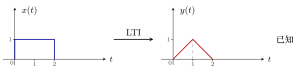{ .notes-fig loading=lazy }

<strong>图 1</strong> 已知条件：$[0,2]$ 上高度为 $1$ 的方波，输出是 $[0,2]$ 上的三角波，在 $t=1$ 处达到峰值 $1$。
{: .fig-caption }

下面三道题，每题用一条性质，从已知推到未知。

例 1 <strong>方波高度变成 2</strong> 齐次性
{: .ex-head }

<strong>题目</strong>：输入仍在 $[0,2]$ 上，高度变成 $2$，送进<strong>同一个</strong> LTI，输出是什么？

<strong>解</strong>：输出是 $[0,2]$ 上峰值为 $2$ 的三角波。

<strong>依据</strong>：<strong>齐次性</strong>。输入是原来的 $2$ 倍（$a=2$），输出也是原来的 $2$ 倍。

例 2 <strong>方波右移到 \[2,4\]</strong> 时不变性
{: .ex-head }

<strong>题目</strong>：输入是 $[2,4]$ 上高度为 $1$ 的方波（原方波右移 $2$），送进同一个 LTI，输出是什么？

<strong>解</strong>：输出是 $[2,4]$ 上的三角波，峰值 $1$ 在 $t=3$。

<strong>依据</strong>：<strong>时不变性</strong>。输入右移 $t_0=2$，输出也右移 $2$。

例 3 <strong>两段台阶相加</strong> 叠加性
{: .ex-head }

<strong>题目</strong>：输入在 $[0,2]$ 上为 $2$、在 $[2,4]$ 上为 $1$，送进同一个 LTI，输出是什么？

<strong>解</strong>：这个输入就是例 1 与例 2 的输入之和，所以输出是例 1 与例 2 的输出之和：$[0,2]$ 上峰值为 $2$ 的三角波，加上 $[2,4]$ 上峰值为 $1$ 的三角波。

<strong>依据</strong>：<strong>叠加性</strong>。

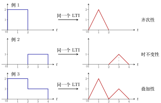{ .notes-fig loading=lazy }

<strong>图 2</strong> 例 1–例 3 的输入（左）与输出（右）。例 3 的输入是例 1、例 2 输入之和，输出也是两者输出之和。
{: .fig-caption }

重点

<strong>三道题用三条性质：</strong>  
<strong>例 1</strong>：输入乘 $a$，输出也乘 $a$ $\Rightarrow$ 齐次性。  
<strong>例 2</strong>：输入右移 $t_0$，输出也右移 $t_0$ $\Rightarrow$ 时不变性。  
<strong>例 3</strong>：输入相加，输出也相加 $\Rightarrow$ 叠加性。

### 1.3 加难度：台阶有重叠的输入

例 4 <strong>三段台阶：1、2、1</strong> 拆成两个方波
{: .ex-head }

<strong>题目</strong>：输入在 $[0,1]$ 上为 $1$、$[1,2]$ 上为 $2$、$[2,3]$ 上为 $1$，送进同一个 LTI，输出是什么？

▸ <strong>做法：把输入拆成两个方波。</strong>

$$
x(t)=\underbrace{[0,2]\text{ 上高度为 1 的方波}}_{\text{已知条件本身}}\;+\;\underbrace{[1,3]\text{ 上高度为 1 的方波}}_{\text{右移 1}}.
$$

两个方波在 $[1,2]$ 上重叠，叠起来高度正好是 $2$。第一个方波的输出是已知的三角波 $[0,2]$；第二个方波由时不变性，输出是三角波右移 $1$，即 $[1,3]$ 上的三角波。由叠加性，$y(t)$ 是两个三角波之和。

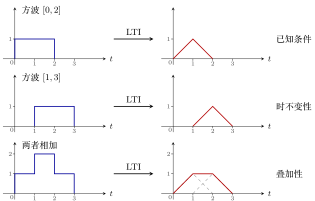{ .notes-fig loading=lazy }

<strong>图 3</strong> 拆成两个方波，各自过 LTI，再相加。最后一行虚线是两个三角波，实线是它们的和：一个梯形，在 $[1,2]$ 上是平的。
{: .fig-caption }

▸ <strong>逐段相加。</strong> 三角波 $[0,2]$ 在 $[0,1]$ 上是 $t$，在 $[1,2]$ 上是 $2-t$；三角波 $[1,3]$ 在 $[1,2]$ 上是 $t-1$，在 $[2,3]$ 上是 $3-t$。

|             区间             | $[0,1]$ |   $[1,2]$    | $[2,3]$ |
|:----------------------------:|:-------:|:------------:|:-------:|
|        三角波 $[0,2]$        |   $t$   |    $2-t$     |   $0$   |
|        三角波 $[1,3]$        |   $0$   |    $t-1$     |  $3-t$  |
| <strong>相加 $y(t)$</strong> |   $t$   | $\mathbf{1}$ |  $3-t$  |

<strong>关键在 $[1,2]$ 段</strong>：一条下降线加一条上升线，两者斜率相反，每一点相加都等于 $1$，所以这一段正好是平的。答案是梯形：$0\to1$ 上升，$1\to2$ 保持 $1$，$2\to3$ 下降。

说明

<strong>易错点</strong>：输入在 $[1,2]$ 上高度为 $2$，容易误以为输出在那里出现一个峰值为 $2$ 的尖。实际上要先拆成两个<strong>完整的</strong>方波（$[0,2]$ 和 $[1,3]$），再把它们的输出相加。不能拆成 $[0,1]$、$[1,2]$、$[2,3]$ 三段单独的窄方波，因为宽度为 $1$ 的方波的输出不知道（见第 2 节例 1）。

## 2 任意输入：用阶梯函数逼近

### 2.1 阶梯函数(step function)

已知「$[0,2]$ 方波 $\to$ $[0,2]$ 三角波」，任意一个波形 $x(t)$ 的输出，用现有的知识<strong>求不出精确解</strong>。但可以求<strong>近似解</strong>：

重点

用宽度为 $2$ 的台阶拼出一条<strong>阶梯函数</strong>(step function)来近似 $x(t)$。每个台阶都是已知方波经过「乘高度、平移」得到的，它的输出就是一个同样高度、同样位置的三角波。把这些三角波加起来，就得到近似的 $y(t)$。

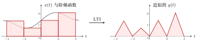{ .notes-fig loading=lazy }

<strong>图 4</strong> 左：灰色曲线是 $x(t)$，红色阶梯每 $2$ 个单位跳一次，台阶高度取该段左端点处 $x(t)$ 的值。右：每个台阶输出一个三角波，台阶矮，三角波就矮；台阶高，三角波就高。
{: .fig-caption }

### 2.2 台阶越窄，近似越准

每隔 $2$ 个单位才跳一次的阶梯函数太粗糙。要让近似更准，只能<strong>改变已知条件</strong>：如果知道的是 $[0,1]$ 方波的输出，就能用每隔 $1$ 跳一次的阶梯函数去近似；如果知道 $[0,0.5]$ 方波的输出，就能每隔 $0.5$ 跳一次，更精确。

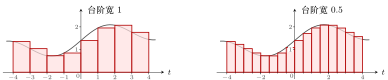{ .notes-fig loading=lazy }

<strong>图 5</strong> 同一条 $x(t)$，台阶宽度从 $1$ 缩到 $0.5$，阶梯函数和曲线之间的缝隙明显变小。前提是知道对应宽度方波的输出。
{: .fig-caption }

例 1 <strong>方波宽度减半，输出会不会也减半？</strong> 不会
{: .ex-head }

<strong>题目</strong>：已知 $[0,2]$ 方波 $\to$ $[0,2]$ 三角波。那么 $[0,1]$ 方波（高度仍为 $1$）通过同一个 LTI，输出是不是 $[0,1]$ 上峰值为 $1$ 的三角波？

<strong>解</strong>：<strong>不是</strong>。用反证法：假设 $[0,1]$ 方波 $\to$ $[0,1]$ 三角波。

1.  由时不变性，$[1,2]$ 方波 $\to$ $[1,2]$ 三角波；

2.  $[0,2]$ 方波 $=$ $[0,1]$ 方波 $+$ $[1,2]$ 方波，由叠加性，它的输出是 $[0,1]$、$[1,2]$ 两个小三角波之和；

3.  但已知 $[0,2]$ 方波的输出是<strong>一个</strong>大三角波，两者矛盾。

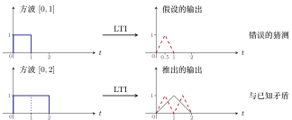{ .notes-fig loading=lazy }

<strong>图 6</strong> 上：错误的猜测。下：照这个猜测，$[0,2]$ 方波的输出应是两个小三角波（红虚线），与已知的一个大三角波（灰实线）不符，所以猜测错误。
{: .fig-caption }

重点

方波宽度压缩一半，输出<strong>不是</strong>把三角波也压缩一半。LTI 的几条性质（齐次性、叠加性、时不变性）都不能把「宽度为 $2$ 的方波的输出」变成「宽度为 $1$ 的方波的输出」。$[0,1]$ 方波的输出到底是什么，要学完第三章才能求。

### 2.3 极限：无限窄的方波

台阶宽度 $2\to1\to0.5\to\cdots$，近似越来越精确。最理想的是知道<strong>一个无限窄的方波</strong>（宽度趋于 $0$）通过系统的输出：知道了它，就能求出<strong>所有</strong> $x(t)$ 对应的输出。

这个无限窄的方波就是<strong>冲激函数</strong> $\delta(t)$（第一章）。要得到连续 LTI 系统的输入输出关系，必须用到它，所以第二章要先把它讲清楚。

## 3 冲激函数与冲激响应

### 3.1 冲激函数 $\delta(t)$ 的定义

冲激函数可以想成一个<strong>无限窄的方波</strong>。为了精确定义它，先定义一个辅助函数 $\delta_\Delta(t)$（教材第 12 页图 1-25）：

重点

-   $\delta_\Delta(t)$：从 $0$ 到 $\Delta$ 的方波，<strong>宽度为 $\Delta$，高度为 $\dfrac1\Delta$</strong>，面积恒为 $1$。

-   冲激函数(impulse function)：

    $$
    \delta(t)=\lim_{\Delta\to0}\delta_\Delta(t).
    $$

    宽度趋于 $0$ 时，高度 $\dfrac1\Delta$ 趋于无穷大。

-   画法（人为规定，教材第 12 页图 1-26）：在 $t=0$ 处画一个向上的箭头，旁边写 $(1)$，表示「$1$ 倍的 $\delta(t)$」，即面积为 $1$，不是高度为 $1$。

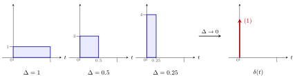{ .notes-fig loading=lazy }

<strong>图 7</strong> $\delta_\Delta(t)$ 随 $\Delta$ 变小：越来越窄、越来越高，面积始终为 $1$（$1\times1$、$0.5\times2$、$0.25\times4$）。极限就是冲激函数 $\delta(t)$，画成 $t=0$ 处的箭头，标 $(1)$。
{: .fig-caption }

### 3.2 冲激响应

-   设 $\delta_\Delta(t)$ 通过 LTI 系统的输出为 $h_\Delta(t)$（某个函数）。

-   $\delta(t)=\lim\limits_{\Delta\to0}\delta_\Delta(t)$ 通过同一个 LTI 系统的输出记作 $h(t)$：

    $$
    h(t)=\lim_{\Delta\to0}h_\Delta(t)\qquad(\text{假设这个极限存在}).
    $$

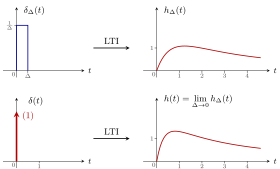{ .notes-fig loading=lazy }

<strong>图 8</strong> 上：窄方波 $\delta_\Delta(t)$ 的输出 $h_\Delta(t)$。下：$\Delta\to0$ 时输入变成 $\delta(t)$，输出变成 $h(t)$。右边的曲线只是示意形状，具体由系统决定。
{: .fig-caption }

重点

<strong>冲激响应</strong>(impulse response) $h(t)$：冲激函数 $\delta(t)$ 输入 LTI 系统得到的输出。它对应离散时的单位脉冲响应 $h[n]$。

## 4 推导连续卷积公式

思路和离散完全一样：<strong>拆成窄方波 $\to$ 每个窄方波单独过系统 $\to$ 加起来</strong>；唯一多出的一步是最后令 $\Delta\to0$。

### 4.1 第一步：把 $x(t)$ 写成窄方波之和

用宽度为 $\Delta$ 的阶梯函数近似 $x(t)$：在 $[k\Delta,(k+1)\Delta)$ 上取高度 $x(k\Delta)$（左端点处 $x(t)$ 的值）。把这条红色阶梯函数记作 $x_\Delta(t)$：

重点

$$
x_\Delta(t)=\sum_{k=-\infty}^{+\infty}x(k\Delta)\,\delta_\Delta(t-k\Delta)\cdot\Delta .
$$

这是整个推导中<strong>最难理解的一步</strong>，下面逐块解释。

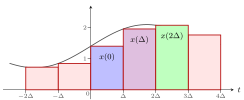{ .notes-fig loading=lazy }

<strong>图 9</strong> 阶梯函数 $x_\Delta(t)$ （红色）由一块块宽为 $\Delta$ 的矩形拼成，灰色曲线是 $x(t)$。蓝、紫、绿三块分别对应 $k=0,1,2$，高度是左端点处的 $x(0)$、$x(\Delta)$、$x(2\Delta)$。
{: .fig-caption }

▸ <strong>蓝色块（$k=0$）。</strong> 它从 $0$ 到 $\Delta$，高度 $x(0)$，等于

$$
x(0)\,\delta_\Delta(t)\cdot\Delta .
$$

原因：$\delta_\Delta(t)$ 是 $0$ 到 $\Delta$ 的方波，高度 $\frac1\Delta$；乘 $\Delta$ 后高度变成 $1$；再乘 $x(0)$，高度变成 $x(0)$。

▸ <strong>紫色块（$k=1$）。</strong> 它从 $\Delta$ 到 $2\Delta$，高度 $x(\Delta)$，等于

$$
x(\Delta)\,\delta_\Delta(t-\Delta)\cdot\Delta .
$$

$\delta_\Delta(t-\Delta)$ 是把 $0$ 到 $\Delta$ 的方波右移 $\Delta$，变成 $\Delta$ 到 $2\Delta$ 的方波；乘 $\Delta$ 的作用和蓝色块一样，把高度 $\frac1\Delta$ 变成 $1$，再由 $x(\Delta)$ 定高度。

▸ <strong>绿色块（$k=2$）。</strong> 从 $2\Delta$ 到 $3\Delta$，高度 $x(2\Delta)$，等于 $x(2\Delta)\,\delta_\Delta(t-2\Delta)\cdot\Delta$：方波右移 $2\Delta$。

以此类推，第 $k$ 块是 $x(k\Delta)\,\delta_\Delta(t-k\Delta)\cdot\Delta$，把所有块加起来就是上面的公式。

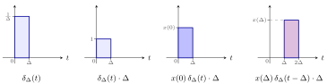{ .notes-fig loading=lazy }

<strong>图 10</strong> 一块矩形是怎么来的：$\delta_\Delta(t)$ 高 $\frac1\Delta$，乘 $\Delta$ 后高 $1$，再乘 $x(0)$ 后高 $x(0)$（蓝色块）。把方波右移 $\Delta$、乘 $x(\Delta)$，得到紫色块。
{: .fig-caption }

说明

从这里到「取极限」之前的内容，依据见 Oppenheim《Signals and Systems》（第 2 版）第 92–93 页式 (2.24)–(2.27)、图 2.12–2.13，以及第 128 页 2.5.1 节。唯一例外是「三角形积木得到折线」，见下文的存疑标记。

▸ <strong>和式算出的是高度，不是面积。</strong> $x(k\Delta)\cdot\Delta$ 看上去像「高度乘宽度」，容易误以为在求面积。把乘法换一种方式组合：

$$
x(k\Delta)\cdot\underbrace{\big[\delta_\Delta(t-k\Delta)\cdot\Delta\big]}_{\text{高 }1\text{、宽 }\Delta\text{ 的门}} .
$$

中括号里乘的 $\Delta$ 只起一个作用：把 $\delta_\Delta$ 的高度 $\frac1\Delta$ 抵消成 $1$。再乘 $x(k\Delta)$，得到高度为 $x(k\Delta)$ 的台阶。

另一种组合 $\big[x(k\Delta)\cdot\Delta\big]\cdot\delta_\Delta(t-k\Delta)$ 也成立：$x(k\Delta)\cdot\Delta$ 是这块矩形的面积，$\delta_\Delta$ 再把这块面积摊在宽 $\Delta$ 的格子上，高度 $=$ 面积 $\div$ 宽 $=x(k\Delta)$。两种读法结果相同，在任一个 $t$ 上读到的都是高度。

不直接写成「高度 $\times$ 门」，是为了第三步取极限：$\Delta\to0$ 时 $\delta_\Delta\to\delta$、$\Delta\to\mathrm{d}\tau$，和式才能变成积分；而「高 $1$ 的门」在 $\Delta\to0$ 时会变成一条宽度为零的线，取不出有用的极限。

▸ <strong>每个 $t$ 上只有一项不为零。</strong> 和式有无穷多项，但对一个固定的 $t$，只有一项不为零，所以 $x_\Delta(t)$ 等于那一格的高度。这一点要把 $\delta_\Delta$ 的定义代进去才能算出来：$\delta_\Delta$ 是一个分段函数，

$$
\delta_\Delta(t)=
\begin{cases}
\dfrac1\Delta, & 0\le t\lt{}\Delta,\\[4pt]
0, & \text{其他}.
\end{cases}
$$

1.  <strong>代入</strong>：把 $t$ 换成 $t-k\Delta$，

    $$
    \delta_\Delta(t-k\Delta)=
    \begin{cases}
    \dfrac1\Delta, & 0\le t-k\Delta\lt{}\Delta,\\[4pt]
    0, & \text{其他}.
    \end{cases}
    $$

2.  <strong>解不等式</strong>：$t$ 是要求的那个时刻，固定不动；未知的是 $k$。把 $0\le t-k\Delta\lt{}\Delta$ 拆成两半：

    $$
    \begin{align*}
    0\le t-k\Delta &\;\Longrightarrow\; k\Delta\le t \;\Longrightarrow\; k\le \frac t\Delta,\\
    t-k\Delta\lt{}\Delta &\;\Longrightarrow\; t-\Delta\lt{}k\Delta \;\Longrightarrow\; k\gt{}\frac t\Delta-1.
    \end{align*}
    $$

    合起来：

    $$
    \frac t\Delta-1\lt{}k\le\frac t\Delta .
    $$

3.  <strong>数整数</strong>：这个区间长度正好为 $1$，左端开、右端闭。$k$ 只能取整数，而长度为 $1$ 的左开右闭区间里<strong>恰好有一个整数</strong>：长度为 $1$，所以至少有一个；左端是开的，所以不会两端都是整数，最多只有一个。这个整数就是 $\frac t\Delta$ 向下取整(floor)，记作 $\big\lfloor \frac t\Delta\big\rfloor$（去掉小数部分，例如 $\lfloor 2.4\rfloor=2$）。

4.  <strong>结论</strong>：除 $k=\lfloor t/\Delta\rfloor$ 外，其余各项的 $\delta_\Delta(t-k\Delta)=0$，整项为 $0$。

重点

$\delta_\Delta$ 在宽 $\Delta$ 的一小段以外都等于 $0$，所以对固定的 $t$，和式中只有 $k=\lfloor t/\Delta\rfloor$ 这一项不为零：

$$
x_\Delta(t)=x\big(\lfloor t/\Delta\rfloor\,\Delta\big),
$$

即 $t$ 所在那一格左端点处 $x$ 的值。

例 1 <strong>代数字验算</strong> 只剩 $k=2$
{: .ex-head }

<strong>题目</strong>：$\Delta=0.5$，求 $x_\Delta(1.2)$；再求格子边界上的 $x_\Delta(1.0)$。

<strong>解</strong>：$t=1.2$ 时 $\frac t\Delta=2.4$，范围 $1.4\lt{}k\le2.4$，其中的整数只有 $k=2$。逐项检查 $t-k\Delta$ 是否落在 $[0,0.5)$：

| $k$ | $t-k\Delta$ | 在 $[0,0.5)$ 里吗 | 这一项 |
|:--:|:--:|:--:|:--:|
| $0$ | $1.2$ | 太大 | $0$ |
| $1$ | $0.7$ | 太大 | $0$ |
| $\mathbf{2}$ | $\mathbf{0.2}$ | <strong>在</strong> | $x(1.0)\cdot\frac1{0.5}\cdot0.5=\boldsymbol{x(1.0)}$ |
| $3$ | $-0.3$ | 负数 | $0$ |
| $4$ | $-0.8$ | 负数 | $0$ |

$k$ 太小时 $t-k\Delta$ 偏大，$k$ 太大时 $t-k\Delta$ 为负，只有中间一个 $k$ 合适。所以 $x_\Delta(1.2)=0+\cdots+0+x(1.0)+0+\cdots=x(1.0)$。

$t=1.0$ 时 $\frac t\Delta=2$，范围 $1\lt{}k\le2$：$k=1$ 不满足（左端不含），只有 $k=2$。格子写成左闭右开 $[k\Delta,(k+1)\Delta)$，边界点 $1.0$ 只归第 $2$ 格，仍然只有一项，$x_\Delta(1.0)=x(1.0)$。

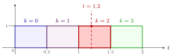{ .notes-fig loading=lazy }

<strong>图 11</strong> $\Delta=0.5$ 时各项 $\delta_\Delta(t-k\Delta)\cdot\Delta$ 都是高 $1$、宽 $0.5$ 的门，依次占据 $[0,0.5)$、$[0.5,1)$、$[1,1.5)$、$[1.5,2)$，不重叠、无空隙。竖虚线 $t=1.2$ 只穿过 $k=2$ 的门（红色），其余门在这里都是 $0$。
{: .fig-caption }

▸ <strong>$\delta_\Delta$ 的分段定义是人为规定的。</strong> $\delta_\Delta$ 不是推出来的，而是为了拼台阶专门设计的积木。按用途，它要满足三条：

1.  <strong>只占宽 $\Delta$ 的一格，格外为 $0$</strong>：每块积木只管自己那一格，相邻积木互不干扰；

2.  <strong>面积为 $1$</strong>：$\Delta\to0$ 时它成为冲激函数 $\delta(t)$，后面才能得到卷积积分；

3.  <strong>宽度 $\Delta$ 可以任意缩小</strong>：$\Delta$ 越小，台阶越细，近似越准。

满足这三条最简单的形状是矩形：宽 $\Delta$、高 $\frac1\Delta$。矩形在格内一个值、格外另一个值，写出来就是分段函数。

<strong>可以换的规定</strong>：

-   <strong>开闭</strong>：写成 $[0,\Delta)$ 还是 $(0,\Delta]$，只影响格子边界上那一点归哪一格，每个 $t$ 仍然只落在一格里。取左闭右开是习惯。

-   <strong>形状</strong>：换成底宽 $2\Delta$、面积为 $1$ 的三角形，相邻三角形会重叠，一个 $t$ 上同时有两项不为零，叠加出来的是把各采样点用直线连起来的折线，不再是台阶（下图）。所以「每个 $t$ 只有一项不为零」是<strong>选了矩形</strong>才有的性质。<strong>【存疑】</strong>Oppenheim 第 2.2、2.5 节只讲三角形脉冲取极限仍是 $\delta(t)$，没讲用它拼 $x(t)$ 得到折线；这里的依据是一阶保持(first-order hold)的标准结论。

<strong>不受影响的结论</strong>：只要积木面积为 $1$、宽度能缩到 $0$，$\Delta\to0$ 的极限都是同一个 $\delta(t)$，最后得到的卷积积分与中间选矩形还是三角形无关（$\delta(t)$ 的多种极限形式见「冲激函数的性质」笔记「冲激函数的多样性」一节）。

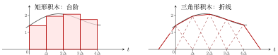{ .notes-fig loading=lazy }

<strong>图 12</strong> 同一条 $x(t)$（灰色）。左：矩形积木互不重叠，每个 $t$ 只有一块起作用，拼出台阶。右：底宽 $2\Delta$ 的三角形积木（虚线）相邻两块重叠，每个 $t$ 上有两块起作用，相加得到经过各采样点 $\big(k\Delta,x(k\Delta)\big)$ 的折线（红实线）。两端的斜边是最外两块三角形的一半，没有邻居与它相加。右图的结论存疑，见上文。
{: .fig-caption }

▸ <strong>取极限。</strong> $\Delta$ 取得特别小时，阶梯函数与 $x(t)$ 保持一致：

$$
\lim_{\Delta\to0}x_\Delta(t)=x(t).
$$

### 4.2 第二步：逐条性质推出输出

| 输入 | 输出 | 依据 |
|:---|:---|:---|
| $\delta_\Delta(t)$ | $h_\Delta(t)$ | $h_\Delta(t)$ 的定义 |
| $\delta_\Delta(t-k\Delta)$ | $h_\Delta(t-k\Delta)$ | <strong>时不变性</strong>：输入右移 $k\Delta$，输出也右移 $k\Delta$ |
| $x(k\Delta)\,\delta_\Delta(t-k\Delta)\cdot\Delta$ | $x(k\Delta)\,h_\Delta(t-k\Delta)\cdot\Delta$ | <strong>齐次性</strong>：系数 $a=x(k\Delta)\cdot\Delta$ |
| $\sum_{k=-\infty}^{+\infty}x(k\Delta)\,\delta_\Delta(t-k\Delta)\cdot\Delta$ | $\sum_{k=-\infty}^{+\infty}x(k\Delta)\,h_\Delta(t-k\Delta)\cdot\Delta$ | <strong>叠加性</strong>：输入全部加起来，输出也全部加起来 |

最后一行左边就是 $x_\Delta(t)$（第一步）。所以阶梯函数 $x_\Delta(t)$ 的输出是 $\sum_k x(k\Delta)\,h_\Delta(t-k\Delta)\cdot\Delta$。

### 4.3 第三步：令 $\Delta\to0$，求和变成积分

两边同时令 $\Delta\to0$。左边 $\lim x_\Delta(t)=x(t)$，所以 $x(t)$ 通过 LTI 的输出 $y(t)$ 为

$$
\begin{align*}
y(t)&=\lim_{\Delta\to0}\sum_{k=-\infty}^{+\infty}x(k\Delta)\,h_\Delta(t-k\Delta)\cdot\Delta\\[2pt]
&=\lim_{\Delta\to0}\sum_{k=-\infty}^{+\infty}x(k\Delta)\,h(t-k\Delta)\cdot\Delta
&&\text{（$\Delta\to0$ 时 $h_\Delta\to h$）}\\[2pt]
&=\int_{-\infty}^{+\infty}x(\tau)\,h(t-\tau)\,\mathrm{d}\tau
&&\text{（黎曼积分的定义）}
\end{align*}
$$

▸ <strong>第二个等号。</strong> $h_\Delta$ 换成 $h$，因为 $\Delta\to0$ 时 $h_\Delta(t)$ 趋于 $h(t)$（冲激响应的定义）。

▸ <strong>第三个等号。</strong> 这就是积分的定义（黎曼和取极限）：

| 求和里的 | 积分里的 | 含义 |
|:---|:---|:---|
| $k\Delta$ | $\tau$ | 第 $k$ 块所在的位置 |
| $\Delta$ | $\mathrm{d}\tau$ | 每块的宽度 |
| $\displaystyle\lim_{\Delta\to0}\sum_{k=-\infty}^{+\infty}$ | $\displaystyle\int_{-\infty}^{+\infty}$ | 把所有块加起来 |

说明

推导中有两处默认成立：一是 $h(t)=\lim_{\Delta\to0}h_\Delta(t)$ 这个极限存在；二是输入取极限（$x_\Delta\to x$）时，输出也取对应的极限。对后面遇到的系统，这两点都成立。

### 4.4 结论：卷积积分

重点

若 $\delta(t)\xrightarrow{\ \text{LTI}\ }h(t)$，则任意 $x(t)$ 通过同一个 LTI，输出为

$$
y(t)=x(t)\ast h(t)=\int_{-\infty}^{+\infty}x(\tau)\,h(t-\tau)\,\mathrm{d}\tau\qquad(\text{教材第 38 页式 2-11、2-12}).
$$

-   $\delta(t)$：冲激函数；$h(t)$：冲激响应。

-   这个公式定义为 $x(t)$ 与 $h(t)$ 的<strong>卷积</strong>(convolution)，记作 $x(t)\ast h(t)$。

-   和离散一样：<strong>只要知道 $h(t)$，就能求出任意输入的输出</strong>。

## 5 离散卷积与连续卷积；「卷积」名字的由来

### 5.1 两个公式对照

重点

$$
\begin{align*}
\text{离散卷积：}\quad x[n]\ast h[n]&=\sum_{k=-\infty}^{+\infty}x[k]\,h[n-k],\\
\text{连续卷积：}\quad x(t)\ast h(t)&=\int_{-\infty}^{+\infty}x(\tau)\,h(t-\tau)\,\mathrm{d}\tau .
\end{align*}
$$

这两个公式要能倒背如流。

|          | 离散                         | 连续                                |
|:---------|:-----------------------------|:------------------------------------|
| 基本输入 | 单位脉冲 $\delta[n]$         | 冲激函数 $\delta(t)$                |
| 它的输出 | 单位脉冲响应 $h[n]$          | 冲激响应 $h(t)$                     |
| 求和变量 | $k$（整数）                  | $\tau$（实数）                      |
| 合成方式 | 求和 $\sum$                  | 积分 $\int\cdots\mathrm{d}\tau$     |
| 推导方式 | 拆成脉冲，直接相加，结果精确 | 拆成窄方波，相加后再令 $\Delta\to0$ |

### 5.2 卷积的四步与名字

把 $h(t-\tau)$ 写成 $h[-(\tau-t)]$：

$$
x(t)\ast h(t)=\int_{-\infty}^{+\infty}x(\tau)\,h\big[-(\tau-t)\big]\,\mathrm{d}\tau .
$$

从里往外读，正好是卷积的四步：

1.  <strong>翻转</strong>：$h(\tau)\to h(-\tau)$，沿纵轴翻过来；

2.  <strong>平移</strong>：$h(-\tau)\to h[-(\tau-t)]$，平移 $t$；

3.  <strong>相乘</strong>：与 $x(\tau)$ 相乘；

4.  <strong>积分</strong>（离散时是<strong>求和</strong>）：对 $\tau$ 积分，得到 $y(t)$ 在这一个 $t$ 上的值。

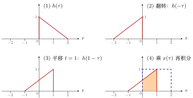{ .notes-fig loading=lazy }

<strong>图 13</strong> 以 $h(\tau)$ 为 $[0,2]$ 上从 $1$ 降到 $0$ 的斜线、$x(\tau)$ 为 $[0,2]$ 上高度 $1$ 的方波（图 (4) 中蓝虚线）为例求 $y(1)$。翻转、平移后 $h(1-\tau)$ 在 $[-1,1]$ 上，与 $x(\tau)$ 重叠在 $[0,1]$，乘积从 $0.5$ 升到 $1$，橙色面积 $=\frac{0.5+1}{2}\times1=0.75$，即 $y(1)=0.75$。
{: .fig-caption }

重点

<strong>卷积</strong>(convolution)的名字取自四步中的两步：<strong>「卷」指翻转，「积」指相乘</strong>。

