# 冲激函数 δ(t) 的性质

浙江大学 2022《信号与系统》（胡浩基）听课笔记（教材第 12、24 页）

[:material-file-pdf-box: 下载 PDF 版](pdf/06-冲激函数的性质.pdf){ .md-button }

<!-- 本页由 tools/signal_notes/sync.py 从 LaTeX 笔记自动生成，请勿手改；改动请改源 .tex 后重新同步。 -->

## 1 复习：冲激函数的定义

重点

$\delta_\Delta(t)$ 是从 $0$ 到 $\Delta$ 的方波，宽度 $\Delta$，高度 $\dfrac1\Delta$，面积为 $1$；

$$
\delta(t)=\lim_{\Delta\to0}\delta_\Delta(t).
$$

下面的性质一、二直接从这个定义出发证明；性质三起要用到「两个函数相等」的新定义（第 4 节）。

## 2 性质一：积分为 1

重点

$$
\int_{-\infty}^{+\infty}\delta(t)\,\mathrm{d}t=1\qquad(\text{教材第 12 页式 1-38}).
$$

推广到任意上下限：

$$
\int_a^b\delta(t)\,\mathrm{d}t=
\begin{cases}
1, & a\lt{}0\lt{}b,\\
-1, & a\gt{}0\gt{}b,\\
0, & \text{其他（上下限同号）}.
\end{cases}
$$

▸ <strong>证明。</strong> 对任意 $\Delta$，$\delta_\Delta(t)$ 的面积是 $\Delta\cdot\frac1\Delta=1$，即 $\int_{-\infty}^{+\infty}\delta_\Delta(t)\,\mathrm{d}t=1$。所以

$$
\begin{align*}
\int_{-\infty}^{+\infty}\delta(t)\,\mathrm{d}t
&=\int_{-\infty}^{+\infty}\Big[\lim_{\Delta\to0}\delta_\Delta(t)\Big]\mathrm{d}t\\
&=\lim_{\Delta\to0}\int_{-\infty}^{+\infty}\delta_\Delta(t)\,\mathrm{d}t
&&\text{（$\delta(t)$ 的积分就\textbf{定义}为这个极限）}\\
&=\lim_{\Delta\to0}1=1.
\end{align*}
$$

▸ <strong>推广的含义。</strong> 冲激只在 $t=0$ 一个点上「冲上去」。积分区间跨过 $0$（$a\lt{}0\lt{}b$）才积到它，结果为 $1$；反过来积（从大到小，$a\gt{}0\gt{}b$）按积分的定义变号，为 $-1$；区间不含 $0$（上下限都小于 $0$ 或都大于 $0$），积分为 $0$。

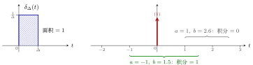{ .notes-fig loading=lazy }

<strong>图 1</strong> 左：每个 $\delta_\Delta(t)$ 的面积都是 $1$。右：积分区间跨过 $0$ 时积到冲激，结果为 $1$；区间不含 $0$ 时结果为 $0$。
{: .fig-caption }

## 3 性质二：筛选性

重点

若 $x(t)$ 在 $t=0$ 处连续，则

$$
\int_{-\infty}^{+\infty}x(t)\,\delta(t)\,\mathrm{d}t=x(0)\qquad(\text{教材第 12 页式 1-40}).
$$

变形（冲激移到 $t_0$）：

$$
\int_{-\infty}^{+\infty}x(t)\,\delta(t-t_0)\,\mathrm{d}t=x(t_0).
$$

$x(t)$ 与冲激相乘再积分，只「筛」出冲激所在那一点的值。性质一是性质二在 $x(t)\equiv1$ 时的特例。

▸ <strong>证明。</strong>

$$
\begin{align*}
\int_{-\infty}^{+\infty}x(t)\,\delta(t)\,\mathrm{d}t
&=\lim_{\Delta\to0}\int_{-\infty}^{+\infty}x(t)\,\delta_\Delta(t)\,\mathrm{d}t\\
&=\lim_{\Delta\to0}\int_0^\Delta x(t)\cdot\frac1\Delta\,\mathrm{d}t
&&\text{（$\delta_\Delta$ 只在 $[0,\Delta]$ 上非零，值为 $\tfrac1\Delta$）}\\
&=\lim_{\Delta\to0}\frac1\Delta\int_0^\Delta x(t)\,\mathrm{d}t\\
&=\lim_{\Delta\to0}\frac1\Delta\cdot x(\xi)\,\Delta,\quad 0\le\xi\le\Delta
&&\text{（积分中值定理）}\\
&=\lim_{\Delta\to0}x(\xi)=x(0)
&&\text{（$\xi$ 被夹在 $0$ 与 $\Delta$ 之间）}.
\end{align*}
$$

<strong>积分中值定理</strong>：函数在一段区间上的积分，等于区间内某一点 $\xi$ 处的函数值乘区间长度。

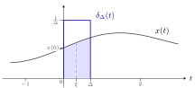{ .notes-fig loading=lazy }

<strong>图 2</strong> $x(t)\,\delta_\Delta(t)$ 只在 $[0,\Delta]$ 上非零。浅蓝色是 $\int_0^\Delta x(t)\,\mathrm{d}t=x(\xi)\Delta$，乘 $\frac1\Delta$ 后剩 $x(\xi)$；$\Delta\to0$ 时 $\xi\to0$，结果是 $x(0)$。
{: .fig-caption }

## 4 两个函数相等的定义

性质三 $x(t)\delta(t)=x(0)\delta(t)$ 的「$=$」两边都含冲激，不能逐点比较。要证明它，先要回答一个看似简单的问题：<strong>两个函数 $f_1(t)$ 与 $f_2(t)$ 什么时候相等？</strong>

### 4.1 定义一：逐点相等

重点

<strong>定义一</strong>：若对任意 $t_0\in\mathbb{R}$，有 $f_1(t_0)=f_2(t_0)$，则 $f_1(t)=f_2(t)$。

两条曲线必须<strong>每一点都严丝合缝</strong>地重合。这个定义<strong>太严格</strong>。

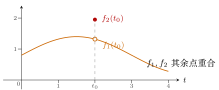{ .notes-fig loading=lazy }

<strong>图 3</strong> 两个函数只在 $t_0$ 一点不同。按定义一它们不相等；按下面的定义二、定义三它们相等。
{: .fig-caption }

### 4.2 定义二：只在有限个点上不等

如果只在一个点上不同也算相等，那么由等号的<strong>传递性</strong>，两个点、三个点……任意有限个点上不同也都必须算相等（中间插一个「只差一个点」的函数即可传递过去）。于是：

重点

<strong>定义二</strong>：若 $f_1(t)$ 与 $f_2(t)$ 只在<strong>有限个点</strong>上不相等，在其他点上相等，则 $f_1(t)=f_2(t)$。

这个定义可以用，但写法笨拙。

### 4.3 定义三：勒贝格的定义

重点

<strong>定义三</strong>（勒贝格(Lebesgue)定义）：$f_1(t)=f_2(t)$ 是指对<strong>任意</strong>函数 $y(t)$，有

$$
\int_{-\infty}^{+\infty}y(t)\,f_1(t)\,\mathrm{d}t=\int_{-\infty}^{+\infty}y(t)\,f_2(t)\,\mathrm{d}t .
$$

意思是：拿任意一个函数 $y(t)$ 去和它们分别相乘、再积分，结果总是一样，就认为这两个函数相等。

▸ <strong>定义三包含定义二。</strong> 若 $f_1$、$f_2$ 只在有限个点上不同，则 $y(t)f_1(t)$ 与 $y(t)f_2(t)$ 也只在这有限个点上不同；按黎曼积分的定义，改动有限个点上的值<strong>不改变积分值</strong>，所以两个积分相等。

说明

-   「任意 $y(t)$」不包括 $\delta(t)$ 这类奇异函数：$y(t)$ 不能取冲激。

-   「在有限个点上不等」指这些点上都是确定的有限值。若一个函数在某点有冲激、另一个没有，它们不相等。

-   若某个 $y(t)$ 让积分不收敛（例如趋于 $+\infty$），则要求两边同时不收敛、且趋向相同。

例 1 <strong>区间上不同的两个函数</strong> 不相等
{: .ex-head }

<strong>题目</strong>：$f_1(t)$ 与 $f_2(t)$ 在 $[t_1,t_2]$ 以外处处相等，在 $[t_1,t_2]$ 上 $f_2(t)\gt{}f_1(t)$。按定义三，它们相等吗？

<strong>解</strong>：<strong>不相等</strong>。只需找一个反例 $y(t)$：取 $y(t)$ 在 $[t_1,t_2]$ 上为 $1$、其他地方为 $0$。则

$$
\int_{-\infty}^{+\infty}y(t)f_1(t)\,\mathrm{d}t=\int_{t_1}^{t_2}f_1(t)\,\mathrm{d}t,\qquad
\int_{-\infty}^{+\infty}y(t)f_2(t)\,\mathrm{d}t=\int_{t_1}^{t_2}f_2(t)\,\mathrm{d}t .
$$

由于 $t_1\le t\le t_2$ 时 $f_2(t)\gt{}f_1(t)$，所以后者严格大于前者，两个积分不等。哪怕这一段区间很短，两个函数也不相等。

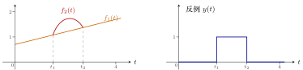{ .notes-fig loading=lazy }

<strong>图 4</strong> 左：$f_2$ 只在 $[t_1,t_2]$ 上高于 $f_1$。右：取 $y(t)$ 为 $[t_1,t_2]$ 上的方波，两个积分不等，所以 $f_1\ne f_2$。
{: .fig-caption }

例 2 <strong>单位阶跃 u(t) 在 0 点的取值</strong> 可以任取
{: .ex-head }

<strong>题目</strong>：$u(t)=\begin{cases}1,&t\gt{}0\\0,&t\lt{}0\end{cases}$，$u(0)$ 等于多少？

<strong>解</strong>：可以是任意值。设

$$
u_1(t)=\begin{cases}1,&t\ge0\\0,&t\lt{}0\end{cases},\qquad
u_2(t)=\begin{cases}1,&t\gt{}0\\0,&t\le0\end{cases}.
$$

两者只在 $t=0$ 一点不同，任何 $y(t)$ 与它们相乘后积分都一样。由定义三，$u_1(t)=u_2(t)$，是同一个函数。

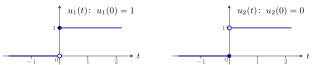{ .notes-fig loading=lazy }

<strong>图 5</strong> 实心点是该点的取值，空心点表示不取。两者只差 $t=0$ 一个点，按定义三是同一个函数。
{: .fig-caption }

例 3 <strong>系统 y(t)=t·x(t) 是否可逆</strong> 可逆
{: .ex-head }

<strong>题目</strong>：系统 $y(t)=t\,x(t)$ 可逆吗？

<strong>解</strong>：$t\ne0$ 时 $x(t)=y(t)/t$，可以由输出恢复输入；只有 $t=0$ 一个点恢复不出来。按定义三，只差一个点的两个函数是同一个函数，所以可以认为这个系统可逆。

说明

平时做题不必走极端：例如问 $u(3)$ 等于多少，答 $1$ 即可。「在个别点上取值可以任意」只用于理解两个函数为什么相等，不要拿来否定常规的结论。

### 4.4 勒贝格积分：横着数钱

▸ <strong>黎曼积分(Riemann integral)。</strong> 高等数学里学的积分：把横轴切成一小段一小段，每段竖着取一个小矩形再相加。勒贝格的比喻是<strong>「竖着数钱」</strong>。

▸ <strong>勒贝格积分(Lebesgue integral)。</strong> 把<strong>纵轴</strong>切成一层一层，每一层横着取出函数值落在这一层的那些 $t$，再相加，即<strong>「横着数钱」</strong>。

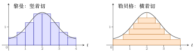{ .notes-fig loading=lazy }

<strong>图 6</strong> 同一个函数的两种近似求面积方法。左：按 $t$ 切成竖条；右：按函数值切成横条，每条的长度是「函数值不低于这一层的 $t$ 的范围」。
{: .fig-caption }

重点

-   凡是黎曼可积的函数，勒贝格积分也能积，而且结果一样。

-   有些函数黎曼积分积不出来，勒贝格积分能积。经典例子是<strong>狄利克雷函数</strong>(Dirichlet function)：

    $$
    D(t)=\begin{cases}1,&t\text{ 为有理数}\\0,&t\text{ 为无理数}\end{cases},\qquad
    \int_0^1D(t)\,\mathrm{d}t=0\ (\text{勒贝格积分}).
    $$

    任意小的区间里都既有有理数又有无理数，竖着切怎么切都积不出来。

-   用勒贝格积分理解定义三，定义二中的「有限个点」可以放宽为<strong>可数个点</strong>（第 5 节）：两个函数在可数个点上不等、其他点相等，仍然相等。例如两个函数在所有有理数点上都不等、在所有无理数点上相等，它们仍然相等。

## 5 可数集与不可数集

无限集合分为两类：<strong>可数无限集</strong>（简称可数集(countable set)）和<strong>不可数集</strong>(uncountable set)。这个区分由康托(Cantor)给出，是实变函数的基础。

### 5.1 两个无限集「一样多」

重点

若存在一个由无限集 $A$ 到无限集 $B$ 的<strong>一一映射</strong>(bijection)，就称 $A$ 与 $B$ <strong>一样多</strong>，也叫<strong>等势</strong>或<strong>基数相同</strong>。

一一映射：$A$ 中每个元素唯一对应 $B$ 中一个元素，$B$ 中每个元素也唯一对应 $A$ 中一个元素，<strong>没有重复，也没有遗漏</strong>。

例 1 <strong>自然数与偶数</strong> 一样多
{: .ex-head }

对应 $n\leftrightarrow 2n$：

|        |     |     |     |     |      |          |
|:-------|:---:|:---:|:---:|:---:|:----:|:--------:|
| 自然数 | $1$ | $2$ | $3$ | $4$ | $5$  | $\cdots$ |
| 偶数   | $2$ | $4$ | $6$ | $8$ | $10$ | $\cdots$ |

没有重复也没有遗漏，所以自然数与偶数一样多。同理，自然数与奇数也一样多。

例 2 <strong>自然数与整数</strong> 一样多
{: .ex-head }

按 $0,1,-1,2,-2,3,-3,\dots$ 的顺序编号：

|        |     |     |      |     |      |     |      |     |      |          |
|:-------|:---:|:---:|:----:|:---:|:----:|:---:|:----:|:---:|:----:|:--------:|
| 自然数 | $1$ | $2$ | $3$  | $4$ | $5$  | $6$ | $7$  | $8$ | $9$  | $\cdots$ |
| 整数   | $0$ | $1$ | $-1$ | $2$ | $-2$ | $3$ | $-3$ | $4$ | $-4$ | $\cdots$ |

每个整数都排到了一个位置，所以一样多。

例 3 <strong>自然数与有理数</strong> 一样多
{: .ex-head }

有理数都能写成 $\frac mn$（$m,n$ 为整数）。先把所有正有理数排成一张表：第 $n$ 行是分母为 $n$ 的数（重复的如 $\frac22$ 也先写上占位）。再按康托的<strong>折线排序</strong>走一遍：

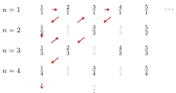{ .notes-fig loading=lazy }

<strong>图 7</strong> 折线排序：$\frac11\to\frac21\to\frac12\to\frac13\to\frac22\to\frac31\to\frac41\to\frac32\to\frac23\to\frac14\to\cdots$。灰色的 $\frac22,\frac42,\frac33,\frac24,\frac44$ 与前面重复，走到时跳过。
{: .fig-caption }

编号时先放 $0$，之后每走到一个新的正有理数，就紧跟着写上它的相反数：

|  |  |  |  |  |  |  |  |  |  |  |  |
|:---|:--:|:--:|:--:|:--:|:--:|:--:|:--:|:--:|:--:|:--:|:--:|
| 自然数 | $1$ | $2$ | $3$ | $4$ | $5$ | $6$ | $7$ | $8$ | $9$ | $10$ | $\cdots$ |
| 有理数 | $0$ | $1$ | $-1$ | $2$ | $-2$ | $\frac12$ | $-\frac12$ | $\frac13$ | $-\frac13$ | $3$ | $\cdots$ |

所有有理数都会被排到一个位置，所以自然数与有理数一样多。

### 5.2 可数集与不可数集

重点

-   <strong>可数集</strong>：与自然数集一样多（等势、基数相同）的集合。偶数集、整数集、有理数集都是可数集。

-   <strong>实数集不可数</strong>：实数比自然数多，无法从头到尾、不重复不遗漏地排成一列。

例 4 <strong>实数集不可数（对角线法）</strong> 反证法
{: .ex-head }

只看 $(0,1)$ 内的实数。假设它们可数，就能排成一列（以下数字只是举例）：

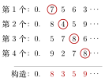{ .notes-fig loading=lazy }

<strong>图 8</strong> 构造一个新数：第 $k$ 位故意取得和第 $k$ 个数的第 $k$ 位（红圈）不一样，例如 $7\to8$、$4\to3$、$8\to5$、$8\to9$。
{: .fig-caption }

新数 $0.8359\cdots$ 与第 $k$ 个数至少在第 $k$ 位上不同，所以不在这一列里。这与「所有实数都排进去了」矛盾，因此 $(0,1)$ 内的实数不可数，实数集不可数。

### 5.3 一小段实数与整条实数轴一样多

▸ <strong>两段区间。</strong> $[0,1]$ 与 $[3,7]$ 一样多：取 $b=4a+3$，$a=0\mapsto b=3$，$a=1\mapsto b=7$，是一一映射。

▸ <strong>一段区间与整条实数轴。</strong> $\left(-\frac\pi2,\frac\pi2\right)$ 与 $(-\infty,+\infty)$ 一样多：取 $b=\tan a$，$a\to\pm\frac\pi2$ 时 $b\to\pm\infty$，中间一一对应。再先用线性映射把 $(0,1)$ 变到 $\left(-\frac\pi2,\frac\pi2\right)$，就知道 $(0,1)$ 也和整条实数轴一样多。

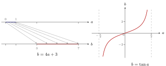{ .notes-fig loading=lazy }

<strong>图 9</strong> 左：$[0,1]$ 上每个点线性对应到 $[3,7]$ 上一个点。右：$\tan a$ 把 $\left(-\frac\pi2,\frac\pi2\right)$ 一一对应到整条实数轴。
{: .fig-caption }

例 5 <strong>线段与正方形一样多</strong> 交错取位
{: .ex-head }

<strong>题目</strong>：线段 $[0,1]$ 上的点，与单位正方形 $[0,1]\times[0,1]$ 上的点，哪个多？

<strong>解</strong>：一样多。正方形上的点写成 $(a,b)$，$a,b\in[0,1]$；把 $a$、$b$ 的小数位<strong>交错</strong>抄成一个数 $c$：

$$
a=0.7182\cdots,\quad b=0.5436\cdots
\quad\Longrightarrow\quad
c=0.7\,5\,1\,4\,8\,3\,2\,6\cdots
$$

（$c$ 的奇数位来自 $a$，偶数位来自 $b$。）反过来，从 $c$ 的奇数位、偶数位又能拆回 $a$ 和 $b$。这建立了正方形与线段之间的一一对应。

说明

严格的证明还要处理 $0.0999\cdots=0.1$ 这类有两种小数写法的数，这里只讲构造思路。

## 6 性质三：与冲激相乘

重点

$$
x(t)\,\delta(t)=x(0)\,\delta(t)\qquad(\text{教材第 12 页式 1-42}).
$$

变形：

$$
x(t)\,\delta(t-t_0)=x(t_0)\,\delta(t-t_0).
$$

这里的「$=$」按定义三理解。

▸ <strong>证明（基于定义三）。</strong> 对任意 $y(t)$，比较两边与 $y(t)$ 相乘后的积分：

$$
\begin{align*}
\text{左边：}\int_{-\infty}^{+\infty}y(t)\big[x(t)\,\delta(t)\big]\mathrm{d}t
&=\int_{-\infty}^{+\infty}\big[x(t)\,y(t)\big]\delta(t)\,\mathrm{d}t=x(0)\,y(0),\\
\text{右边：}\int_{-\infty}^{+\infty}y(t)\big[x(0)\,\delta(t)\big]\mathrm{d}t
&=x(0)\int_{-\infty}^{+\infty}y(t)\,\delta(t)\,\mathrm{d}t=x(0)\,y(0).
\end{align*}
$$

左边把 $x(t)y(t)$ 整体看成一个函数，用性质二；右边先把常数 $x(0)$ 提出来，再用性质二。两边相等，由定义三，命题成立。变形的证明完全一样：两边乘 $y(t)$ 再积分，用性质二的变形。

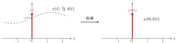{ .notes-fig loading=lazy }

<strong>图 10</strong> $x(t)$ 乘冲激，只有 $t=0$ 处的值 $x(0)$ 起作用：结果是强度为 $x(0)$ 的冲激（括号里的数是强度，不是高度）。
{: .fig-caption }

## 7 性质四：尺度变换

重点

$$
\delta(at)=\frac{1}{|a|}\,\delta(t),\quad a\ne0\qquad(\text{教材第 24 页式 1-82}).
$$

变形：

$$
\delta(at+b)=\frac{1}{|a|}\,\delta\!\left(t+\frac ba\right).
$$

▸ <strong>证明（基于定义三）。</strong> 对任意 $y(t)$：

右边：$\displaystyle\int_{-\infty}^{+\infty}y(t)\,\frac1{|a|}\,\delta(t)\,\mathrm{d}t=\frac1{|a|}\,y(0)$（性质二）。

左边：$\displaystyle\int_{-\infty}^{+\infty}y(t)\,\delta(at)\,\mathrm{d}t$，换元 $t'=at$，$t=\frac{t'}a$，$\mathrm{d}t=\frac{\mathrm{d}t'}a$。要按 $a$ 的正负讨论积分上下限：

1.  $a\gt{}0$：$t$ 从 $-\infty$ 到 $+\infty$ 时，$t'$ 也从 $-\infty$ 到 $+\infty$，

    $$
    \text{左边}=\frac1a\int_{-\infty}^{+\infty}y\!\left(\frac{t'}a\right)\delta(t')\,\mathrm{d}t'=\frac1a\,y(0).
    $$

2.  $a\lt{}0$：$t$ 从 $-\infty$ 到 $+\infty$ 时，$t'$ 从 $+\infty$ 到 $-\infty$，上下限颠倒，翻回来要加负号，

    $$
    \text{左边}=\frac1a\int_{+\infty}^{-\infty}y\!\left(\frac{t'}a\right)\delta(t')\,\mathrm{d}t'
    =-\frac1a\int_{-\infty}^{+\infty}y\!\left(\frac{t'}a\right)\delta(t')\,\mathrm{d}t'=-\frac1a\,y(0).
    $$

两种情况合起来，左边 $=\frac1{|a|}y(0)=$ 右边。由定义三，命题成立。变形用同样的方法证明。

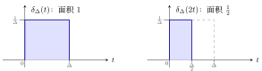{ .notes-fig loading=lazy }

<strong>图 11</strong> 以 $a=2$ 为例：$\delta_\Delta(2t)$ 宽度压缩一半、高度不变，面积变成 $\frac12$。取极限得 $\delta(2t)=\frac12\delta(t)$。
{: .fig-caption }

## 8 函数相等与卷积

定义三下的「相等」和卷积完全兼容，可以放心地用来分析 LTI 系统。

重点

<strong>定理</strong>：若 $h_1(t)=h_2(t)$（按定义三），则对任意 $x(t)$，有

$$
x(t)\ast h_1(t)=x(t)\ast h_2(t).
$$

逆命题也成立：若对任意 $x(t)$ 都有 $x(t)\ast h_1(t)=x(t)\ast h_2(t)$，则 $h_1(t)=h_2(t)$。

▸ <strong>为什么需要证明。</strong> 按定义三，$h_1=h_2$ 并不保证两者每一点都相等，所以「代进卷积公式结果一样」不是显然的。

▸ <strong>证明。</strong>

$$
\begin{align*}
x(t)\ast h_1(t)
&=\int_{-\infty}^{+\infty}x(\tau)\,h_1(t-\tau)\,\mathrm{d}\tau
&&\text{（连续卷积公式）}\\
&=\int_{-\infty}^{+\infty}x(t-\tau)\,h_1(\tau)\,\mathrm{d}\tau
&&\text{（换元，即卷积交换律）}\\
&=\int_{-\infty}^{+\infty}x(t-\tau)\,h_2(\tau)\,\mathrm{d}\tau
&&\text{（定义三，把 $x(t-\tau)$ 当作 $y(\tau)$）}\\
&=x(t)\ast h_2(t).
\end{align*}
$$

▸ <strong>第二个等号的换元。</strong> 令 $\tau'=t-\tau$，则 $\tau=t-\tau'$，$\mathrm{d}\tau=-\mathrm{d}\tau'$；$\tau=-\infty$ 时 $\tau'=+\infty$，$\tau=+\infty$ 时 $\tau'=-\infty$。于是

$$
\int_{-\infty}^{+\infty}x(\tau)\,h_1(t-\tau)\,\mathrm{d}\tau
=\int_{+\infty}^{-\infty}x(t-\tau')\,h_1(\tau')\,(-\mathrm{d}\tau')
=\int_{-\infty}^{+\infty}x(t-\tau')\,h_1(\tau')\,\mathrm{d}\tau',
$$

最后把 $\tau'$ 改写回 $\tau$ 即可。

▸ <strong>第三个等号。</strong> 对固定的 $t$，$x(t-\tau)$ 是 $\tau$ 的一个函数，相当于定义三中的 $y(\tau)$；$h_1=h_2$ 意味着它与 $h_1(\tau)$、$h_2(\tau)$ 分别相乘积分的结果相同。

## 9 性质五：冲激的复合

重点

设 $f(t)$ 的所有零点为 $t_i$（即 $f(t_i)=0$），且 $f'(t_i)\ne0$，则

$$
\delta\big(f(t)\big)=\sum_{i}\frac{1}{|f'(t_i)|}\,\delta(t-t_i).
$$

这条性质出自郑君里《信号与系统》；证明方法仍是两边乘 $y(t)$ 再积分。

$f(t)$ 每过一次零点，$\delta(f(t))$ 就在那里产生一个冲激，强度是该点斜率绝对值的倒数：$f(t)$ 穿过零点越陡，冲激越弱。

例 1 <strong>性质四是性质五的特例</strong> $f(t)=at$
{: .ex-head }

取 $f(t)=at$（$a\ne0$）。当且仅当 $t=0$ 时 $f(t)=0$；$f'(t)=a$，所以 $f'(0)=a$。代入性质五：

$$
\delta(at)=\frac1{|a|}\,\delta(t),
$$

正是性质四。

例 2 <strong>$\delta(t^2-3t+2)$</strong> $\delta(t-1)+\delta(t-2)$
{: .ex-head }

<strong>解</strong>：$f(t)=t^2-3t+2=(t-1)(t-2)$，当且仅当 $t=1$、$t=2$ 时 $f(t)=0$。$f'(t)=2t-3$，所以 $f'(1)=-1$，$f'(2)=1$。代入性质五：

$$
\delta(t^2-3t+2)=\frac1{|-1|}\,\delta(t-1)+\frac1{|1|}\,\delta(t-2)=\delta(t-1)+\delta(t-2).
$$

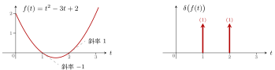{ .notes-fig loading=lazy }

<strong>图 12</strong> 左：$f(t)$ 在 $t=1$、$t=2$ 处过零，斜率分别为 $-1$、$1$。右：$\delta(f(t))$ 在这两点各有一个强度为 $1$ 的冲激。
{: .fig-caption }

例 3 <strong>$\delta(\cos t)$ 与 $\delta(\sin t)$</strong> 每隔 $\pi$ 一个冲激
{: .ex-head }

<strong>解</strong>：设 $f(t)=\cos t$，当且仅当 $t=k\pi+\frac\pi2$（$k\in\mathbb{Z}$）时 $f(t)=0$。$f'(t)=-\sin t$，

$$
\left|f'\!\left(k\pi+\tfrac\pi2\right)\right|=\left|\sin\!\left(k\pi+\tfrac\pi2\right)\right|=1
$$

（正负交替，但绝对值恒为 $1$）。代入性质五：

$$
\delta(\cos t)=\sum_{k=-\infty}^{+\infty}\delta\!\left(t-k\pi-\frac\pi2\right).
$$

同理，$\sin t$ 的零点是 $t=k\pi$，且 $|\cos k\pi|=1$，所以

$$
\delta(\sin t)=\sum_{k=-\infty}^{+\infty}\delta(t-k\pi).
$$

例 4 <strong>$\int_{-2\pi}^{2\pi}(1+t)\,\delta(\cos t)\,\mathrm{d}t$</strong> <small>教材第 33 页 1-20(3)</small> 结果为 4
{: .ex-head }

<strong>解</strong>：由上一例，$\delta(\cos t)$ 在每个 $k\pi+\frac\pi2$ 处有一个强度为 $1$ 的冲激。积分区间 $[-2\pi,2\pi]$ 里只有四个：$-\frac{3\pi}2,\ -\frac\pi2,\ \frac\pi2,\ \frac{3\pi}2$（$\pm\frac{5\pi}2$ 在区间外）。

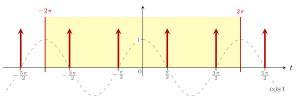{ .notes-fig loading=lazy }

<strong>图 13</strong> 灰色虚线是 $\cos t$，红色箭头是 $\delta(\cos t)$ 的冲激（强度均为 $1$），落在 $\cos t$ 的每个零点上。黄色是积分区间 $[-2\pi,2\pi]$，里面只有四个冲激。
{: .fig-caption }

$$
\int_{-2\pi}^{2\pi}(1+t)\,\delta(\cos t)\,\mathrm{d}t
=\int_{-2\pi}^{2\pi}(1+t)\Big[\delta\!\left(t+\tfrac{3\pi}2\right)+\delta\!\left(t+\tfrac\pi2\right)+\delta\!\left(t-\tfrac\pi2\right)+\delta\!\left(t-\tfrac{3\pi}2\right)\Big]\mathrm{d}t .
$$

每一项用性质二的变形 $\int x(t)\,\delta(t-t_0)\,\mathrm{d}t=x(t_0)$（冲激在积分区间内部，积分限不必是 $\pm\infty$）：

$$
=\left(1-\tfrac{3\pi}2\right)+\left(1-\tfrac\pi2\right)+\left(1+\tfrac\pi2\right)+\left(1+\tfrac{3\pi}2\right)=4 .
$$

含 $\pi$ 的项两两抵消。

## 10 冲激函数的多样性

### 10.1 判定一个函数是不是 $\delta(t)$

$\delta(t)$ 不只有「$[0,\Delta]$ 上的窄方波取极限」这一种写法，很多不同的极限都等于它。判定方法：

重点

要证明一个函数 $f(t)$ 是 $\delta(t)$，只需证明对任意函数 $y(t)$ 有

$$
\int_{-\infty}^{+\infty}y(t)\,f(t)\,\mathrm{d}t=y(0).
$$

理由有两条：一是性质二，$\int y(t)\,\delta(t)\,\mathrm{d}t=y(0)$；二是定义三，与任意 $y(t)$ 相乘积分结果都相同的两个函数相等。

### 10.2 对称的窄方波

有的教材把 $\delta_\Delta(t)$ 定义为 $\left[-\frac\Delta2,\frac\Delta2\right]$ 上高度为 $\frac1\Delta$ 的方波，再令 $\Delta\to0$。两种定义都对。

▸ <strong>证明。</strong>

$$
\begin{align*}
\int_{-\infty}^{+\infty}y(t)\Big[\lim_{\Delta\to0}\delta_\Delta(t)\Big]\mathrm{d}t
&=\lim_{\Delta\to0}\frac1\Delta\int_{-\Delta/2}^{\Delta/2}y(t)\,\mathrm{d}t\\
&=\lim_{\Delta\to0}\frac1\Delta\cdot y(\xi)\,\Delta,\quad -\tfrac\Delta2\le\xi\le\tfrac\Delta2
&&\text{（积分中值定理）}\\
&=\lim_{\Delta\to0}y(\xi)=y(0).
\end{align*}
$$

### 10.3 三角形脉冲

$\delta_\Delta(t)$ 取底边为 $[-\Delta,\Delta]$、顶点高度为 $\frac1\Delta$ 的三角形（面积 $\frac12\cdot2\Delta\cdot\frac1\Delta=1$），$\Delta\to0$ 时同样等于 $\delta(t)$。证明方法相同，只是积分要分左右两段讨论，计算更繁琐。

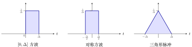{ .notes-fig loading=lazy }

<strong>图 14</strong> 三种 $\delta_\Delta(t)$，面积都是 $1$。$\Delta\to0$ 时三者都等于 $\delta(t)$。
{: .fig-caption }

### 10.4 抽样函数的极限

重点

$$
\lim_{\omega\to+\infty}\frac{\sin(\omega t)}{\pi t}=\delta(t).
$$

这个结论在第三章还会用到，即使记不住证明，也要<strong>记住结论</strong>。

▸ <strong>直观理解。</strong> $\dfrac{\sin(\omega t)}{\pi t}$ 是一个抽样函数（Sa 函数）的形状（$\omega\gt{}0$）：

-   $t=0$ 处取极限值 $\dfrac\omega\pi$；

-   零点在 $t=\pm\dfrac\pi\omega,\ \pm\dfrac{2\pi}\omega,\dots$；

-   $\displaystyle\int_{-\infty}^{+\infty}\frac{\sin(\omega t)}{\pi t}\,\mathrm{d}t=1$，与 $\omega$ 无关。

$\omega\to+\infty$ 时，中间的峰冲向无穷大，零点 $\frac\pi\omega\to0$，整个波浪被向中间无限压缩、两侧被压平；而面积始终为 $1$，和性质一吻合。看起来就像一个冲激。

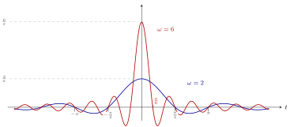{ .notes-fig loading=lazy }

<strong>图 15</strong> $\frac{\sin(\omega t)}{\pi t}$。蓝：$\omega=2$，峰值 $\frac2\pi$，第一个零点 $\frac\pi2$；红：$\omega=6$，峰值 $\frac6\pi$，第一个零点 $\frac\pi6$。两条水平虚线标出两个峰值。$\omega$ 越大，峰越高越窄，面积始终为 $1$。
{: .fig-caption }

▸ <strong>引理。</strong> 若 $x(t)$ 不是无限振荡的函数，则

$$
\lim_{\omega\to+\infty}\int_{-\infty}^{+\infty}x(t)\cos(\omega t)\,\mathrm{d}t=0,\qquad
\lim_{\omega\to+\infty}\int_{-\infty}^{+\infty}x(t)\sin(\omega t)\,\mathrm{d}t=0 .
$$

<strong>直观理解</strong>：$\omega$ 很大时 $\cos(\omega t)$ 上下振荡极快。相邻的半个周期里，$\cos$ 一正一负，而 $x(t)$ 变化平缓、取值几乎一样，所以 $x(t)\cos(\omega t)$ 在相邻两段上的积分一正一负、互相抵消，总积分趋于 $0$。只有 $x(t)$ 自己也变化得极其剧烈（无限振荡），才抵消不掉。

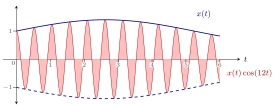{ .notes-fig loading=lazy }

<strong>图 16</strong> 蓝线是平缓的 $x(t)$，红色是 $x(t)\cos(\omega t)$（$\omega=12$）。正、负两部分面积几乎一样，积分几乎为 $0$；$\omega$ 越大抵消越彻底。
{: .fig-caption }

▸ <strong>引理在 $x(t)$ 可导时的证明。</strong> 用分部积分：

$$
\begin{align*}
\int_{-\infty}^{+\infty}x(t)\cos(\omega t)\,\mathrm{d}t
&=\frac1\omega\int_{-\infty}^{+\infty}x(t)\,\mathrm{d}\big(\sin(\omega t)\big)\\
&=\frac1\omega\Big[x(t)\sin(\omega t)\Big]_{-\infty}^{+\infty}-\frac1\omega\int_{-\infty}^{+\infty}x'(t)\sin(\omega t)\,\mathrm{d}t .
\end{align*}
$$

方括号和后面的积分都是有限值，前面乘 $\frac1\omega$；$\omega\to+\infty$ 时两项都趋于 $0$。$\sin$ 的情况同理。（只要求 $x(t)$ 不是无限振荡的版本更一般，证明更难。）

▸ <strong>证明 $\lim\limits_{\omega\to+\infty}\frac{\sin(\omega t)}{\pi t}=\delta(t)$。</strong> 由判定方法，只需证明对任意 $y(t)$：

$$
\int_{-\infty}^{+\infty}\Big[\lim_{\omega\to+\infty}\frac{\sin(\omega t)}{\pi t}\Big]y(t)\,\mathrm{d}t=y(0).
$$

左边 $=\lim\limits_{\omega\to+\infty}\displaystyle\int_{-\infty}^{+\infty}\frac{y(t)}{\pi t}\sin(\omega t)\,\mathrm{d}t$。

<strong>不能直接套引理</strong>：若 $y(0)\ne0$，$\frac{y(t)}{\pi t}$ 在 $t\to0^-$ 时趋于 $\mp\infty$、$t\to0^+$ 时趋于 $\pm\infty$，在 $0$ 点附近变化无限剧烈，不满足引理的条件。

<strong>做法</strong>：减一个 $y(0)$ 再加回来：

$$
\text{左边}=\underbrace{\lim_{\omega\to+\infty}\int_{-\infty}^{+\infty}\frac{y(t)-y(0)}{\pi t}\sin(\omega t)\,\mathrm{d}t}_{(\text{A})}
+\;y(0)\underbrace{\lim_{\omega\to+\infty}\int_{-\infty}^{+\infty}\frac{\sin(\omega t)}{\pi t}\,\mathrm{d}t}_{(\text{B})}.
$$

-   (A)：设 $x(t)=\dfrac{y(t)-y(0)}{\pi t}$。$t\to0$ 时分子、分母都趋于 $0$，由洛必达法则 $x(0)=\lim\limits_{t\to0}\dfrac{y'(t)}{\pi}=\dfrac{y'(0)}{\pi}$，即

    $$
    x(t)=\begin{cases}\dfrac{y(t)-y(0)}{\pi t},&t\ne0\\[6pt]\dfrac{y'(0)}{\pi},&t=0\end{cases},
    $$

    不再是无限振荡的函数，可以用引理：(A) $=0$。

-   (B)：对任意 $\omega\gt{}0$，积分恒等于 $1$，所以 (B) $=1$。

因此左边 $=0+y(0)\cdot1=y(0)$，命题成立。

### 10.5 另一个例子

$$
\lim_{\tau\to0}\frac{\tau}{\pi\,(t^2+\tau^2)}=\delta(t)
$$

也成立（郑君里《信号与系统》习题集）。
