# 连续信号卷积的计算

浙江大学 2022《信号与系统》（胡浩基）第二章听课笔记（教材第 38--39 页）

[:material-file-pdf-box: 下载 PDF 版](pdf/07-连续信号卷积计算.pdf){ .md-button }

<!-- 本页由 tools/signal_notes/sync.py 从 LaTeX 笔记自动生成，请勿手改；改动请改源 .tex 后重新同步。 -->

## 1 卷积公式与两种算法

重点

$$
x(t)\ast h(t)=\int_{-\infty}^{+\infty}x(\tau)\,h(t-\tau)\,\mathrm{d}\tau
=\int_{-\infty}^{+\infty}x(\tau)\,h\big[-(\tau-t)\big]\,\mathrm{d}\tau .
$$

这个公式要通过做题达到倒背如流。按第二种写法，从里往外读是四步：<strong>翻转</strong>（$h(\tau)\to h(-\tau)$）、<strong>平移</strong>（移 $t$）、<strong>相乘</strong>（乘 $x(\tau)$）、<strong>积分</strong>（对 $\tau$ 积分）。与离散卷积相比，只是最后一步由求和换成积分。

两种算法：

-   <strong>直接代公式</strong>：$x(t)$、$h(t)$ 有简单的表达式（如指数乘 $u(t)$）时用（第 2 节）。

-   <strong>图解法</strong>：$x(t)$、$h(t)$ 是方波、三角波这类分段的图形时用。如果硬写出分段表达式代公式，会非常繁琐；应当在脑子里想象 $h$ 翻转后从左往右移动、与 $x$ 重叠的过程（第 3 节）。

重点

<strong>两条辅助规则</strong>（图解法必用）：

1.  <strong>取值范围</strong>：$y(t)=x(t)\ast h(t)$ 的最左端 $=$ $x$ 的最左端 $+$ $h$ 的最左端；最右端 $=$ $x$ 的最右端 $+$ $h$ 的最右端。

2.  <strong>验算：卷积结果不跳变</strong>。积分是平滑的过程，除非 $x(t)$ 或 $h(t)$ 中含冲激，$y(t)$ 不会跳变。分段算出的结果，在各分段的分界点上左右两边要相等。

## 2 直接代公式

例 1 <strong>两个衰减指数的卷积</strong> <small>教材第 38 页例 2-1</small> $\frac{1}{b-a}(e^{-at}-e^{-bt})u(t)$
{: .ex-head }

<strong>题目</strong>：$x(t)=e^{-bt}u(t)$，$h(t)=e^{-at}u(t)$（$a,b\gt{}0$，$a\ne b$），求 $x(t)\ast h(t)$。

▸ <strong>先看图形。</strong> 乘 $u(t)$ 的作用是让 $t\lt{}0$ 的部分全为 $0$。$x(t)$ 在 $t=0$ 处为 $1$，之后向下衰减，$t\to+\infty$ 时趋于 $0$；$b$ 越大衰减越快。$h(t)$ 同理。

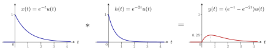{ .notes-fig loading=lazy }

<strong>图 1</strong> 取 $b=1$、$a=2$ 的例子。结果从 $0$ 开始，先升后降，在 $t=\ln2\approx0.69$ 处达到最大值 $0.25$；没有跳变，与「卷积结果不跳变」一致。
{: .fig-caption }

▸ <strong>代公式。</strong>

$$
x(t)\ast h(t)=\int_{-\infty}^{+\infty}e^{-b\tau}u(\tau)\cdot e^{-a(t-\tau)}u(t-\tau)\,\mathrm{d}\tau .
$$

<strong>千万不要代错</strong>：$x(\tau)$ 里 $t$ 换成 $\tau$，$h(t-\tau)$ 里 $t$ 换成 $t-\tau$，包括 $u$ 里的自变量。

▸ <strong>关键：两个 $u$ 决定积分上下限。</strong> $u(\tau)$ 在 $\tau\gt{}0$ 时为 $1$、$\tau\lt{}0$ 时为 $0$；$u(t-\tau)$ 在 $\tau\lt{}t$ 时为 $1$、$\tau\gt{}t$ 时为 $0$。两者相乘，<strong>只有 $0\lt{}\tau\lt{}t$ 时 $u(\tau)\,u(t-\tau)=1$</strong>，其他都为 $0$。

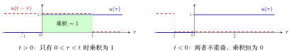{ .notes-fig loading=lazy }

<strong>图 2</strong> 蓝：$u(\tau)$，右半边为 $1$；红虚线：$u(t-\tau)$，在 $\tau\lt{}t$ 时为 $1$。两者重叠的部分（绿色）就是积分区间 $[0,t]$。
{: .fig-caption }

▸ <strong>分情况。</strong>

-   $t\lt{}0$：任何 $\tau$ 都使乘积为 $0$，所以 $x(t)\ast h(t)\equiv0$。

-   $t\gt{}0$：积分区间变成 $[0,t]$，两个 $u$ 都等于 $1$：

$$
\begin{align*}
x(t)\ast h(t)&=\int_0^t e^{-b\tau}e^{-a(t-\tau)}\,\mathrm{d}\tau
=e^{-at}\int_0^t e^{-(b-a)\tau}\,\mathrm{d}\tau\\
&=e^{-at}\cdot\frac{1}{b-a}\Big[1-e^{-(b-a)t}\Big]
=\frac{1}{b-a}\big(e^{-at}-e^{-bt}\big),\qquad t\gt{}0 .
\end{align*}
$$

▸ <strong>合并成一个式子。</strong> 乘 $u(t)$ 就把 $t\lt{}0$ 的部分变成 $0$、$t\gt{}0$ 的部分保持原样：

$$
x(t)\ast h(t)=\frac{1}{b-a}\big(e^{-at}-e^{-bt}\big)\,u(t).
$$

这个「最后乘 $u(t)$」的技巧很常用。教材写成 $\frac{1}{a-b}\big(e^{-bt}-e^{-at}\big)u(t)$，两者相同。

## 3 图解法

例 1 <strong>方波卷直角三角形</strong> <small>教材第 39 页例 2-2</small> 分两段
{: .ex-head }

<strong>题目</strong>：$x(t)$ 是 $[0,1]$ 上高度为 $1$ 的方波；$h(t)$ 是 $[0,1]$ 上的直角三角形，$t=0$ 处高度为 $1$，直线降到 $t=1$ 处为 $0$。求 $y(t)=x(t)\ast h(t)$。

▸ <strong>第一步：取值范围。</strong> 最左端 $0+0=0$，最右端 $1+1=2$，所以 $y(t)$ 只在 $[0,2]$ 上有值。

▸ <strong>第二步：翻转。</strong> 把 $h(\tau)$ 沿纵轴翻转成 $h(-\tau)$：直角边在 $\tau=0$，斜边向左降到 $\tau=-1$。$t=0$ 时，翻转后 $h$ 的最右端正好碰到 $x$ 的最左端，重叠为 $0$。

▸ <strong>第三步：平移、相乘、积分。</strong> $h(t-\tau)$ 是把 $h(-\tau)$ 向右移 $t$：它占据 $[t-1,t]$，在 $\tau=t$ 处最高（为 $1$），在 $\tau=t-1$ 处为 $0$。从左往右移动时，先逐渐移进 $x$ 的方波，再逐渐移出，要分两种情况：

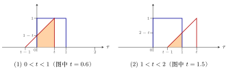{ .notes-fig loading=lazy }

<strong>图 3</strong> 蓝：$x(\tau)$；红：$h(t-\tau)$。橙色是两者重叠部分，它的面积就是 $y(t)$（$x$ 的高度为 $1$，乘积就是红线下的面积）。
{: .fig-caption }

1.  $0\lt{}t\lt{}1$：重叠部分是<strong>梯形</strong>，底边从 $0$ 到 $t$，长 $t$；左边高 $1-t$（红线在 $\tau=0$ 处的高度），右边高 $1$。

    $$
    y(t)=\frac{(1-t)+1}{2}\cdot t=\frac{(2-t)\,t}{2}.
    $$

2.  $1\lt{}t\lt{}2$：重叠部分是<strong>三角形</strong>，从 $t-1$ 到 $1$，底边长 $1-(t-1)=2-t$；斜边是 $45^\circ$，高也是 $2-t$。

    $$
    y(t)=\frac{(2-t)^2}{2}.
    $$

3.  其他（$t\lt{}0$ 或 $t\gt{}2$）：不重叠，$y(t)=0$。

▸ <strong>验算：分界点不跳变。</strong> $t=0$：$\frac{(2-0)\cdot0}{2}=0$，与左边的 $0$ 一致。$t=1$：第一段 $\frac{1\cdot1}2=\frac12$，第二段 $\frac{1^2}2=\frac12$，一致。$t=2$：$\frac{0^2}2=0$，与右边的 $0$ 一致。三个分界点都不跳变。

说明

<strong>易错点</strong>：第一段的梯形，左边的高是红线在 $\tau=0$ 处的高度 $1-t$，不是 $t$。若误用 $t$，会算成 $\frac{(1+t)t}{2}$，在 $t=1$ 处等于 $1$，与第二段的 $\frac12$ 不连续，用「不跳变」一验就能发现。

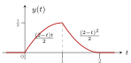{ .notes-fig loading=lazy }

<strong>图 4</strong> 例 1 的结果：$[0,1]$ 上向上弯地升到 $\frac12$，$[1,2]$ 上向下弯地降到 $0$，处处连续。
{: .fig-caption }

## 4 两个方波的卷积

这两个结论要在理解的基础上记住，第三章会用到。

### 4.1 宽度相同：三角波

重点

$x(t)$ 是 $[-T_0,T_0]$ 上高度 $E_1$ 的方波，$h(t)$ 是 $[-T_0,T_0]$ 上高度 $E_2$ 的方波，则 $x(t)\ast h(t)$ 是<strong>三角波</strong>：

-   在 $[-2T_0,2T_0]$ 上有值；

-   在 $t=0$ 处达到最大值 $2T_0E_1E_2$（重合部分的宽度 $\times$ $x$ 的高度 $\times$ $h$ 的高度）；

-   两边是直线。

例 1 <strong>两个 \[-1,1\] 上的单位方波</strong> 三角波
{: .ex-head }

<strong>题目</strong>：$x(t)$、$h(t)$ 都是 $[-1,1]$ 上高度为 $1$ 的方波，求 $x(t)\ast h(t)$。

<strong>解</strong>：

1.  取值范围：最左端 $-1+(-1)=-2$，最右端 $1+1=2$。

2.  $t=-2$ 时两个方波刚好碰上，重叠为 $0$。两个方波宽都是 $2$，所以再走 $2$ 个单位（到 $t=0$）时完全重合，达到最大值：宽 $2$ $\times$ 高 $1$ $\times$ 高 $1$ $=2$。

3.  之后再走 $2$ 个单位（到 $t=2$）完全分开，回到 $0$。

4.  移动的距离增加多少，重叠面积就增加（或减少）多少，是线性关系，所以中间都是直线。

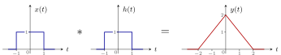{ .notes-fig loading=lazy }

<strong>图 5</strong> 两个宽度都为 $2$ 的单位方波，卷积是 $[-2,2]$ 上的三角波，峰值 $2$。
{: .fig-caption }

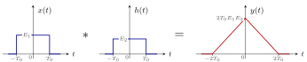{ .notes-fig loading=lazy }

<strong>图 6</strong> 一般情形：宽度相同（都是 $2T_0$）的两个方波，卷积是 $[-2T_0,2T_0]$ 上的三角波，峰值 $2T_0E_1E_2$。
{: .fig-caption }

### 4.2 宽度不同：梯形波

重点

$x(t)$ 是 $[-A,A]$ 上高度 $E_1$ 的方波，$h(t)$ 是 $[-B,B]$ 上高度 $E_2$ 的方波，$A\gt{}B$，则 $x(t)\ast h(t)$ 是<strong>梯形波</strong>：

-   四个拐点的横坐标：$-A-B,\ \ B-A,\ \ A-B,\ \ A+B$（$B-A$ 与 $A-B$ 互为相反数，梯形左右对称）；

-   平顶高度 $2BE_1E_2$（<strong>窄</strong>方波的宽度 $\times$ $E_1$ $\times$ $E_2$）。

▸ <strong>四个拐点怎么来。</strong>

1.  起点：$-A-B$（两个最左端相加），两个方波刚好碰上。

2.  窄方波完全移进宽方波，需要再走<strong>窄方波的宽度</strong> $2B$：$-A-B+2B=B-A$，此后重叠面积达到最大 $2B\cdot E_1E_2$。

3.  窄方波在宽方波里继续走，重叠面积保持不变；能走的距离是<strong>宽度之差</strong> $2A-2B$：$B-A+(2A-2B)=A-B$。

4.  再走 $2B$ 完全移出：$A-B+2B=A+B$（两个最右端相加）。

例 2 <strong>与 \[-1,1\] 上的单位方波</strong> 梯形波
{: .ex-head }

<strong>题目</strong>：$x(t)$ 是 $[-3,3]$ 上高度 $1$ 的方波，$h(t)$ 是 $[-1,1]$ 上高度 $1$ 的方波，求 $x(t)\ast h(t)$。

<strong>解</strong>：$A=3$，$B=1$。起点 $-4$；走窄方波宽度 $2$ 到 $-2$，达到最大值 $2\times1\times1=2$；保持不变走 $6-2=4$ 个单位到 $2$；再走 $2$ 到 $4$ 回到 $0$。

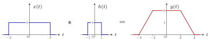{ .notes-fig loading=lazy }

<strong>图 7</strong> 宽度 $6$ 与宽度 $2$ 的单位方波卷积：梯形，拐点 $-4,-2,2,4$，平顶高度 $2$。
{: .fig-caption }

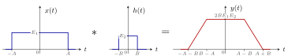{ .notes-fig loading=lazy }

<strong>图 8</strong> 一般情形（$A\gt{}B$）：梯形的四个拐点 $-A-B$、$B-A$、$A-B$、$A+B$，平顶高度 $2BE_1E_2$。
{: .fig-caption }

重点

<strong>分段为常数的信号卷积，关键点之间连直线</strong>：若 $x(t)$、$h(t)$ 都由若干段方波拼成，算出几个关键点上 $y(t)$ 的值，用直线依次连起来就是答案。原因：两个方波相对移动时，重叠面积随移动距离线性变化。

## 5 综合例题

例 1 <strong>两段台阶卷两段台阶</strong> 关键点连直线
{: .ex-head }

<strong>题目</strong>：$x(t)$ 在 $[-1,0]$ 上为 $1$、$[0,1]$ 上为 $-2$；$h(t)$ 在 $[-1,0]$ 上为 $1$、$[0,1]$ 上为 $2$。求 $y(t)=x(t)\ast h(t)$。

<strong>解</strong>：

1.  <strong>取值范围</strong>：最左端 $-1+(-1)=-2$，最右端 $1+1=2$。

2.  <strong>翻转</strong>：$h(-\tau)$ 在 $[-1,0]$ 上为 $2$、$[0,1]$ 上为 $1$（左右对调）。$t=-2$ 时 $h$ 翻转后的最右端碰到 $x$ 的最左端，$y(-2)=0$。

3.  <strong>每移一个单位算一次</strong>（各段宽度都是 $1$，关键点在整数处）：

    -   $t=-1$：$h$ 的「$1$」那段与 $x$ 的「$1$」那段重合，$y(-1)=1\times1\times1=1$。

    -   $t=0$：$h$ 的「$2$」对 $x$ 的「$1$」、$h$ 的「$1$」对 $x$ 的「$-2$」，$y(0)=2\times1\times1+(-2)\times1\times1=0$。

    -   $t=1$：只剩 $h$ 的「$2$」对 $x$ 的「$-2$」，$y(1)=(-2)\times2\times1=-4$。

    -   $t=2$：完全移出，$y(2)=0$。

4.  关键点之间连直线。

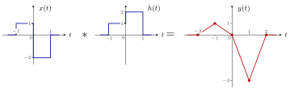{ .notes-fig loading=lazy }

<strong>图 9</strong> 结果是 $(-2,0)$、$(-1,1)$、$(0,0)$、$(1,-4)$、$(2,0)$ 五个关键点依次连成的折线。
{: .fig-caption }

例 2 <strong>方波卷两段台阶</strong> <small>教材第 78 页图 2-44 第二个</small> 关键点连直线
{: .ex-head }

<strong>题目</strong>：$x(t)$ 是 $[-1,0]$ 上高度 $1$ 的方波；$h(t)$ 在 $[-1,0]$ 上为 $1$、$[0,1]$ 上为 $2$。求 $x(t)\ast h(t)$。

<strong>解</strong>：取值范围 $[-2,1]$。$x$ 是宽度 $1$ 的单位方波，所以 $y(t)$ 等于 $h$ 在长度为 $1$ 的窗口 $[t,t+1]$ 上的积分：$y(-2)=0$，$y(-1)=\int_{-1}^0h=1$，$y(0)=\int_0^1h=2$，$y(1)=0$。关键点连直线。

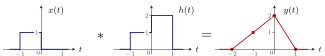{ .notes-fig loading=lazy }

<strong>图 10</strong> 结果是 $(-2,0)$、$(-1,1)$、$(0,2)$、$(1,0)$ 连成的折线。
{: .fig-caption }

例 3 <strong>周期方波卷三角波</strong> <small>教材第 78 页图 2-44 最下面一个</small> 周期为 2
{: .ex-head }

<strong>题目</strong>：$x(t)$ 是周期为 $2$ 的方波：在 $(0,1)$ 上为 $1$、$(1,2)$ 上为 $-1$，向两边无限重复。$h(t)$ 是 $[0,2]$ 上的三角波，$t=1$ 处峰值为 $1$。求 $y(t)=x(t)\ast h(t)$。

▸ <strong>先看结构。</strong> $x$ 从 $-\infty$ 延伸到 $+\infty$，所以 $y$ 也是。$x$ 以 $2$ 为周期重复，$h$ 每移 $2$ 个单位看到的情况完全一样，所以 <strong>$y(t)$ 也是周期为 $2$ 的函数</strong>，只需求出一个周期 $[0,2]$。

▸ <strong>$t=0$。</strong> 翻转后的三角形占据 $[-2,0]$，左半边落在 $x=1$ 的 $(-2,-1)$ 上，右半边落在 $x=-1$ 的 $(-1,0)$ 上；两半面积相同，正负抵消，$y(0)=0$。

▸ <strong>$0\lt{}t\lt{}1$。</strong> 三角形 $h(t-\tau)$ 占据 $[t-2,t]$，峰在 $\tau=t-1$。它被 $x$ 的跳变点 $\tau=-1$、$\tau=0$ 分成三块：

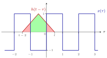{ .notes-fig loading=lazy }

<strong>图 11</strong> $0\lt{}t\lt{}1$（图中 $t=0.5$）：两块红色落在 $x=+1$ 上，乘 $+1$；绿色落在 $x=-1$ 上，乘 $-1$。横轴刻度数字标在方波下沿下方。所以 $y(t)=$ 两块红色面积 $-$ 绿色面积。
{: .fig-caption }

-   右边红色：$\tau\in[0,t]$，是腰长 $t$ 的等腰直角三角形，面积 $\frac{t^2}2$；

-   左边红色：$\tau\in[t-2,-1]$，底边长 $-1-(t-2)=1-t$，面积 $\frac{(1-t)^2}2$；

-   绿色：整个三角形面积 $\frac{2\times1}2=1$ 减去两块红色：$1-\frac{t^2}2-\frac{(1-t)^2}2$。

$$
y(t)=\frac{t^2}2+\frac{(1-t)^2}2-\Big[1-\frac{t^2}2-\frac{(1-t)^2}2\Big]=t^2+(1-t)^2-1,\qquad 0\lt{}t\lt{}1 .
$$

验算：$t=0$ 时 $0+1-1=0$，与 $y(0)=0$ 一致。

▸ <strong>$1\lt{}t\lt{}2$。</strong> 三角形占据 $[t-2,t]$，被 $\tau=0$、$\tau=1$ 分成三块：中间一块落在 $x=+1$ 的 $(0,1)$ 上，两边两块落在 $x=-1$ 上。

-   右边：$\tau\in[1,t]$，面积 $\frac{(t-1)^2}2$；

-   左边：$\tau\in[t-2,0]$，底边长 $2-t$，面积 $\frac{(2-t)^2}2$；

-   中间：$1-\frac{(t-1)^2}2-\frac{(2-t)^2}2$。

$$
y(t)=\Big[1-\frac{(t-1)^2}2-\frac{(t-2)^2}2\Big]-\frac{(t-1)^2}2-\frac{(t-2)^2}2=1-(t-1)^2-(t-2)^2,\qquad 1\lt{}t\lt{}2 .
$$

验算：$t=1$ 时第一段 $1+0-1=0$，第二段 $1-0-1=0$，不跳变。

▸ <strong>化简与图形。</strong> 第一段 $=2t^2-2t=-2t(1-t)$，在 $t=\frac12$ 处最小为 $-\frac12$；第二段 $=-2(t-1)(t-2)$，在 $t=\frac32$ 处最大为 $\frac12$。再以 $2$ 为周期重复。

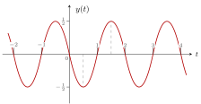{ .notes-fig loading=lazy }

<strong>图 12</strong> $y(t)$：$(0,1)$ 上是向下的抛物线拱（最低 $-\frac12$），$(1,2)$ 上是向上的抛物线拱（最高 $\frac12$），以 $2$ 为周期重复。
{: .fig-caption }

## 6 冲激的尺度变换：易错题

重点

$$
\delta(at)=\frac1{|a|}\,\delta(t),\qquad
\delta(at+b)=\frac1{|a|}\,\delta\!\left(t+\frac ba\right).
$$

冲激的性质与普通信号相反：<strong>波形拉伸 $k$ 倍时，冲激的强度变为 $k$ 倍；压缩 $k$ 倍时，强度变为 $\frac1k$</strong>。第五章还会用到这一点。

例 1 <strong>已知 x(3-2t) 的波形，求 x(t)</strong> <small>教材第 31 页 1-9</small> 冲激强度变为 4
{: .ex-head }

<strong>题目</strong>：$x(3-2t)$ 的波形是：$t=1$ 处一个 $2$ 倍的冲激 $2\delta(t-1)$，$[2,3]$ 上为 $1$，$[3,4]$ 上为 $2$。求 $x(t)$。

▸ <strong>换元。</strong> 设 $t'=3-2t$，则 $t=\frac{3-t'}2$，所以 $x(t')$ 就是已知波形在 $\frac{3-t'}2$ 处的值。把 $t'$ 改写回 $t$，要求的是已知波形 $g(t)=x(3-2t)$ 变换成

$$
x(t)=g\!\left(\frac{3-t}2\right)=g\!\left(-\frac12(t-3)\right).
$$

▸ <strong>三步变换。</strong>

1.  <strong>翻转</strong>（前面有负号）：$g(-t)$。冲激移到 $-1$；台阶变成 $[-3,-2]$ 上为 $1$、$[-4,-3]$ 上为 $2$。

2.  <strong>拉伸</strong>（系数 $\left|-\frac12\right|\lt{}1$，拉伸 $2$ 倍）：$g\!\left(-\frac t2\right)$。冲激移到 $-2$；台阶变成 $[-6,-4]$ 上为 $1$、$[-8,-6]$ 上为 $2$。

3.  <strong>右移 $3$</strong>（$t-3$）：冲激移到 $1$；台阶变成 $[-3,-1]$ 上为 $1$、$[-5,-3]$ 上为 $2$。

▸ <strong>易错点：冲激的强度。</strong> 台阶的高度在变换中不变，但冲激的强度会变。单独算冲激这一项：

$$
\begin{align*}
2\,\delta\!\left(\frac{3-t}2-1\right)
&=2\,\delta\!\left(-\frac12t+\frac12\right)
=2\,\delta\!\left(-\frac12(t-1)\right)\\
&=2\cdot\frac{1}{\left|-\frac12\right|}\,\delta(t-1)=4\,\delta(t-1).
\end{align*}
$$

所以拉伸那一步，冲激的强度从 $2$ 变成 $4$。若照搬台阶的做法保持强度 $2$，答案就错了。

重点

<strong>答案</strong>：$x(t)=4\,\delta(t-1)$，加上 $[-5,-3]$ 上为 $2$、$[-3,-1]$ 上为 $1$ 的台阶。

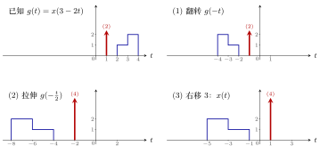{ .notes-fig loading=lazy }

<strong>图 13</strong> 由 $x(3-2t)$ 求 $x(t)$ 的三步。台阶高度不变；冲激（括号里是强度）在拉伸 $2$ 倍时强度由 $2$ 变成 $4$。
{: .fig-caption }
